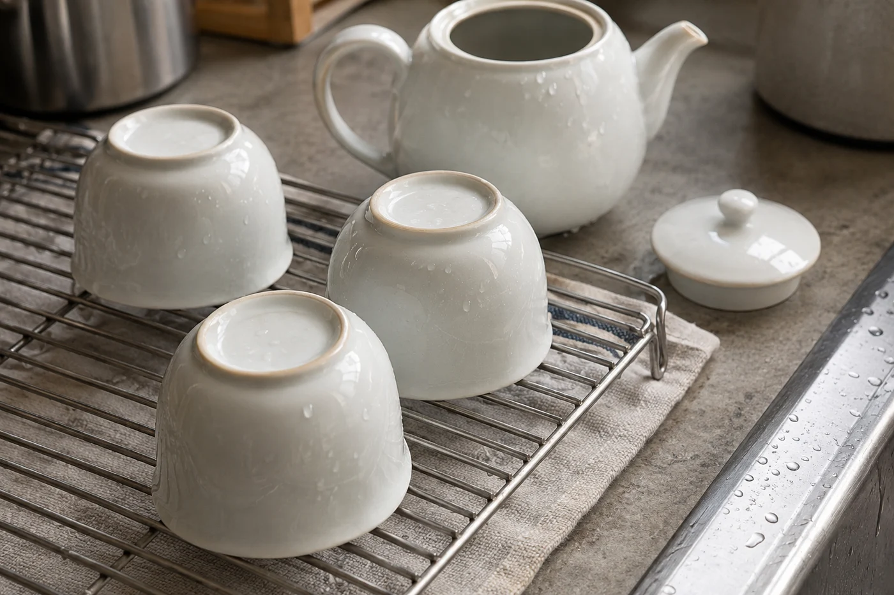

鑰匙放進門邊的小碟，鞋還沒脫好，我已經在想要不要泡茶。回到家十點多，人是累的，手卻有點習慣性地想去拿茶罐。

這種晚上，我不跟自己講究。一隻蓋碗，一小撮茶，一壺熱水，兩泡就收。疲倦的時候泡茶，樂趣正在於不用想太多。

只是燒水之前，我會先停一停。

剛進門，人還留在工作的節奏裏，袋未放好，水未燒，腦裏仍在轉日間的事。我會先去洗把臉，換過衣服，然後才決定喝不喝。很多次坐下來，才發覺想喝的只是一杯熱水。

洗過澡、換了衣服，肩膊鬆下來，再喝一杯淡茶或清水，比一進門就灌一杯濃茶舒服得多。若已經近睡覺的時間，茶留到明天也很好，它不會走。

茶盤、茶夾、公道杯，平日晚間都可以不出場。蓋碗夠穩，注水和出湯都在同一隻手裏完成，少洗兩件東西，也少兩個打翻的機會。人倦的時候，手不如白天靈活，這一點我很在意。

用壺也可以，揀出水俐落的小壺，別挑那種要慢慢等它滴完的。公道杯省掉也不可惜，直接倒進自己的杯就是。一個人喝，不必講究分得平均。

茶量和水溫也一併退一步。晚間喝茶，濃淡比香氣重要。平日放五克的茶，我晚上放三克左右；水燒開後等一會，大約八十五度到九十度才注，泡出來柔一些，也不容易過濃。浸泡的時間縮短，寧可淡，不要濃。

茶類之間也有分別。綠茶、白茶、輕發酵的烏龍，晚上泡淡一點，影響較小。熟普和重焙火的茶味道厚實，晚間喝半泡就好，喝多了胃裏會覺得實。

## 咖啡因不分新舊

常有人以為某幾類茶喝了不礙事。茶都含咖啡因，不分新茶老茶、綠茶紅茶，差別只在含量多少，以及泡出來有多少。所以睡前三四小時內，我會避免喝濃茶。

自己晚上喝了會不會睡不着，別人說不準。不確定的話，就泡淡一點、喝得早一點，或者索性改喝清水。每個人的反應不同，自己試過最清楚。

我也看當日的狀態。已經很累、隔天又要早起，那一杯茶帶來的清醒未必划算，清水就夠。若想喝的是那點味道，不為提神，那更簡單，泡一泡淡的，喝完便算。

茶喝完，當晚就把茶渣倒掉，杯子沖淨。茶渣在杯裏過一夜，隔天不但難洗，還有一股悶味。沖一沖，倒扣在架上，早上見它乾爽，心情也好些。

茶葉罐用完要立刻蓋緊。晚上人倦，最容易隨手一放，蓋子沒壓好，茶就吸了廚房的氣味。我的辦法很笨：取茶前先把蓋子放在手邊，舀完茶，手還沒離開，就順手蓋回去。
