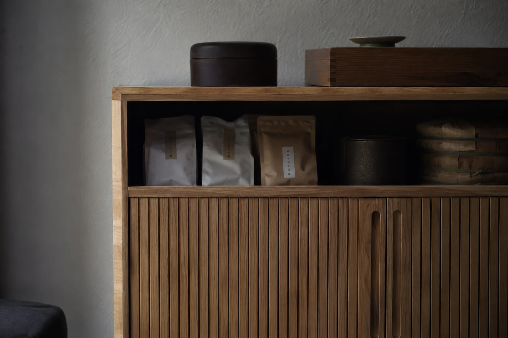

「這是幾十年的老茶。」

這句話一出，茶桌邊通常會靜下來。價錢越高，人越不好意思開口，好像再追問一句，就顯得自己不懂茶。

我的想法剛好相反。年份只告訴你這餅茶放了多久，沒有告訴你它好不好喝。一餅茶放了二三十年，可以一直放在乾爽通風的地方慢慢轉化，也可能待在潮濕、有異味的角落度過那些年。數字一樣，杯裏可以差很遠。年份老了，核實也難，就更需要旁證。

所以遇到陳年普洱，我先問來源說不說得清，再看存放的地方乾不乾淨，最後還是回到杯子裏：它今天喝起來是甚麼樣。

包裝上寫的年份，要先問它指的是甚麼。有些是壓餅那一年，有些是原料採摘那一年，也有些只是包裝紙或內飛印製的年份。三者未必一致，相差幾年很平常。

紙張泛黃，包裝看來有年代感，這些我都不單獨拿來判斷。舊紙可以仿，故事也可以編。我比較信得過的，是一些可以互相核對的資料：甚麼時候購入，經過誰的手，原本的包裝和記錄還在不在。越具體越好。

生茶與熟茶也不能放在同一把尺上量。熟茶製成時已經過渥堆發酵，生茶則在存放之中慢慢轉化，同樣放了二十年，面貌並不相同。別拿「二十年」這個數字把兩者直接比較。

## 我會問的幾句

先問來源。這餅茶由誰保存，放在哪裏，中途有沒有換過倉。認真做茶的商家，一般不介意客人多問兩句。若答得含糊，或者只說一句「老茶都是這樣」，我就再放慢一步。

情況許可，一定要先試飲。茶未開沖，先湊近聞一聞，氣味乾不乾淨，有沒有霉味、潮悶味或者混雜的怪味。再沖一兩泡，看湯色清不清亮，入口順不順，幾泡之後味道是否仍然平穩。湯色渾濁、雜味明顯，或者喝完喉嚨不舒服，這款茶就不必勉強。

價錢也是一條線索。同年份、同類型的茶，標價遠低於一般行情，要問為甚麼；遠高於一般行情，也要問憑甚麼。不必怕錯過而即時拍板，好茶不會因為你多問幾句就消失。

有人喝了老茶，覺得身體發熱，或者特別想睡，便當作茶齡夠長的證明。這些感受因人而異，也跟當天的狀態有關，記下來無妨，卻不能當證據。茶與身體的關係不宜說成保證，更不能當藥。

## 家裏的茶，也要打開來看

存茶的朋友常說，放着就好，時間自會做功夫。這句我不太同意。放得好，茶會慢慢轉化；放得不好，只會越放越差。

我自己的做法，是每隔幾個月取一小撮出來沖，順便看看包裝有沒有受潮的痕跡，湯色跟上次比有甚麼不同。記幾句就夠：日期、放在哪個位置、當時喝起來怎樣。

存放的原則並不複雜。乾爽、通風，遠離廚房和有氣味的東西，避開陽光直曬，也別跟香料、樟腦擺在一起。茶餅各自包好，免得氣味互相串。一旦發現異味、受潮或發霉，先停止飲用，再找原因。有人把這些統統叫作「陳味」，這樣帶過並不妥當，健康的陳香和變壞的氣味是兩回事。

年份也不是入門的門檻。新製的茶清爽直接，價錢較合理，天天喝更合適。老茶要喝得出好處，先得對普洱有一點認識，手頭也要有幾款茶樣可以反覆比較。

我會把老茶留給一個安靜的下午，用熟悉的器具，下足茶量，沖三四泡就收手，剩下的重新包好放回櫃裏。茶是買來喝的，慢慢喝掉一餅，比把它供在櫃裏當資產實在。
