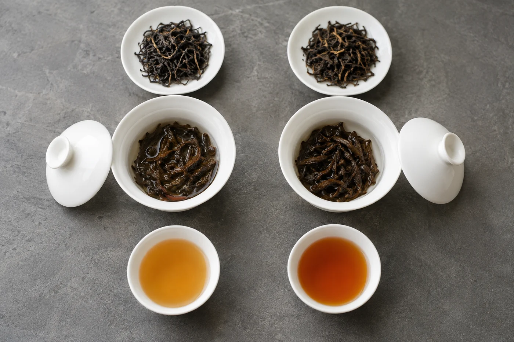

手機亮起，訊息只有一句：「老師，為甚麼我的茶不好喝？」

我盯着這句話，不知道該從哪裏答起。問的人是真心的，只是範圍太大。淡、苦、澀、有怪味，各有各的原因。我只好一路反問：甚麼茶，用甚麼泡，放了多少。來回幾次，兩邊都累，對方也開始覺得自己問錯了。

其實沒有問錯，只是少說了幾樣東西。

泡的是甚麼茶；用蓋碗、茶壺還是保溫壺；放了多少茶；大約泡了多久。再補一句水怎樣燒、燒到多熱，我就差不多看得見那張茶桌了。

很多人怕自己說得不準，索性不說。沒有秤，也沒有計時，那就坦白寫「大概一小撮」「估計一兩分鐘」。不必事後補一個看似精準的數字，老師讀得出哪些是記得的，哪些是估的。估的照實說，反而有用。

這些交代了，才輪到感受。「不好喝」三個字我幫不上忙，香氣不夠、入口太薄、喉嚨發緊、尾段有苦味，分開講就不同了。若記得是第幾泡開始變差，也一併說，頭兩泡出問題和後幾泡才出問題，處理的方向往往不一樣。

## 最常被漏掉的，是放了多少茶

這一項漏得最多，偏偏影響最大。同一款茶，放一小撮和放大半碗，可以喝成兩回事。我不知道份量，就分不出是茶本身的問題，還是份量的問題。

家裏有一把小電子秤最穩妥，泡的時候稱一次，克數寫在筆記上。沒有秤也不要緊，用「茶葉鋪滿碗底」「大約佔碗的三分一」這類說法。只要每次都用同一種描述，我看得懂，你自己隔一個月回頭看也看得懂。

器具也要說。蓋碗、小壺、保溫杯，泡出來差別很大。保溫杯把茶葉一直泡在熱水裏，湯一直濃下去，帶苦帶澀並不奇怪。一句「我用保溫杯」，已經替我省掉一半猜測。

有人會傳一張照片過來，希望我一看便知。照片確實有用，看得到器具多大、茶放了多少。可是香氣和口感要聞要喝才判斷得了，湯色又受光線和相機影響，未必可靠。

所以我回一句「要試泡一次才知道」，不是推搪，是真的看不出來。

想帶茶樣來給我試，先問一聲方不方便，也別期待一次就把所有疑問解決。最好連平日用的器具一起帶來。我用自己的器具泡得好，不等於你的器具也行，問題有時就藏在那隻碗裏。

傳訊息有它的好處，你可以慢慢整理，我有空再回。壞處是細節容易漏。這些寫成一段話一次說完，比分成幾條短訊好，我不會看漏。

當面問又是另一回事。倒水時滴漏、蓋碗拿不穩這類毛病，文字很難寫清楚，我看你做一遍，比你寫十行有用。

## 試完一樣，再告訴我

照着建議試一次，回頭告訴我結果。「少放了茶，沒那麼澀了，可是又覺得薄」，這句話我很喜歡收到，因為下一步可以接着調。「還是不行」就只能從頭再問。

如果我一口氣給了三個建議，先試最容易做的那一個，回報了，再試下一個。一次全改，好轉了不知道是哪一項的功勞，變差了更難查。

問問題不需要術語。做了甚麼，喝到甚麼，想要甚麼，照實說就夠。這份照實也要練，下次泡茶時，順手在筆記上寫下茶量和時間，就是開始。
