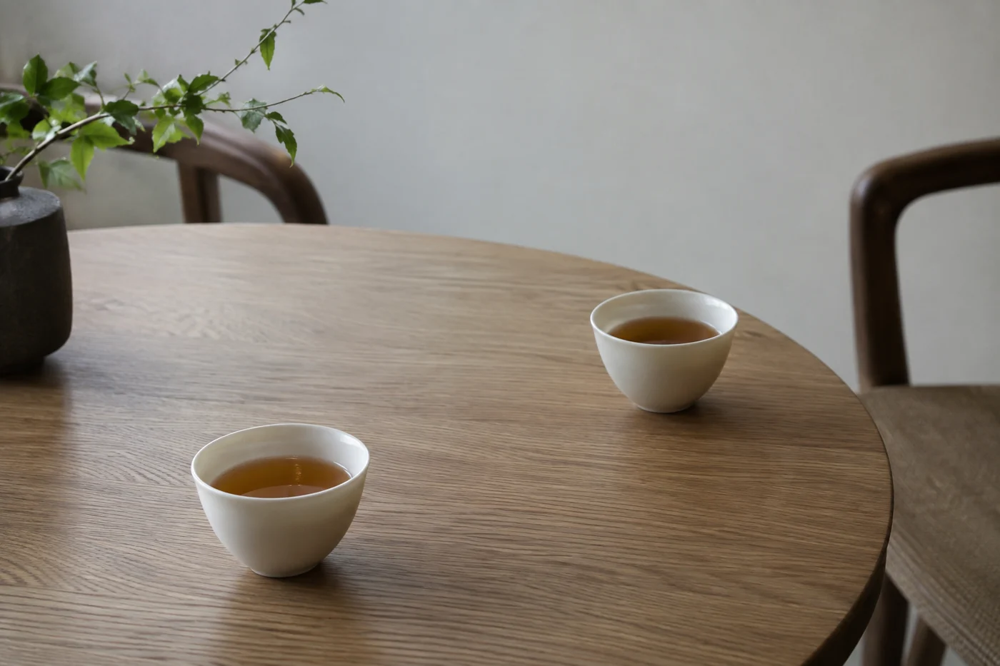

有時水壺已經放上爐，茶罐也拿到手邊，客人坐下來才說，剛在樓下喝完一杯咖啡。

這種時候，我會把茶罐先放回去。主人的興致是一回事，客人當天的身體和口味是另一回事。他不必勉強自己配合我的好意，我也不必把珍藏的茶拆開，換來一個其實不太領情的表情。

所以請人喝茶，我開口的第一句很少是「這茶很好」。多數是問：「今天想喝濃一點，還是淡一點？」話問出口，茶才拆。也有人這天腸胃不舒服，只想喝口溫水。茶席的第一步，未必要從拆茶開始。

我問的通常只有三樣：平日喝甚麼茶，有沒有不想喝的，今天口味偏重還是偏輕。問得簡單，客人才答得自然。問題一多，來訪就變成填問卷，客人反過來要照顧主人的情緒。

有些話客人不會主動講。白天喝濃茶無事，晚上卻睡不着；空腹喝茶會手軟；醫生囑咐過少喝咖啡因。這些都用不着追問原因，我只換一個問法：「想喝茶、花草茶，還是清水？」他指哪一樣，我就備哪一樣。

最常聽到的回答是「隨便」。這兩個字多數是客氣，並不代表他沒有偏好。我會替他把範圍收窄，拿兩款差別明顯的出來，一款清淡，一款厚實，各倒一小杯讓他挑。選項一多，初來的人反而開不了口。

兩款茶的湯色最好也拉開，一淺一深，看一眼就知道自己傾向哪一邊。手上只有一款也不要緊，問一句「泡淡一點好不好」就是。水溫和浸泡時間都能調，不必為此另開一罐。

清水和空杯，我會先放到客人手邊，不必等他開口要。有人喝兩三杯就想停，有人當天不想碰含咖啡因的東西，這些原因都不必在席上交代。水在眼前，他想換便換。

杯要乾淨，水溫常溫或微溫都可以，夏天稍涼一點，冬天稍暖一點。一杯溫度合適的水，比冰水更容易在兩泡茶之間把口裏清乾淨。

客人明說不喝茶，那就不喝。花草茶、麥茶、溫水，都算待客，主人不必覺得失了面子。家裏有甚麼，就問一句；甚麼都沒有，就把溫水放好，說一聲「想喝再告訴我」。人坐下來，手裏有一隻杯，聚會已經開始了。

## 續杯看杯子，不看茶壺

杯快見底的時候，我會看對方一眼，再輕聲問要不要添。客人可能說到興頭上忘了喝，也可能早已夠了，只是不好意思推。杯一空就倒滿，看起來周到，其實是替人作了決定。

人多的時候沒法逐個問，我就在分茶之前說一句「要再來一點嗎」。有人把手蓋在杯口，或者把杯子往外推一點，那就是夠了，不必再勸。

現在有客來，我的次序是先倒好水，再問他想喝哪一款，然後才去燒水。只是把次序換一換，整場茶都鬆了一點。
