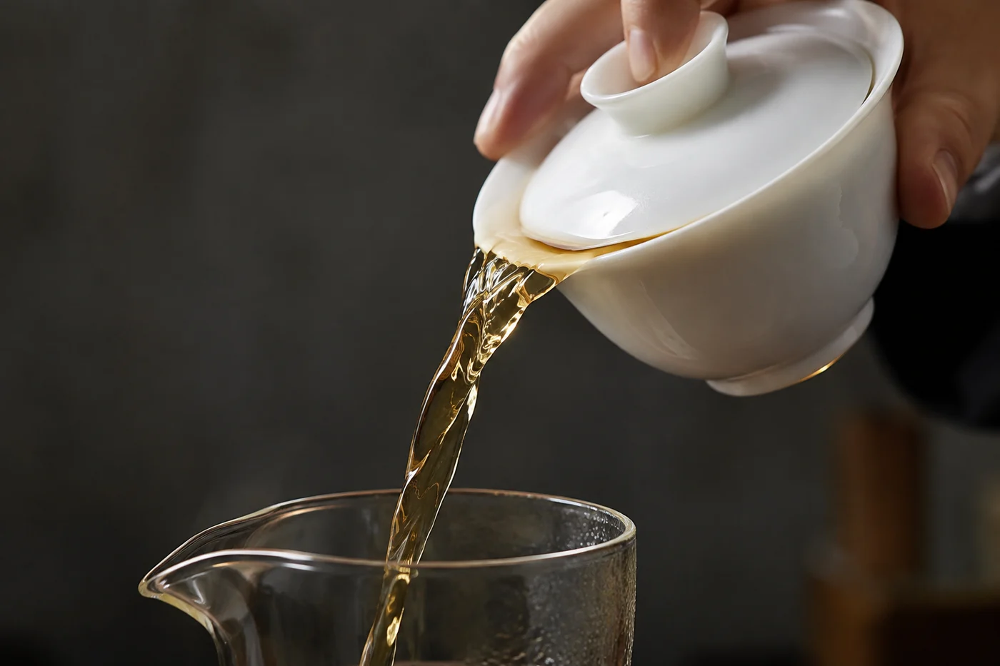

「這杯好苦。」

學生把杯放下，舌頭在嘴裏動了兩下，像要把那點味道推到一邊。我問他：苦，還是澀？

他張開嘴，又合上，搖頭。

這四個字其實沒有說出任何東西。在嘴裏，這兩件事分得很清楚，只是我們平日懶得去分。苦是味道，在舌根一帶留得久，舌頭兩側也會沾到；澀不是味道，是觸感，舌面、牙齦、上顎一起發緊，口水像忽然被抽走，像咬了一口未熟的柿子。

## 一個先來，一個後到

一般認為，澀是茶多酚和口水裏的蛋白質結合，口腔表面那層滑潤被收走，於是發乾、發皺。苦多來自咖啡鹼，還有一些帶苦味的物質，停在舌根和喉頭，散得慢。

兩者的溶出速度不同，這件事在杯子裏看得見。咖啡鹼來得快，頭幾秒就出來；茶多酚慢，浸得越久越多。所以一杯久浸的茶，先是苦，跟着澀，最後只剩一口乾。同一泡茶，頭段和中段的性格可以不一樣。

分得開，才知道該動哪一項。一入口就苦，多數與茶量、水溫有關；喝完才覺得口腔收緊，多數是時間拖長了。

## 他的四十秒

我請那位學生再做一次。同一款茶，同一隻蓋碗，同樣的水，只把時間由四十秒減到二十五秒。

他喝完，說：苦還在，但後面那層不見了。

這就是要他學的東西。不是把茶泡淡了就算數，是知道剛才動的是哪一項，下次可以自己調。同時改三樣，變好了也不知道是誰的功勞；變差了，更無從退回去。

水溫是另一隻手。水越熱，苦澀出得越快越多，嫩葉尤其受不住。細嫩的綠茶、黃茶用滾水直沖，很容易苦成一片，降一點溫，通常柔和得多；發酵足、存放久的茶，反而要夠熱才出味。

這像灼菜。水夠滾，菜落鍋幾秒就軟，顏色還在；水不夠滾，菜要在鍋裏拖着，最後又黃又韌。同一把菜，差的分別不在菜，在水。

## 有些茶先天如此

細嫩的綠茶和白茶，葉片薄，滋味釋出得快，水太熱或泡久了，苦澀立刻跑出來。切得細碎的茶同理，表面積大，一沖就出，同樣時間比整片葉重得多。

新製的生普洱帶明顯收斂，這是它的特點，也是許多人要慢慢適應的地方。想溫和一點，減茶量、縮短前幾泡，或者挑存放過一段日子的。每款茶的反應不同，親手試過才算數。

用料粗老、製作有瑕疵的茶，也會有不討好的苦澀。小改幾次仍然不舒服，就換一款。未必是你手勢不好，只是這款茶不合你口味。

把忍受苦澀當修行，我不贊成。有人喜歡那一點苦，覺得耐喝；有人偏愛柔和順口。身體的反應更不能硬撐，空腹喝濃茶頭暈手軟，很多人都試過，換淡一點，或者先吃點東西。

下一次遇到一杯苦澀，別急着換茶。把浸泡時間減一半，再喝一口。若苦退了、澀還在，你已經知道下一步該動哪一項。
