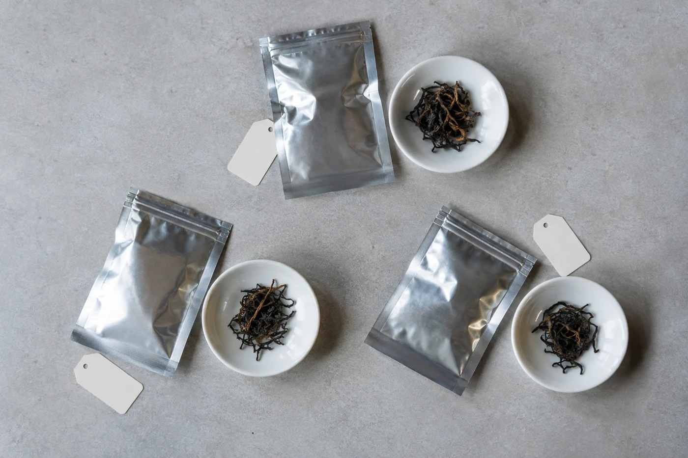

我也會被包裝騙。

兩包茶並排放着，一包貴，一包平，袋還未開，心裏已經有了次序。這份期待來得很早，早過茶湯入口。後來我養成一個小習慣，遇到這種時候就把標籤翻過去，喝完再看。

在家盲飲，做法簡單得很。挑兩三款茶，請人替杯子編號，或把名稱遮住，用同樣的器具、水量、茶量和時間沖泡。先憑感受排出自己喜歡的次序，最後才揭曉。目的不在猜中，是對自己的口味誠實一次。

一開始就排一張長桌，未必是好主意。款數一多，喝到第五杯，舌頭已經記不住第一杯。三款是我的上限，超過就分兩晚做。

器具、水量、茶量、浸泡方式，盡量一致。這樣比較才有個清楚的基礎。我要補一句：不同的茶各有合適的沖法，劃一的做法只是一個公平的起點，不代表這樣沖就最好。綠茶用沸水、悶一分鐘，本來就會苦，這樣把它排到最後，只證明了我懂得把茶泡壞。

有同行的人幫忙倒茶、編號最理想。一個人做，最難的地方是自己知道答案。我試過把茶樣裝進同樣的小袋，寫上 A、B、C，放進抽屜幾天，等自己忘了哪個是哪個再沖；也試過請家人隨機排好，只告訴我杯子的編號。

沖好之後，每款用相同的杯子，按編號順序倒好。然後我會離開桌子一會，再回來喝。杯子放左放右，也可能影響感受，有餘力的話，第二次把位置調換再試一遍。

幾個人一起玩，就找一位不參加品飲的朋友做「出題人」，負責編號和倒茶，其他人不看標籤。大家各自寫下次序，先別討論，也別看對方的表情。寫好了，才互相對照。表情這件事很難控制，有人一喝就皺眉，旁邊的人看見，接下來那杯已經有了答案。

次序各不相同，是很正常的事。這正好說明口味沒有標準答案，爭誰排得對，沒有意思。

每杯各喝一口，再回頭比較。紙上寫兩樣：喜歡的次序，以及原因。香氣較清楚、入口較舒服，或者某一杯的後段更有意思，這些都算原因。寫原因比寫分數有用，分數給完就沒有了，原因可以拿去下次買茶。

兩杯之間喝一口清水，或者吃一小片蘇打餅。前一泡的甘味留在口裏，會把下一杯壓得平淡。

朋友喝完第二杯，指着 B 杯問：「這是不是貴的那包？」

「你先寫次序，價錢留到最後。」

山頭、年份、價錢，這一步留白。一猜起來，很快又變成另一場背資料的比賽，注意力就從杯子被拉走了。

茶涼了，再喝一次。有些茶熱的時候好，涼了就顯得單薄；有些剛好相反。熱和涼的印象各寫一句，比只寫一個結果有用得多。涼了以後苦澀會更明顯，這是溫度低時舌頭對苦的感覺不同，不等於茶變差了。

## 它說得出的，和說不出的

盲飲只能告訴你這一刻、這一種沖法下的感受。茶樣有沒有代表性、當日身體狀態、沖泡時的小誤差，都會左右結果。

兩款茶若屬完全不同的類型，例如一款輕發酵、一款重焙火，硬要排名也不太公平，它們本來就適合不同的場合。放了很久、保存不佳的樣品，也難以和新茶比。這些都要在結論裏留點餘地。

揭曉的時候，結果可能合乎預期，也可能完全相反。急着替自己辯護，就錯過了它想說的事。一次盲飲受茶樣、沖泡和當日狀態影響，不能替一個品牌下定論。它只是提醒我們，價錢和名字確實會影響感受，入口的滋味，我會多聽一點。

我自己的改變很小。之後買茶，會更願意先要一份茶樣，回家翻過標籤喝一次。
