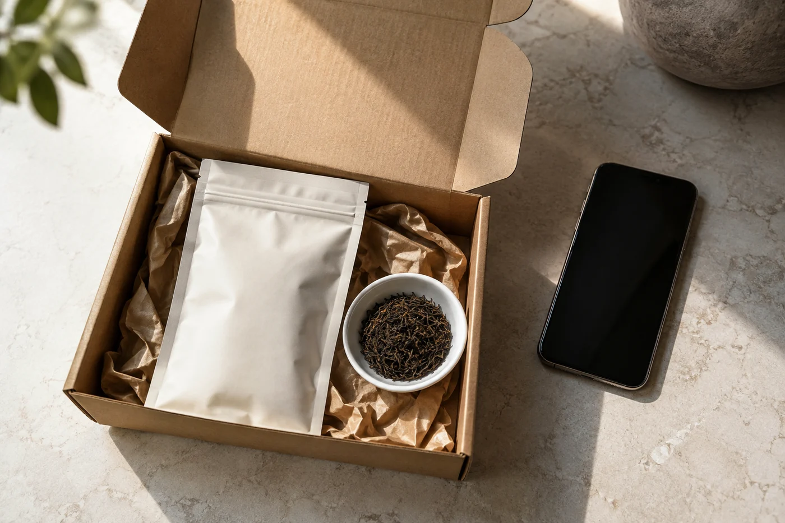

「多買幾包，計落平啲。」

這句話在茶店裏聽得最多。說的人沒有錯，單價確實便宜了。可是我心裏總會多問一句：這一包，要喝多久才見底？

一包茶放了半年還喝不完，單價再低，也談不上划算。買茶的分量，應該跟着自己喝茶的速度走，折扣只是旁邊的聲音。

站在一排排包裝前面，人很容易覺得還有許多滋味未認識，想多帶幾款回家。這份好奇我明白，也不想勸人收起來。只是家裏的櫃子有限，每天能喝的分量也有限。

我會請學生數一數：一星期泡幾次，每次放多少茶。一個人用小蓋碗，每次大約三至五克；一星期泡三四次，一百克就夠喝兩三個月。兩個人常常一起喝，速度自然快得多。

這筆數不必算得精確。知道是一兩個月，還是大半年，已經夠用。

開封之後，茶最好在幾個月內喝完。期限按茶類有別，綠茶和清香型的短一些，耐放的長一些。估算過，才知道眼前這包該不該買大。

## 新相識的茶，先要一小份

第一次買的茶，買小包就好，或者向店家要一份茶樣。回家用不同水溫、不同茶量試兩三次，才看得出自己是否真的喜歡。

在店裏覺得驚艷的茶，過幾天在家再泡，印象往往已經不同。店裏的環境、當日的心情、同行的人是誰，都會影響第一口的判斷。茶樣花費不多，卻替人擋下不少買錯的大包。

喝熟了的、家裏常泡的，我才買大包。我的看法很簡單：過去幾個月，這款茶有沒有回回見底。有的話，大包省下的包裝與運費才算數。

耐存放的茶類，例如陳放中的普洱，分量大一點問題較小。前提是你有乾爽的位置，也願意定期照顧。這兩個條件缺了一樣，我寧願買少。

## 折扣面前，先想放哪裏

遇到折扣，先問自己一句：買回來放哪裏。茶要乾淨的空間、合適的包裝，還要有人持續看顧。最後只能擠在潮濕的角落，省下的錢也換不回茶原來的味道。

也有人買茶，是為了「以後可能會喝」。這個「以後」要打個折扣。夏天想喝清爽的，冬天想喝厚實的，口味跟着季節走，買的時候不可能全部預計到。與其一次買足一年，不如分幾次買，每次按當下的口味和存量調整。

小包裝開封後較快喝完，狀態也較一致。大包每開合一次，就多一次接觸空氣，受潮的風險跟着增加。已經買了大包，可以趁剛開封時按幾次的用量分成小袋，各自封好，用到哪袋才開哪袋。

朋友送的、旅行帶回來的茶，也要算進「手上有多少」裏，這些最容易被忘記。收到之後先泡一次，決定它是日常喝的，還是留給特別場合，再決定放哪個位置。家裏未開的同類茶已經太多，就先別再買，讓送來的先喝完。

我自己有個習慣：每添一款新茶，就從手上已有的挑一款，認真再喝一次。同一款茶，在不同日子、不同水溫下表現不一樣，重複喝才看得見。

茶櫃裏每一款都叫得出名字，比擺滿一櫃實在。
