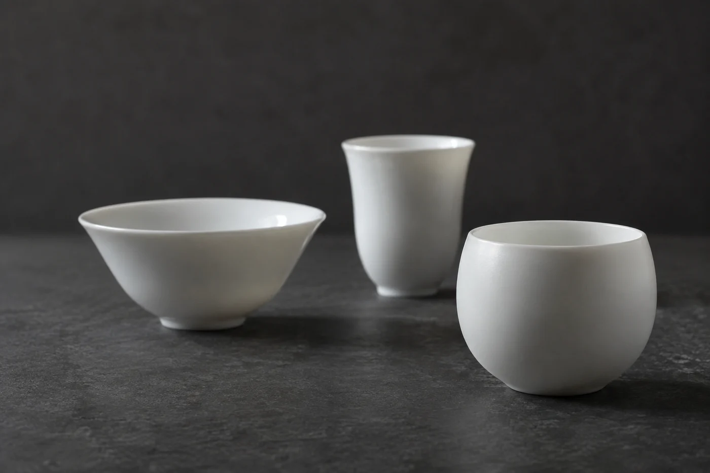

桌上攤開幾張課程單張，入門、進階、專業、精讀，名字一個比一個好聽。

有人拿着這幾張紙問我，該報哪一個。我通常先請他把名字遮住。同一個名字，在不同機構裏可以差很遠，有的是三小時的體驗，有的是幾個月的系統訓練。名字叫甚麼，反而最不要緊。

遮住名字之後，我會請他在紙邊寫一句話：上完課，想學會甚麼。

想在家泡得更好喝，要的是多練習，身邊有人糾正。想認識各種茶類，課上要有足夠的茶樣可以對比品嚐。想以此為業，內容還得涵蓋待客、器具管理和衛生知識。

這句話寫得出來，往往已經篩走一半選擇。剩下的，才按它去核對內容、實作時間、導師背景和證書性質。

## 單張上要找兩個數字

內容、堂數、每堂多長、怎樣授課、實作怎樣安排，這些課程資料應該寫得清清楚楚，屬於基本。我會特別找兩個數字：一班有多少人，每位學員實際動手的時間有多長。

人太多的班，示範很容易變成觀看。輪到自己親手做，可能只有幾分鐘，學得不扎實。

目的不同，看的地方也不同。最想改善沖泡的人，要看每位學員能不能親手練、老師怎樣回應你的手勢；想理解茶類和製法的人，要看理論和茶樣怎樣配合，講完一種製法，有沒有茶放在面前可以對照。

## 老師、證書和退路

導師的背景，可以從公開的履歷和教學資料了解：教過甚麼，教了多久，說明清不清楚，有沒有誇大。若一個課程把茶說得無所不能，或者承諾上完就能開店，我會多問幾句。

證書的名稱也要看真。課程結業證明、機構自行頒發的證書、行業認可的職業資格，是三回事。牽涉考試或認可範圍的，直接向主辦方查詢最穩妥，問清楚這張證書在甚麼場合被承認，不要憑印象假設。

報名前還有一串可以問。有沒有試堂或公開的導賞活動，讓你親身感受老師的講法和課室的氣氛；學費包含哪些器具、茶樣和教材，有沒有額外開支；缺了堂能不能補；報了名想退出，退款條款怎樣。這些問清楚，日後就不必不安。

## 兩堂課之間的日子

上課的地點和時間，要配合你平日的節奏。課程再好，每次都在趕路和遲到之間進出，學到的東西也會零零碎碎。

另外我會問一句：課後有沒有練習指引，平日能不能向老師請教。我教了這些年，進步多數發生在兩堂課之間，學生自己在家泡的那幾壺裏。

還要分清課的方向。以茶藝表演或比賽為主的課，練的是儀態和流程；以日常泡茶為主的課，練的是味道穩不穩定。兩種都有用處，報名前先弄清楚自己要哪一種。

合適的課，是讓你知道從哪裏開始，又有機會親手做明白。上完之後，在自己家的茶桌上用得着，就是一個好課。

報名前，把要問的幾條寫在手機裏，逐項向主辦方問清楚。
