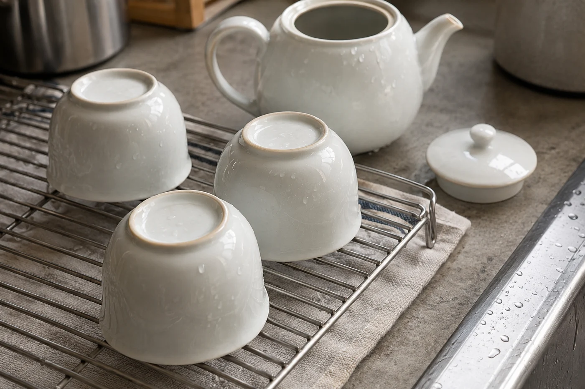

我看時間，不看鐘，看水壺。

燒到第二壺水，茶聚大概走到一半。到第三壺，我心裏便知道要開始收了。這個習慣是坐得多才有的：談得投契的時候，水總是一壺接一壺地燒，主人越添越起勁，客人卻可能早已在等一個告辭的空隙。

杯子空了，未必是茶不夠。有人要趕車，有人明早要早起，那隻空杯，可能正是想走的訊號。

一個下午的茶聚，兩三小時已經不短。茶泡到後段，味道也淡了，本來就是一個自然的轉折。

所以邀請的時候，我會順口說一句「下午坐兩個鐘頭左右」。大家心裏有數，也方便安排後面的事。有人之後還有約，聽到這句反而坐得更放鬆，因為他知道到點自然會收，離席時不需要編一個理由。

席間留意客人的小動作。看一眼時間，把外套拿近一點，說話漸漸少了，這些都在說他想動身。這時候輕聲問一句：「再來一泡，還是今天先到這裏？」要讓對方真的可以選。主人只顧添茶，熱情很容易過了頭。

茶席越長，杯數越多，後半段的茶越容易喝得淡而無味。早一點收，那個下午留下的印象反而好。

最後一泡照平常沖就好，不要臨時再開一款更珍貴的。把這款茶餘下的滋味好好喝完，各人說一個自己最清楚的感受，已經是很好的結尾。拿「好茶難得」來留人，客人只會更難開口。

耐泡的茶，到後面幾泡湯色轉淡，可以把水溫拉高一點，出湯放快一點。容易苦澀的茶，到了尾段就乾脆淡淡地喝。為了把茶葉榨乾而久泡，一杯苦澀會連前面的好印象一併帶走。

想試的新茶，留給下一次。

## 先把茶點撤下

這一步我很少開口說明。茶食吃完了，茶還在，桌上的氣氛會自己慢慢靜下來，客人感覺得到聚會將近，主人可以不出聲。

收拾的時候，熱水和茶具由熟手處理。客人想幫忙，我會請他做不燙手的事，例如把茶點碟端到旁邊。茶具洗淨後要晾到全乾才收，蓋碗和壺蓋分開放，茶葉封好，茶渣倒掉。濕的茶具直接收進櫃，容易生出異味。

有時客人還坐着，話也還沒說完。這也趕不得。我會把茶換成清水或淡茶，說一句「我去燒水，你坐一會」，談話就收成一種輕鬆的節奏。若自己真的有事，就坦白說「我下午要出門」，比拐彎抹角更尊重對方。

客人帶了茶來，不一定要當場開。說一句「我留着慢慢喝」就好；當場開，是因為大家都想試。要是有客人另外帶了朋友來，收尾時多問候那位朋友一句，讓他也覺得被接待過，下次再來就自然。

送到門口，說一句下次再聚便好，急着替這個下午下評語，反而掃興。客人帶了禮物或茶，當場道謝，改天喝過了，再告訴他喝後的感受。
