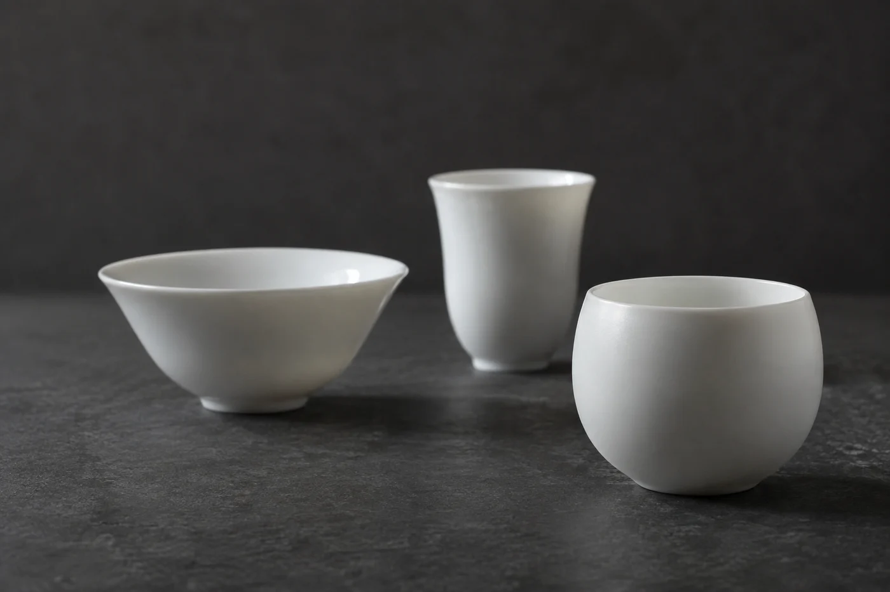

茶斟到杯口，杯沿那一圈便沒有一處可以下手。

客人只好用指尖捏着，或者乾脆捧在掌心，一邊說話，一邊顧着別灑出來。斟的人覺得滿杯才夠誠意，喝的人卻要分神去應付這一杯。

我通常斟七分。留下那一點空，手有位置拿，茶香也有地方聚。滿杯的茶，香氣一到杯口就散開；留一點空，香會在杯壁和湯面之間停一停，客人低頭便聞得到。

七分是很多人都用的做法，我只當它是起點。最後斟多少，還要看手上是怎樣的一隻杯。

薄胎的小杯散熱快，斟到八分也不至於燙手。厚壁的杯保溫，七分已經很夠。杯口收窄的，可以斟滿一點，香氣較聚；杯口開闊的，留多一點空間才好端起。

所以我不要求每杯都斟到同一條看不見的線。客人想慢慢喝，就少斟一點，喝完再添。同桌有人喝得快，有人顧着說話，杯裏的分量本來就不會一樣，硬要齊整，反而變成客人配合主人。

## 先入公道杯，再分到杯

茶湯出了蓋碗，我先倒進公道杯，再逐杯分。直接由蓋碗輪着斟，先斟的淡、後斟的濃，是很常見的事。經過公道杯，每杯濃淡一致，先分到的和後分到的，喝的是同一泡茶。

剛出湯的茶在公道杯裏放一放，溫度降下來，斟到七分，客人也不必急着喝。分到最後，杯底常有細碎的茶末，這一點我留給自己，不倒給客人。

幾個人圍坐，公道杯順着轉一圈，誰先誰後很分明，不必推讓。斟的時候壺嘴向着自己，手勢穩定，茶湯就不會濺到別人面前。

頭一泡溫度最高。我會輕聲提一句「燙，慢慢來」。一句就夠，講多了像在宣讀安全守則，客人反而緊張。

不小心滴了茶，先說一聲，再用茶巾把四周擦乾。不要慌忙把杯子連人一起移開，越急越容易碰翻。萬一濺到衣服或燙到手，先處理人，桌面等一下再抹。主人從容，客人才鬆得下來。

叩手禮也是同一個道理。在廣東一帶，接茶時用手指輕叩桌面道謝很常見，也有人從沒見過。對方沒有叩，只是點個頭、說聲多謝，心意一樣到了。當着眾人去考他懂不懂，一杯茶忽然就拘束起來。

下一輪斟茶，留意一下客人拿杯的手。斟七分的時候，那隻手通常會放鬆一些。
