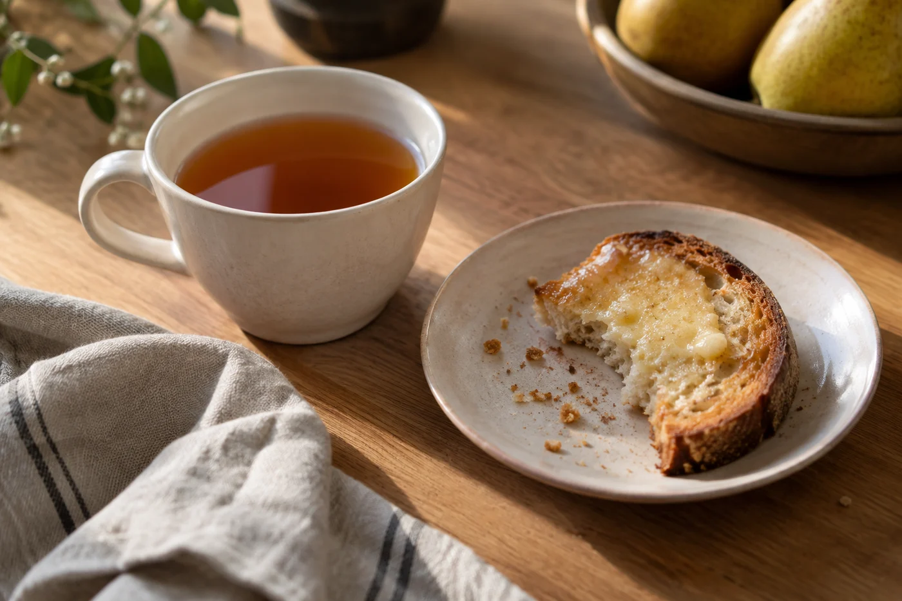
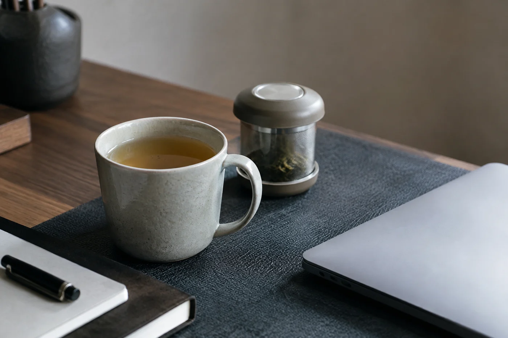

我以前也習慣把好的普洱留着，等一個像樣的日子才開。日常隨手拿一款將就。後來發覺，留着的那餅一年也開不到兩次，天天喝的那款，反而從來沒有認真揀過。

所以現在有人一講普洱就從拍賣價說起，我會先問：你是打算天天喝，還是收在櫃裏？

天天喝的茶，我只要求順口、價錢自己負擔得起、能在幾個月內喝完。這幾樣齊了，比一餅名山古樹有用。名氣留給特別的日子，日常靠的是穩定。

## 揀之前，先讀包裝上的字

生茶與熟茶是兩種性格。熟茶經過渥堆，湯色深，入口厚，天冷時喝着舒服。生茶清爽，回甘來得快，但腸胃敏感的人不宜空腹喝得太濃。

買的時候，我一定問清是散茶還是緊壓茶、生還是熟、大約何時製成。日常茶用不着追問山頭和樹齡，這幾樣基本資料卻要有，日後翻看才有依據。

分量也要先算。一餅三百多克，每天泡也要喝上一段日子。買之前想好家裏放在哪裏，比在店裏多試一泡更實際。

## 一餅茶，大約喝兩個月

我的算法很粗。每天五至七克，一個月大約用去一百五十至二百克，三百多克的茶餅，喝兩個月上下。散茶、小沱、小餅分量更少，買之前一樣算一算。

家裏只放得下一點的，就買小沱，或一百克左右的小餅，喝完再買。看不見底的茶櫃，往往就是喝不完的開始。

## 拆開之後

近期會喝的分量，我另外分出來，貼上名稱和日期。其餘的用原包裝紮好，避光、避濕、避氣味。茶餅散着撬，撬開的地方用紙包回去就好。

泡也不必講究。約一百二十毫升的壺，放五至七克，用沸水，頭一兩泡快出，之後每泡加幾秒。喝着濃，下次少放一克；喝着薄，就多等一會。日常茶最怕器具擺得太隆重，一覺麻煩，人就不泡了。

同一款喝久了，舌頭會鈍。我會換一款喝幾天再回來，這時才說得出自己為甚麼偏愛原來那款：也許是香氣不搶，也許是後面幾泡仍然舒服，也許單單是跟家裏那把壺合襯。這些理由，不比名氣差。

換也不要一次換太多。同時開三四款，每款都喝得零零星星，到頭來沒有一款是熟的。

有人會覺得，日常茶就是次一等的茶。我不這樣看。一款茶能天天泡、泡得順手、喝到最後幾泡仍不覺得勉強，它已經替你做了很多事。拍賣場上那一套，搬不到每天的杯裏。

我櫃裏現在是這樣放的：一款天天喝，一款週末才開，其餘好好包着。水滾了，手上是熟悉的茶，就可以坐下。
