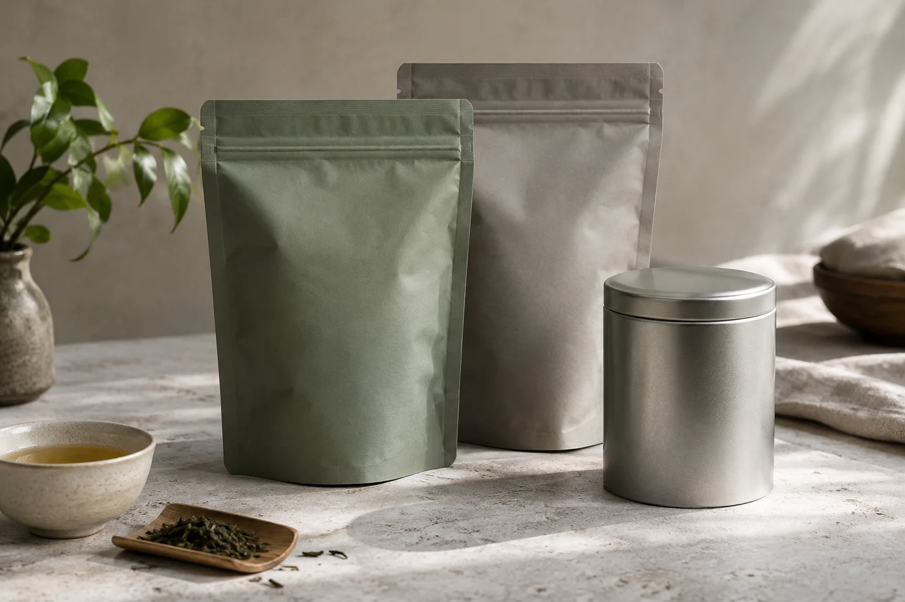
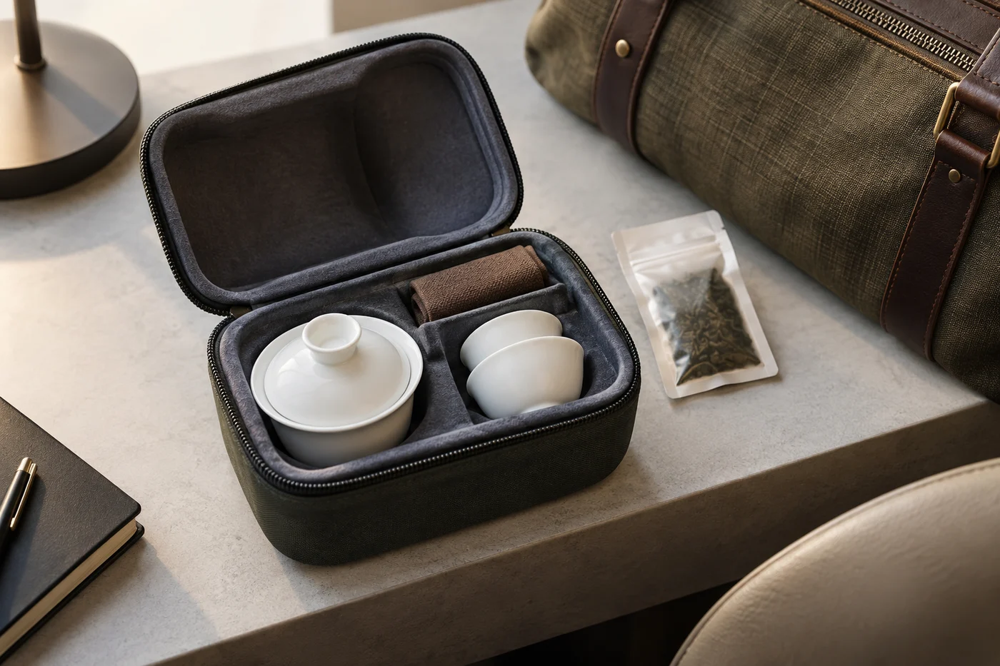

文件邊上有一圈淡褐色的水印，乾了，抹不走。

這種痕跡我見過不少。杯子放在滑鼠旁，一轉身就碰；放在文件上，一個手肘就翻。桌上喝茶，最常出事的往往不是茶，是位置。

所以我會先替杯子找一個不必時刻提防的角落。離鍵盤大約一隻手掌的距離，背後沒有垂下來的電線。位置定了，喝茶才不會變成每天的一點風險。

最省事的，是有蓋的馬克杯，加一個可取出的濾網或茶隔。杯蓋保溫，萬一碰倒，灑出來的也少些。濾網拿得出來，茶葉就不會整個上午泡在水裏。

水和電器要分開放。熱水壺擺在不會被人撞到的一側，插座不要和文件擠在同一處。辦公桌上東西本來就多，茶具留必要那幾件就夠。

茶葉揀自己熟悉、不容易泡壞的。烏龍、紅茶、熟普比較寬容，泡久一點也不至於難喝。綠茶、白茶要低一點的水溫，飲水機的熱水往往剛好合用，只是別泡過頭。

## 抽屜裏放一星期的份

我會一次帶一星期夠用的量，用小密封袋或小罐裝好，放在抽屜裏。同一個抽屜，最好不要有咖啡豆、糖果和香精。茶很會吸味，抽屜一拉開滿是咖啡香，茶也就跟着變了。

分裝還有一樣好處。用完一袋再開一袋，省去每天秤，也不會一下子倒多了浪費。

辦公室的水，多半是飲水機、過濾水或瓶裝水。飲水機的熱水不一定到滾，泡綠茶、白茶反而剛好；泡烏龍、熟普覺得淡，就多放一點茶，或者多等一分鐘。水質偏硬的，茶湯容易顯得鈍，香氣也收着；換過濾水沖，同一款茶會清楚一些。這些事研究不來，喝慣了自己那一部機，自然知道怎樣調。

## 一天兩三次

上午一次，午後一次。太晚才喝，就要想想自己的睡眠。茶含咖啡因，影響人人不同，睡不好一晚，比少喝一杯茶麻煩得多。提神這件事，交給睡得夠的第二天更可靠。

杯空了，就讓它空着。讓它空一會，起身去取水，看看遠處，或者先把手上的事做完。這樣，茶就是工作裏一個自然的停頓，不會變成另一件「還未做完」的事。

續水時，順手看一眼濾網裏的葉。泡到淡得沒味道，就換一份。一天兩三次，一份茶已經盡了本分。
