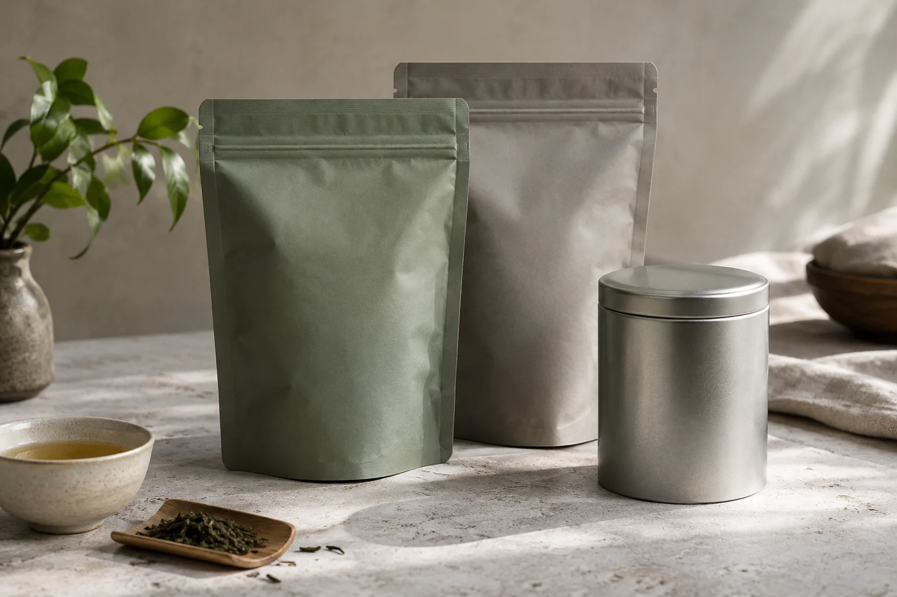

茶筅停下來，盞面一層白沫，看上去已經很細。過不了一會，貼着盞壁的地方先浮出一線水，沫就跟着往中間縮。

課堂上試點茶，這一幕最常見。多數人第一反應是自己手不夠快，再拿起茶筅猛打一輪。其實那一線水說的是前面的事：膏沒調好，或者水下得太急。

點茶是宋代的飲法。它跟今天把茶葉留在壺裏、只喝茶湯的習慣不同，茶末連湯一起喝下去，湯是有厚度的，和平日清亮的一杯完全兩回事。成不成，不看茶葉泡得好不好，看那一盞沫。

古法要先炙茶，再碾碎、羅細，取得茶末。茶末放進預熱過的盞，注入少量沸水，調成沒有顆粒的膏，稠度像稀糊。這一步急不得，粉塊沒化開，後面怎樣打都會有粉粒浮在面上。

膏調好，才分幾次加水。每加一次，就擊拂一輪，靠手腕帶動茶筅，把空氣打進湯裏，沫便一層一層建立起來，表面浮起細密的白。

水溫、水量、力度、節奏，有一樣失衡，沫就粗、就散，或者很快退去。所以我看人點茶，不太盯最後的紋樣，反而看他怎樣下水、手腕怎樣動、沫在甚麼時候開始變細。圖案是結果。我留意的，是他下水的幾十秒。

## 那隻黑盞，是為白沫而設

宋人愛看白色的沫，深色的盞把它襯得分明。建盞一類的黑釉茶盞，常和點茶一起被提起，原因就在這層對比。

盞形也有它的道理。口沿要容得下茶筅轉動，碗壁要夠高，沫才不會一擊拂就濺出來。

開頭那一線水，宋人也看。沫打得好，會緊緊貼住盞壁，久久不散，叫「咬盞」；打得不好，沫與水分開，先現出一道水痕，很快退回去。一盞茶的高下，就看這條水痕出現得早還是遲。

在博物館看見類似的盞，我會想，它是為哪一步工序而做的。器物的形狀，很多時候已經寫着答案。

## 器具可以少，水流不能亂

傳統配置不算多：茶末，燒水的湯瓶，盛茶的盞，擊拂的茶筅，再加一把量茶末的小匙。湯瓶的嘴又細又長，為的是控制水流，讓水穩穩落在茶膏上，不一下子把它沖散。

在家試，器具可以簡化，水流卻省不了。普通水壺嘴粗，一傾就急，初學的人最容易在這裏把膏沖散。我會先叫人練倒水，練到水注得細而穩，才談其他。

失敗通常出在這幾處。膏調不勻，粉粒浮面；一次倒水太多，沫還沒建立就被沖淡；手腕太僵，全靠手臂出力，茶筅在盞底刮來刮去，空氣帶不進去。改法都是慢一點：調膏多花點耐性，水分幾次少量加，擊拂時手腕放鬆，讓茶筅在湯面附近輕而快地來回。

也有手法沒錯，沫仍然打不起來的時候。茶末太粗、受了潮或放得太久，再好的手也沒辦法，這時要換的是茶末。

## 茶末比茶葉嬌氣

磨成末，表面積大了，比原葉更容易受潮走味。買回來或自己磨好，裝進密封小罐，放在陰涼避光處，遠離爐火和窗邊。取用要快，取完立刻蓋好，不要讓它開着口擱在茶桌上。

一次不必磨太多，磨好一兩星期內用完比較理想。打開聞到油味、霉味，或者一股紙板似的氣味，就不要再用。

茶百戲、分茶，是在沫上作畫的技藝，聽起來像遊戲。可是沫不夠厚、不夠穩，畫不上兩筆就散。初學的人常拿能不能畫出花樣衡量自己，次序剛好倒轉了。茶末調得勻，沫打得細，水量穩得住，才輪到變化。

練習時我會記下用了多少茶末、多少水，下次只改一樣。比憑感覺亂試，快得多。

茶末是整片葉子喝下去，對咖啡因敏感的人，杯量宜小，自己拿捏。

日本茶道的點茶，和宋人記載的擊拂、注湯是同一條路，只是後來更重儀節。想認識這條線，不必先讀一疊文獻。找一隻盞、一支茶筅，調一次膏，手上試過，就知道難在哪裏。
