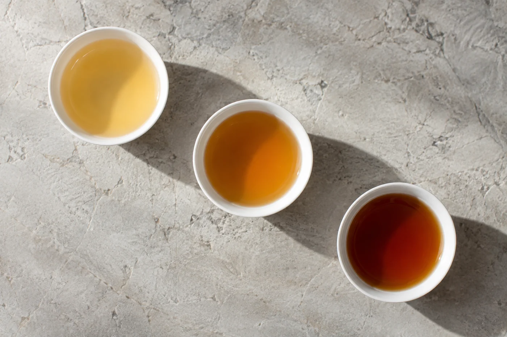
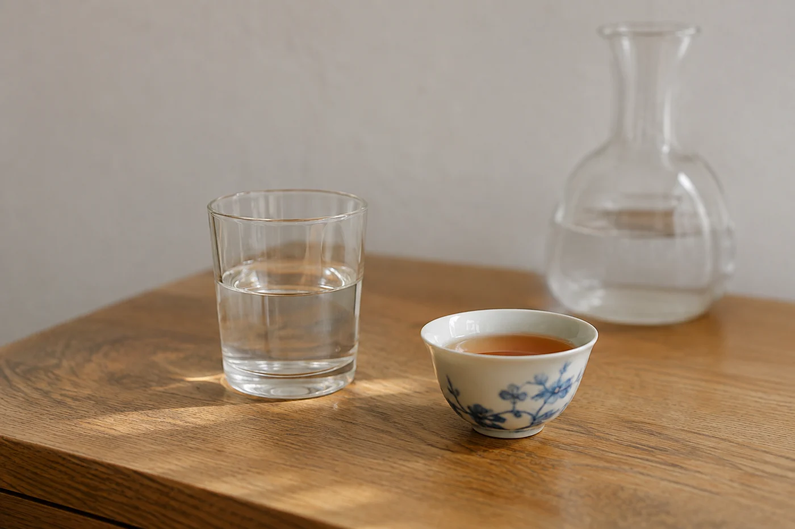

天黑以後，屋裏的聲音少了，燈也只剩一兩盞。這是我最想坐下來泡茶的時候，也是最需要問自己一句的時候：這一杯，今晚喝不喝。

答案只能由自己給。茶含咖啡因，對睡眠的影響因人而異，也跟喝多少、喝到幾點有關。知道自己喝了容易睡不好，就提早喝、少喝，晚間改喝清水。我不覺得這是委屈，一泡好茶，明天還在。

要調整，我通常先動時間，不急着換茶。把當天最後一杯定在晚飯前後，不留到臨睡前。

時間定了，再看濃淡。茶葉少放一些，浸泡時間縮短，湯色淺一點就出。份量也收一收，一隻小杯夠了，不必陪着談話一杯接一杯。

常聽到的一個說法，是晚上喝熟茶、老茶就安全。我不會這樣算。熟茶經過發酵，苦澀較低，喝起來溫和，但咖啡因仍然存在，只是釋放的方式不同，老茶也一樣。把它們當成無咖啡因來喝，往往到半夜還睜着眼，才知道判斷錯了。

有位學生不信。他連續三晚臨睡前喝熟普，白天照常上班，第三晚三點多醒，躺着到天亮。第四晚他改在晚飯後喝，睡得踏實。他問我是不是熟普的問題。不是，是時間的問題。

一般說，咖啡因在人體內要幾個小時才減半，各人代謝快慢相差很遠，這也解釋了為甚麼同一杯茶，有人照睡，有人失眠。這種事，書上的數字幫不上忙，自己試幾晚最清楚。

反方向的說法也要小心。有人喝完某款茶覺得想睡，便說它安神。當下的感受我會記下，作息卻要看仔細一點。茶不是藥，也不能代替休息。

## 要多留心的人

對咖啡因敏感的人、本來睡得淺的人、懷孕或哺乳的人、有心悸或胃部不適的人，晚上都要留意分量與時間。醫生有指示的，照醫生的說。

朋友端着杯，問：「這一杯，喝完還睡得着？」

「現在喝，還行。再晚就不喝。」

花草茶和草本茶，要按所用的草藥分別看待。有些人對某些草本過敏，不宜亂試。它們都是飲品，不是藥。

還有一樣常被忽略，是水本身。睡前喝太多水，半夜要起床，一樣影響睡眠。我習慣臨睡前一小時不再大量喝水，口乾就啜幾口潤喉。

晚上相聚，茶席照擺也可以。晚燈亮着，白天的聲音退去，本來就適合坐下來慢慢談。麻煩在於手邊有茶，很容易一杯接一杯，所以我會在旁邊備一壺清水，客人和自己都有得選。

茶席安靜，大家坐在一起，不必靠不停斟茶來維持。客人說想少喝一點，就讓他少喝，他最清楚自己。

## 身體會先告訴你

心跳較快、手心發熱、躺下後腦袋仍然很清醒，這些都是提示。遇過一次，下次就把最後一杯提早一兩個鐘。

想看清自己的規律，有個很樸素的辦法：一個星期內，每晚記下最後一杯的時間和睡着的狀態。兩三晚，通常已經看得出規律。

到了想休息的時候，我會把燈調暗，桌面收好，剩下的茶倒掉，杯子洗好，然後去睡。
