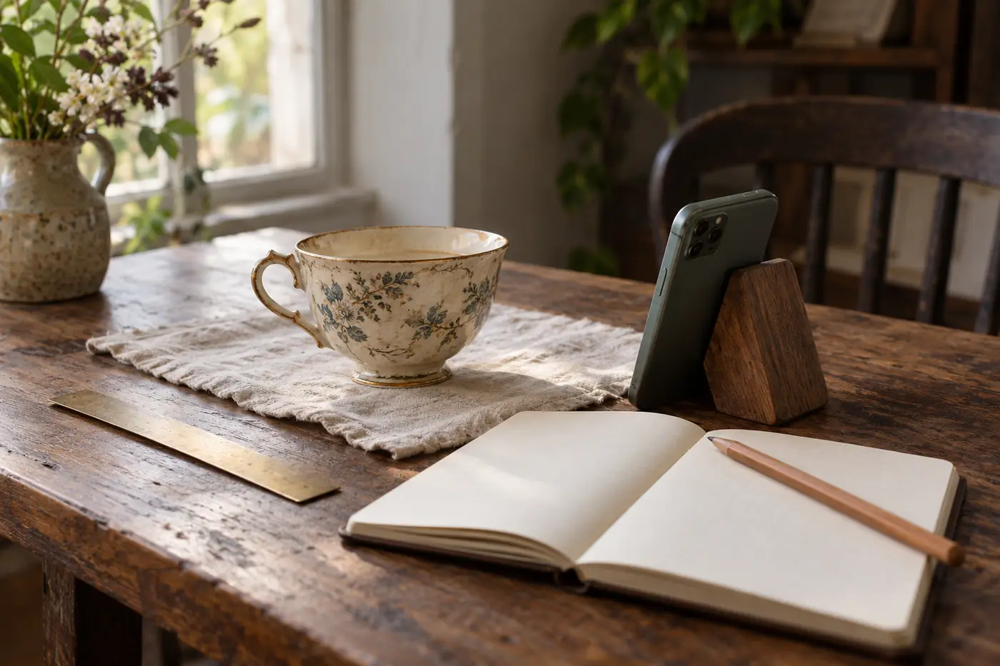

「從前是怎樣的？」

很多人想替長輩留下一點飲茶的記憶，一開口就是這一句。長輩笑一笑，沒有接話。範圍太大，記憶反而找不到入口。

我換一問：「家裏以前用哪一隻杯？」

「白瓷，杯口崩了一角，你阿婆不肯丟。」

話頭就是這樣開的。問題愈小，答案愈多。

一個人講起從前飲茶，往往由一個店名、一條街，或者一位老朋友開始。年份未必記得準，杯子是甚麼顏色、茶壺有多重、誰先斟茶，倒說得一清二楚。

這些東西，正式的歷史書不會寫，卻是一個家庭、一個社區怎樣過日子的證據。香港的茶樓、茶莊、涼茶舖，幾十年間換過幾代人，很多名字只留在記憶裏。長輩還在的時候先問一句，比日後四處翻查容易得多。

還有一層用處。平日兩代人難開口的話題，講到一壺茶，就容易了。

所以我會把「從前」拆開來問。家裏平日用哪個壺、哪隻杯，為甚麼偏偏是這一個。過年過節泡甚麼茶招待客人，由誰負責沖。第一次自己買茶是甚麼時候，在哪裏買，買了多少錢。有沒有一種茶的味道，一聞就想起某個人。

也可以問規矩。斟茶先斟誰，叩手指謝茶的習慣在家裏是怎樣來的，茶涼了會倒掉，還是一併倒進大壺再煮。茶樓裏那些更細碎的事也值得問：點心卡是怎樣蓋印的，伙計怎樣叫人，茶錢幾多，一桌人誰負責埋單。這類問題沒有標準答案，答案本身就是那個家的習慣。

找時間，先別想着要一個完整的下午。挑一個彼此都從容的時候，一次談一個小題目，已經很夠。飯後收拾完，桌上還有兩隻杯，那是最容易開口的時候。

## 聽到的話，要分三格放

每次談話，我會記下日期、地點和講述的人。寫的時候，把對方親身經歷的、聽別人說的、我自己推測的分開記。混在一起，過幾年再讀，就分不出哪句是誰的。

錄音之前，先問一句可不可以。長輩對着電話講，和對着人講，語氣會不一樣，有些人反而說得更放鬆，有些人會拘謹。錄了也要清楚告訴他，這段錄音給誰聽、放在哪裏。

錄音轉成文字之後，人名和店名最容易出錯。同一個「陳」可以寫成三個不同的姓，茶樓名號又常常有雅稱和俗稱。轉好之後要逐段核對，不確定的加問號，不要自己填一個看來合理的字。

遇到不肯定的年份，別當場逼對方給一個數字。先寫「約在某個時期」，之後再拿舊照片、單據、剪報，或者其他親友的說法互相對照。查不到也沒關係，寫上「待考」，這樣的記錄才誠實。

## 讓舊物開口

家裏若仍留着舊茶罐、茶杯、茶壺，或者一張包裝紙，就把它拿出來。拍下正面、背面和底部，量一量大小，寫上由誰保存、平時怎樣用。長輩看着實物，往往會想起更多，比單憑一問一答有效。一隻崩了口仍留着的老杯，背後通常有一句解釋。

拍的時候光線均勻就好，不必佈景。文字裏記下這件東西現在放在哪裏，日後家人要找，也有線索。

整理成文字之後，還有一步不能省：把全文讀給長輩聽，或者請他自己看，讓他補充、更正。很多時候到了這一步，他會想起另一段，或者忽然說「不是這樣的」。這些修改正好令記錄更準，不要當成麻煩。

寫好的文稿，放在家人都找得到的地方，註明是哪一天的版本。錄音和照片另外備一份副本，存在不同的地方。手機壞了，或者雲端帳戶出了問題，也不至於一次丟光。

問這種事，最好趁長輩還說得清楚的時候。一杯茶的來歷，往往順着這句話就打開了。
