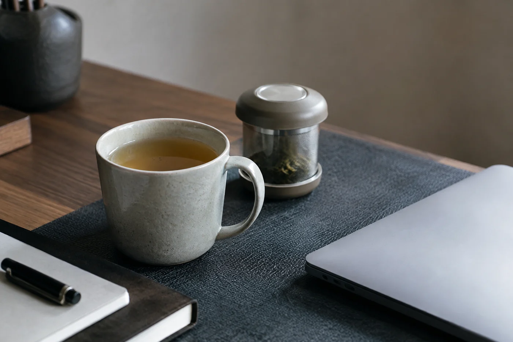

我以前也是見到好看的杯就想帶回家。

新壺的泥色，新杯的線條，總像在邀你開下一席茶。後來有一回，我想取一隻公道杯，先要搬開三隻杯和一把壺。那一刻才看清楚，每天泡茶，手伸出去拿的，來來去去是同一隻杯、同一個蓋碗。其餘的都在櫃裏等一個特別的日子，然後一直等下去。

細想原因，不外幾種。見到好看的就想買，彷彿換一件器物，下一泡就會更好喝。或者是配套的心思，有了壺就覺得缺一個公道杯，有了公道杯又缺一組杯。也有純粹的收藏之樂，看着器物一件件排在櫃裏，本身已是享受。

這些都很正常。沒有誰對誰錯。只是櫃子滿到取一件要動三件，每天用的又只得一兩樣，我就停了手。

茶的滋味，主要靠茶葉本身、水溫、茶水比例和出湯時間。器物影響的是手感、保溫和觀感，這些都真實存在，只是排不到最前。把手上現有的用熟，比再添一件新的，更容易喝到好茶。

後來我用了一個很笨的方法。這個星期用過的器具，洗好之後不放回原位，另外擺在一邊。到了周末一看，哪幾件拿得順手，哪幾件從頭到尾沒動過，一清二楚。

沒動過的，我不急着判死刑。有些是特定場合才用，好好收起就是。有些只是因為不熟，一直放着，用清水練一次，或者換一款合適的茶試試，再決定去留。人和器物之間要時間，這急不來。

真的想買，先想一個具體理由。是人多的時候公道杯不夠大，還是常用的杯崩了口，需要一隻接替？理由說得出，買回家才用得上。

然後再問一句：現有的能不能解決。一個蓋碗可以泡很多種茶，換茶時換一隻杯也行。初學的朋友尤其不必急着配齊一整套，先把一個蓋碗、兩三隻杯用熟，之後自然知道自己缺甚麼。

價錢高、數量少，也不一定好用。能拿在手上的話，掂一掂重量，倒一次清水，看出水的角度順不順，這比看圖片可靠得多。

## 一個人喝茶，要幾件

一個蓋碗，一隻品茗杯，一個放茶葉的容器，再加一壺熱水，已經泡得出一杯像樣的茶。人多了，才用得着公道杯和更多杯子。其餘多屬錦上添花，有也好，沒有也不影響味道。用這個尺度回看茶櫃，哪些是基本，哪些是享受，就分得清了。

茶桌上留點空位，並不寒酸。手伸過去不會碰到別的東西，客人的杯有地方放，自己也看得見茶湯的顏色。器物之間有空隙，抹水和收拾都快。

現在我看到心動的器物，會先放在心裏等一個星期，看看這份想要會不會退下去。還在的話，再問自己一句：它要放在茶桌的哪個位置。
