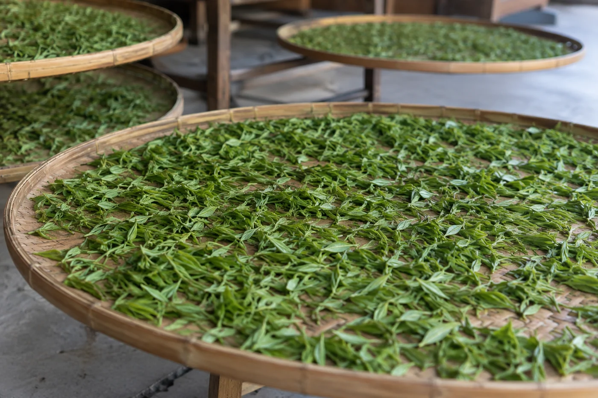
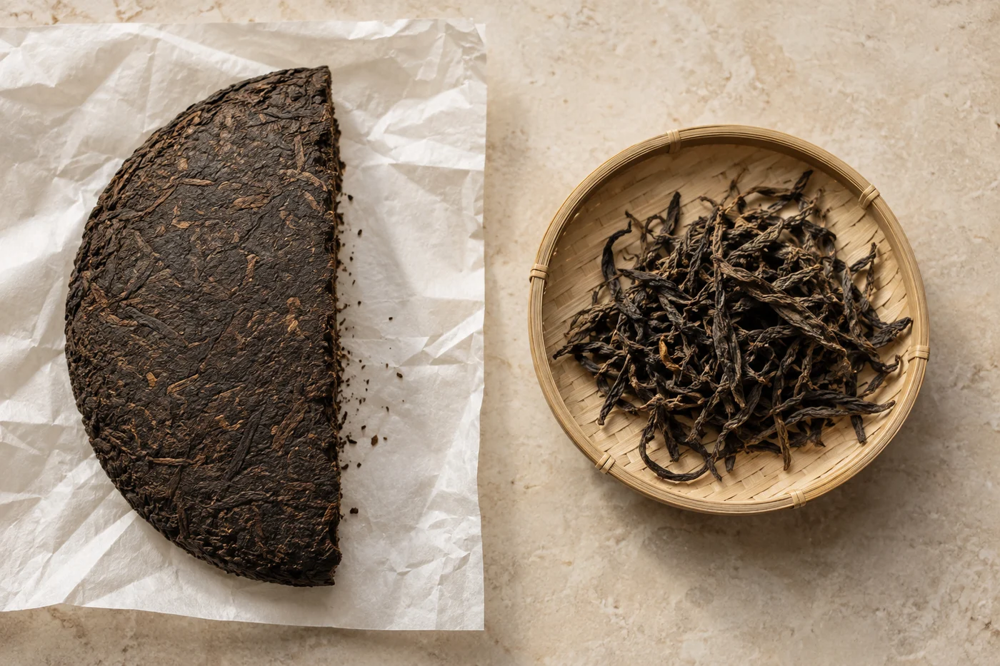

「世界遺產的茶，會不會好喝一點？」

有人在茶桌邊這樣問我，手上拿着一張印了「景邁山」的包裝紙。這個問題很自然。

先把事情講清楚。景邁山古茶林文化景觀在雲南普洱，2023 年列入聯合國教科文組織的世界遺產名錄。它被看重的地方，是茶樹長在林木之間，與村落、灌溉和傳統管理方式連在一起，是人與土地一起形成的景觀，不單是一片茶園。

我們平常想到茶園，是一行一行整齊的茶樹，樹形矮，方便採摘。古茶林不是這樣。茶樹與其他林木混生，高低疏密不一，樹下有落葉，林中有鳥有蟲。種茶的人沒有把整片地改成單一作物，只在林子裏留出位置讓茶生長。

行內人常說，這樣的生態比較完整。我同意，但不打算把它說成必然帶來更好的茶。茶好不好，仍要看原料、工藝與保存；景觀的價值和茶湯的優劣是兩個問題，分開想才清楚。

林下種茶，產量通常不及密植的茶園，採摘也不像整齊的茶行那樣方便機械作業。這是種植方式帶來的差別，沒有誰錯。台地茶園有它的效率與穩定，古茶林有它的生態與傳統，在市場上各有位置。

## 名錄保護的，是一整套辦法

世界遺產看的是一處地方的整體價值。景邁山一帶有世代相傳的種茶方式和村落生活：怎樣在林下種茶，怎樣輪流管理，怎樣把知識交給下一代。保護的對象是一整套人與自然相處的辦法，茶樹只是其中一部分。

林子能留到今天，靠的是村民一代一代地照顧。修剪，採摘有節制，林地輪流使用，還有各村約定俗成的規矩。這些知識多數沒有寫成書，是在日常勞動裏口耳相傳的。

所以談保護，不能只想着不砍樹、不蓋房子。讓當地人仍能在那裏生活、種茶，把手藝教給下一代，才是長遠的事。這一點，放在所有傳統產茶地都一樣。

我自己的理解是，這提醒了愛茶的人：杯裏一口普洱，背後有一個持續被人照顧的地方。包裝上寫「古樹」「風土」很容易。風土背後是一群人，有名字，有生活。

列入名錄，不等於林子裏出的每一餅茶都特別好。名錄保護的是地方與生活方式，沒有替任何一款茶的味道作擔保。這點不分清，「遺產」兩個字就很容易被當成品質標籤。

## 樹齡只是線索

樹齡高的茶樹根系深、生長慢，通常被認為有獨特的風味，所以受重視。可是「幾百年」「上千年」這類數字，買茶的人很難核實，也常被拿來做賣點。樹齡可以參考，不宜單憑它定價錢、定好壞。同一片林子裏，不同的樹、不同季節、不同的製作，茶都有差別。

這和我在談年份、談山頭時說的道理相通。標籤是線索，最後仍要靠自己的口舌去驗證。

## 買茶時，我會多問幾句

知道了這些背景，問茶的方式可以改一改。除了香氣和價錢，也問產自哪個山頭、哪個村寨，由誰採摘、由誰加工，是春天還是其他季節的原料。賣茶的人答得具體，是好的信號；只用漂亮形容詞帶過，就多留一點心。

產地名稱也不自動等於品質，名山之名被借用的情況並不少見。所以我的習慣是先試飲，再聽故事。

試的時候留意幾件事：茶湯入口順不順，滋味有沒有變化；沖到第五、六泡，是只剩水味，還是仍有厚度；葉底是否完整，大小是否合理。單憑一項證明不了來歷，幾項合起來，比十句形容詞可靠。

若有機會到產茶地，請守當地的參觀規定和保護安排。不隨便採茶葉，不踏入正在生產或受保護的區域，也不把村民當成拍照的背景。想拍，先問；想知道更多，先聽當地人怎麼說，再拿自己看到的和可靠的資料對照。

這些背景，未必能在杯裏喝成某一種香氣。買普洱，試飲之外，我仍會多問一句：這茶是哪個村寨的，由誰採的。答得出來的，才算認真。
