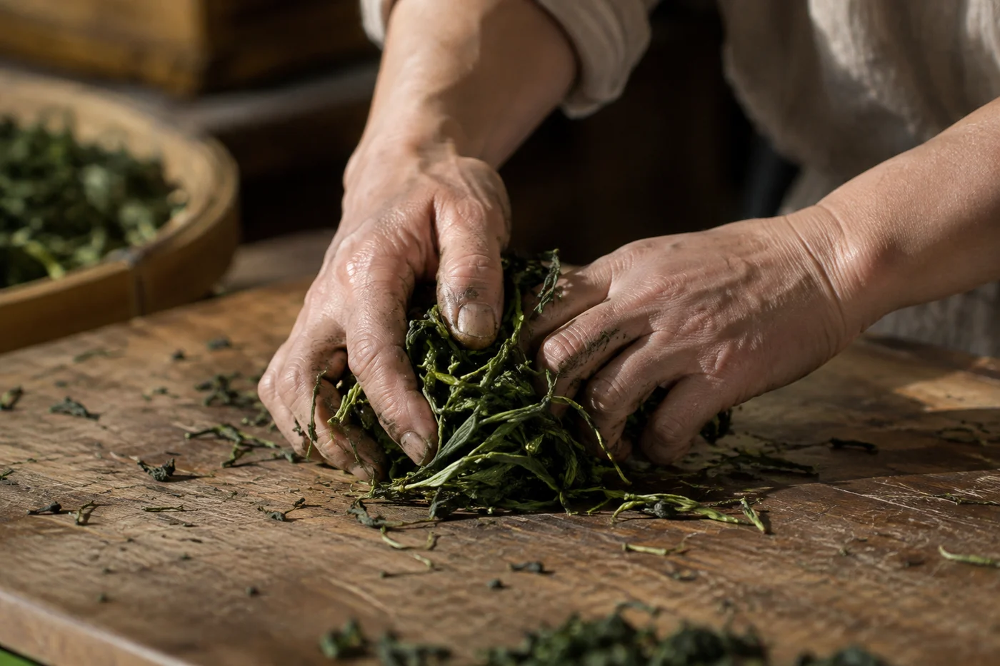

課堂上泡完最後一泡，我習慣把葉底倒在白碟上，用茶撥輕輕攤開。

葉子舒展開來，有的整片完好，有的捲着，有的邊緣一圈淡紅。總有人湊近看，問這圈紅是怎樣來的。要答，得由鮮葉離樹那一刻說起。

由鮮葉到成茶，常見的工序有採摘、萎凋、殺青、揉捻、氧化、乾燥。可是沒有一種茶會全部經歷，也沒有一條流程套得進所有茶。保留哪幾步、次序怎樣排、每一步做到甚麼程度，就是各類茶風味不同的來由。

萎凋，是讓鮮葉散失部分水分，葉子變軟，內含物質開始轉化。做白茶，含水量可以降到三四成；做綠茶只輕輕散一散，葉還帶脆。殺青，是用高溫把葉內的酵素停住，常見有鍋炒、滾筒炒和蒸。鍋炒時葉溫要上到七八十度，手貼近鍋面都覺得燙，酵素才真的停得住；溫度不夠，葉子會紅，綠茶就變了樣。揉捻，是把葉片捲緊、壓揉，令葉成形，細胞受了力，滋味比較容易釋出。氧化，是葉內成分遇上氧氣，顏色由綠轉黃、轉紅、轉褐。乾燥，則把水分降到可以存放的程度，同時定住香氣。綠茶乾到含水量百分之五上下，摸上去一捏就碎，才算存得住。

這幾步放在一起，其實都在回答：酵素要讓它工作到甚麼時候，水分要在甚麼時候散走。製茶人的種種安排，都繞着這兩處轉。

## 每類茶走的路不一樣

綠茶重在趁鮮殺青，先把酵素停住，再揉捻、乾燥，所以葉色和香氣最接近鮮葉。白茶幾乎只靠萎凋和乾燥，工序最簡單，對原料和天氣的要求反而最高，因為沒有太多步驟可以補救。紅茶由萎凋、揉捻走到氧化，每一步都在推動轉化，最後才乾燥。工夫紅茶的條索細，是揉捻時分幾次加壓、再解塊做出來的。

烏龍茶在萎凋之外多了搖青，讓葉緣輕輕受力，部分氧化，然後殺青、揉捻。搖一次，晾一次，一夜裏重複好幾回，甚麼時候收手，全靠聞。工序交錯，最需要經驗判斷。白碟上那圈紅邊，就和這種葉緣的局部氧化有關。

黃茶的做法像綠茶，但多了悶黃，殺青後趁熱包起來，讓葉色轉黃，湯也轉成杏黃。黑茶裏的熟普洱，則在毛茶之後再加上渥堆，一堆茶灑水、翻堆，靠微生物和濕熱把苦澀轉掉，幾十天後才攤開乾燥。

所以有人問我「茶是怎麼做的」，我通常先反問一句：你問的是哪一類茶？問清楚了，答案才有意義。

## 葉子一離樹，時間就開始計

鮮葉採下之後，變化立刻開始。葉片失水，內含物質轉化。若裝得太滿、疊得太厚，葉堆內部會發熱，變化便失控。所以大部分茶類都不會讓鮮葉放太久，很快處理，運送時也講究透氣，不宜壓實。山上採下來的葉，裝在竹籃或透氣的布袋，不用密不透風的膠袋。

採摘的時間、鮮葉的嫩度、運到工場要多久，都會影響後面的做法。同一座茶山、同一棵茶樹，不同批次可以做出明顯不同的茶，原因就在這裏。芽葉大小、當天天氣、處理快慢，每一項都在茶裏留下痕跡。產地固然重要，製茶人在這段時間裏的判斷，影響同樣深遠。

這些判斷多數難以量化。今天的葉片比昨天含水多還是少，空氣潮不潮，香氣出來了沒有，都要靠眼、手、鼻去確認。天氣一變，鮮葉狀況不同，操作就得跟着調整。我在茶廠見過老師傅把一把葉貼在臉上，說今天要早半個鐘收。他說不出為甚麼，就是知道。

機器的作用在於穩定和效率，幫忙處理分量、維持條件。但機器仍要人去設定、觀察和管理。人手和機械不必互相排斥，在現代製作裏，兩者經常並存。

## 做好了，還差幾步

製作完成，只算茶的一半。毛茶有時還要揀梗、拼配、複焙或壓製，才成為成品。乾燥夠不夠也很要緊，水分偏高的茶容易吸濕、走味，甚至發霉。普洱毛茶的水分會留一點，壓餅前還要蒸軟，所以買回來的餅，頭幾個月仍會慢慢轉。

保存不當，吸了濕氣或異味，前面的功夫一樣打折。茶宜放進密封、不透光的容器，遠離廚房和有氣味的雜物，開封後盡量在合理時間內喝完。

懂一點製法，最實在的好處是問題會問得準。與其籠統稱讚一句「手工」，不如問這個動作為甚麼存在，對茶有甚麼影響，生產環境怎樣保持清潔。一款茶的香氣、茶湯厚薄、耐泡程度，大多可以回到某一道工序找原因。這樣記茶，比單憑形容詞記得牢。

初學的人容易被工序名稱嚇怕，其實不用。先記住自己常喝的那一類，知道它大概少了哪一步、多了哪一步，已經足夠。喝綠茶時想到它沒有氧化，喝紅茶時想到它氧化到底，杯子裏的東西就開始有來歷。

一片葉要走完那幾步，才變成杯裏的東西。知道它走過哪條路，喝的時候就多一層明白。
