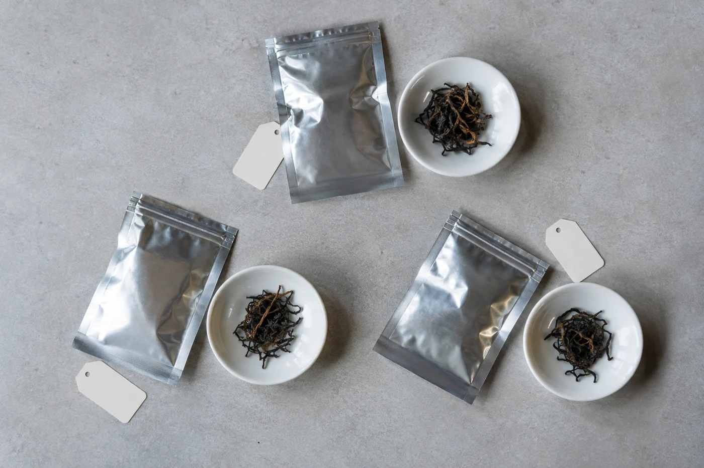

「茶葉放雪櫃係咪最好？」

問這句話的人，家裏的茶通常已經全部搬了進去。

有位同學就是這樣。那天他在電話裏問，我請他打開雪櫃，逐層讓我看。他一邊開門一邊說「亂七八糟，唔好介意」。第一層是雞蛋，第二層放着一包綠茶、一包烏龍，旁邊一盒昨晚的餸。最裏面，一餅普洱豎着，靠着雪櫃壁。

我看完，先問他一句：「嗰餅普洱，你打算幾時開？」

他停了兩秒，說：「唔知喎，擺住先。」

雪櫃合不合用，要看茶的種類，也要看包裝。適合的放，不適合的留在櫃裏。

重視新鮮香氣的茶，例如綠茶、清香型的烏龍，還有一些輕發酵的茶，香氣會隨時間慢慢減退，生產者有時會建議低溫保存。包裝上寫明建議冷藏的，就照它的說明做。

這類茶好在鮮爽，放久了鮮味就鈍。一時喝不完，冷藏可以把變化減慢，卻不能叫它停下來。雪櫃只替人爭取一點時間；買的時候，仍是自己估分量最實際。

普洱、老白茶、六堡這些講求陳放的茶，一般不需要冷藏。它們要的是乾爽、通風不悶、沒有異味的環境，讓茶自己慢慢轉化。所有茶用同一套方法收，很多人這樣做；只是每一種茶想要的，其實不一樣。

烘焙較重的烏龍和岩茶，同樣不用特別放雪櫃。乾燥、密封、避光，放在櫃裏已經夠。紅茶也一樣，平常的室溫乾爽環境就可以。

## 雪櫃的氣味與水氣

打開雪櫃那一刻聞到的東西，茶葉都會想吸進去。茶很容易吸附異味，密封得不好，和榴槤、海鮮、隔夜餸放在一起，不用多久就沾了味。所以要冷藏，包裝必須是完整的密封袋，最好再套一層，與氣味重的食物分開，留一個固定角落專放茶。

另一件容易忽略的事是凝水。冷的茶葉一拿出來就開袋，空氣中的水氣會凝在葉面上，茶就受潮了。我的做法是把密封包裝整個放在室溫，等它完全回暖才打開。一小包通常要一兩個鐘頭，大包更久，摸上去和室溫一樣就可以。

所以低溫本身不是問題。雪櫃潮濕、氣味雜、又常常開開關關，密封不夠的話，這些都會一併走進袋裏。冷藏要有條件，放進去不等於安心。

至於冷凍，也有人用，但來回凍融的風險更大，我不建議家庭隨便試。

## 分成小包，少搬動

把茶分成小份。日常只取一小包出來喝，喝完才拿下一包，不要每次泡茶都把整大包搬進搬出。每一次溫差，都是一次凝水的機會。

分裝的袋要乾爽，袋上寫好茶名和日期。寫清楚一點，下次不必靠記性。

放了雪櫃的茶，一樣有喝完的期限，包裝上的保質期照樣要看。開封以後可以放多久，沒有統一答案，因茶類、包裝、沖泡頻率而不同。清香型的茶，我會盡量在開封後一兩個月內喝完；即使冷藏，也不當作可以無限期存放。最直接的標準是香氣：開袋時鮮味和花香明顯弱了，就該改作日常喝，不要再存。

偶爾才喝茶、一包要幾個月才喝完、又分不清是哪一類的，最簡單的辦法是向賣茶的人問清楚，把答案寫在袋上。自己反覆猜，不如一次問明白。

那位同學後來傳了一張照片來。雪櫃第二層空了一格，普洱擺在書架頂，旁邊壓着一張紙，寫着日期。

我問他綠茶有沒有分小包。他說分了，用夾子夾着，一包一包排在雞蛋旁邊，看着有點好笑。

想喝綠茶的早上，取一小包放在桌上，等它回暖，才剪開。
