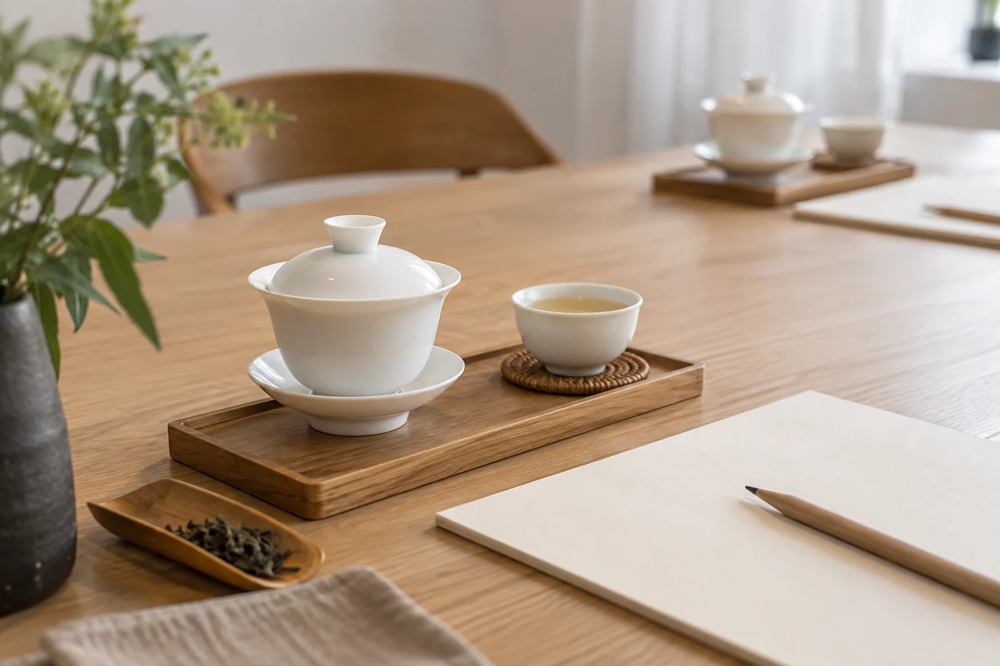

課堂散了，水槽邊還有人在洗杯。

水開得很小，杯一隻一隻沖過，倒扣在布上，偶爾碰出一下清脆的響。洗完了，又回到茶桌，再練一次出水。沒有人吩咐過要這樣做。

每次聽到這種聲音，我都會想起「傳承」兩個字。這兩個字常常被說得很大，落到實處，其實就是有人願意學，也有人願意慢慢教。

中國傳統製茶技藝及其相關習俗，在 2022 年列入聯合國教科文組織人類非物質文化遺產代表作名錄。它保護的是一整套做法與知識，從製作、飲用到分享，並不單是一杯成品。

非物質文化遺產看重的，是仍然活着的技藝與習俗，不是某件器物，也不是某個品牌。就茶來說，包括不同茶類的製作方法，殺青、揉捻、發酵、烘焙這些工序怎樣配合；也包括各地圍繞茶形成的飲用與待客習慣。

這裏有一點要分清。列入名錄的是技藝與習俗這個整體，並不表示每一場茶藝表演、每一家茶店、每一款茶，都自動帶上「非遺」的資格。看到包裝或宣傳寫着非遺，可以問一問具體指哪一項技藝，由誰傳承。答得清楚，是好現象；只丟下一句「非遺工藝」就沒有下文，我會保留一點。

舞台上的茶藝展示，動作整齊，器物漂亮，容易讓人記住，對推廣茶文化有幫助，我不會否定。只是一項技藝能不能延續，更多要看課後有沒有人反覆洗杯、練習出水，也看師傅肯不肯花時間解釋為甚麼要這樣做。

看表演的人多，坐下來練的人少，這很自然。我只怕有人看完一場，就當自己學過了。

## 愛茶的人能做的，都很具體

這份力可以很具體。學清楚一種做法，弄明白它的來處；使用時尊重材料，也尊重同席的人；向朋友介紹時把資料說準確，不把聽來的傳說一概當成史實。這已經是很實在的一份力。

初學的人，我通常建議每次只練一個環節，例如溫杯、出水或收水，練到穩，再加下一個。同時用簡單的筆記，記下當天學到的原因，不要只記動作。過一段時間回頭翻，會發現自己問的問題在變，這是進步的跡象。

問問題也有分別。「這樣做對不對？」只會得到一個是或否；換成「為甚麼這一步要這樣做？」往往牽出水溫、茶葉狀態、器具大小之間的關係。師傅解釋時用心聽；不同意的地方，先記住，回家試過再算。回家按所學試一試，有疑問，下一堂再請教。

好的老師不怕被問，也會告訴學生哪些是通行的做法，哪些只是自己的習慣。學生分清這兩類，日後才不會把某個人的習慣，誤當成唯一的規矩。

第一次上課，帶一本小簿和一枝鉛筆就夠。課後十分鐘內把重點寫下來，比回家才憑記憶補寫準確得多。

很多人以為傳承就是反對機器。製茶行業其實早已有不同程度的機械輔助，用不用，要看工序和目的。有些環節，機器令品質更穩定；有些環節，仍然要靠人用手感判斷。要緊的是師傅明白每一步的道理，用機器還是用手，由他有根據地決定。

教的一方，也要容許新的問題。年輕人用今天的語言、器具和生活方式接觸茶，提出的疑問有時比舊規矩更切中要害：茶袋和散茶有甚麼分別？在辦公室可以怎樣泡？這些問題未必有現成的傳統答案，卻值得好好回應。只要他們願意了解工藝背後的道理，傳統就有機會在現代生活裏繼續被使用。

名錄記的是人，不是手勢。真正留下來的東西，多半在洗杯、抹桌、把水燒開這些時刻裏面，一天做一點，做得比昨天乾淨一點，已經夠了。
