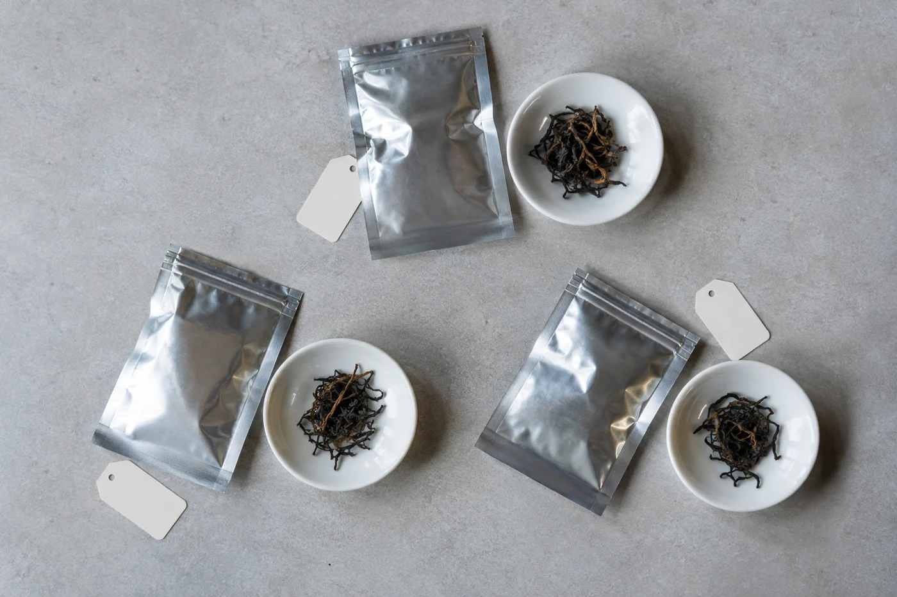

「在店裏明明很好喝的。」

說這句話的人，手裏多半捏着一包開了口的茶，已經在家泡過兩三次，開始懷疑問題出在茶，還是出在自己。

兩樣都未必。同一款茶，店裏喝覺得好，回家泡卻不一樣，最常見的原因是條件變了。茶量、器具大小、水、水溫、浸泡時間，其中一項不同，味道就跟着變。這不代表茶被調換，也不一定是你不會泡。

我會勸人買茶時多問幾句：用了多少茶，器具多大，水溫大約多少，第一泡泡了多久。對方未必每項都記得，大概的說法已經很有用。問回來寫在包裝旁邊，等於替自己留下一個起點。

器具的差別最容易被看輕。比方店裏用一隻一百毫升的小壺，投茶六克；你回家用二百多毫升的馬克杯，照樣放六克，等於把茶稀釋了一半，當然淡。反過來，有人把小壺的分量照搬到大杯，又泡得濃苦，就以為茶不好。

節奏又是一回事。店裏試茶，往往用小壺，茶水比較高，短時間出湯，一泡接一泡地喝，很快。在家用大杯慢慢悶，同一款茶自然換了一副樣子。所以除了問克數，還要問一句：是不是分很多泡，每泡都很短。

## 試的和買的，是否同一批

這一點較少人想到。茶有批次，名字一樣，今年的與去年的、春茶與秋茶，都可以有差別。購買時可以問：試喝的是不是這一批、這一包？若店裏另開一罐給你試，你帶走的卻是另一罐，就留意兩者的乾茶外觀與氣味是否相近。

店裏肯給小樣，那最好。小樣拿回家，按同一方法泡一次，再決定要不要買整份，比靠記憶可靠得多。

## 水、氣氛和茶罐

茶湯裏最多的是水。店裏的水和家裏的水不同，味道自然有差別，所以我泡茶前習慣先試一試水，這件事另有一篇談過。硬水裏的鈣、鎂會把香氣壓住，茶湯也顯得鈍；同一款茶，換一支水，差別有時比換一隻壺更大。

人也是條件之一。在店裏有人介紹，有人同桌，注意力全在杯上；在家可能一邊做別的事一邊喝，感受當然不同。記憶中的那一口，多少被當時的氣氛加了分。這不必苛責自己，每個人都會這樣。

然後是存放。茶放了一段時間，香氣會慢慢變，剛開封與開封後一兩個月，味道可以不同。茶要密封、避光、避濕，不要與有味道的東西放在一起。

家裏常見的幾個毛病，我見得多了。茶罐擺在爐灶旁，每次開罐都吸進油煙味；大包裝開了口，只用一個夾子夾着；或者從雪櫃拿出來就馬上開蓋，冷的茶葉遇上暖空氣，表面凝了一層水氣。這幾樣都會令家裏那一包，和店裏的狀態拉開距離。從雪櫃取出的茶，我一般會連袋放半小時，回到室溫才開。

實際一點的做法，是把大包裝分成幾個小袋，常喝的一袋放在手邊，其餘密封收好。開的次數少了，茶的狀態也穩一些。

## 回家重新試

先挑自己最順手的器具，其他條件保持穩定，一次只改一項。太淡就加茶量，太濃就減茶量或縮短時間。不要一次把所有設定推翻，否則不知道是哪一步見效。

第一次的泡法當作基準，寫下來，試過兩三次才下判斷。第一次泡不好很平常，器具未熟、手勢未穩，都會影響結果。我自己搬家的時候也吃過一次虧：新廚房的水煲出水急，同一把壺、同一款茶，泡出來硬是差了一截，查了兩個星期才想到是水注太猛，把茶葉沖翻了。

若調了幾次，味道仍與店裏相差很遠，或者乾茶的外觀、氣味明顯和購買時不符，就保留茶樣和購買資料，向商家查問。描述要具體，說清楚用多少茶、多大的壺、泡多久、嚐到甚麼，比一句「不一樣」容易溝通得多。

也有另一種結果：你在家泡出了另一個味道，自己反而更喜歡。我覺得那樣也很好。茶買回來，是要在自己的日子裏喝得舒服，用不着重現店裏那一刻。
