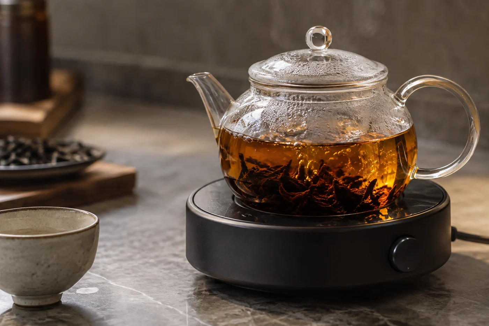
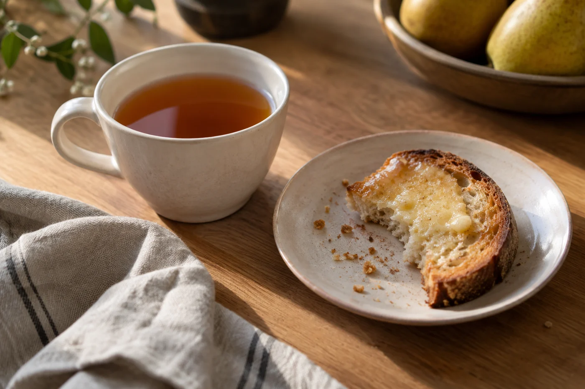

茶餐廳櫃枱後面，總掛着一個布茶袋。用得久了，顏色變深，早已看不出原來是白的。

坊間叫它做「絲襪」，就是因為這個顏色。叫法流傳很廣，連帶整杯飲品也被叫成「絲襪奶茶」。我每次看見那個袋，都覺得它比任何介紹更能說明這杯東西：用多種紅茶配搭，在布袋裏反覆沖煮出濃茶，再加淡奶調成。

這杯茶沒有一套人人相同的配方。各家茶餐廳的茶底、沖煮時間和奶量都不一樣，所以同樣叫奶茶，每間店喝起來都有自己的樣子。

港式奶茶製作技藝被列為香港的非物質文化遺產項目。我想原因在於整個過程靠經驗。幾種茶葉怎樣混合才夠香濃，水滾之後茶袋浸多久、悶多久，怎樣把茶湯濾出來，師傅都要憑手感和長年的觀察拿捏。同一批茶，換了天氣，或者換了水，沖出來也未必一樣。

這杯飲品也帶着香港的來歷。紅茶加奶的喝法來自西方，落到本地茶餐廳，遇上廣東人的口味、點心麵包的搭配，還有趕着上班的早晨，慢慢成了自己的風格。

在家加奶，很多人覺得味道平平。我聽到這種話，多數會先問茶沖得夠不夠濃。

淡奶一加進去，茶味就被沖淡、拉平。茶底要先夠濃、夠厚，喝起來才仍然有茶味。問題通常出在茶，不在奶。

茶餐廳常用幾種紅茶混合，也是這個道理。有些茶偏重香氣，有些偏重濃度和茶色，配在一起，才能濃而不過澀。至於各家用甚麼茶、怎樣配，是店家自己的心思，外人很難問得到，也不必追問。

## 自己在家沖一杯

紅茶揀顆粒較粗或碎的，這類茶出味快，適合煮得濃。水燒滾後下茶，用小火略煮，或者加蓋焗一段時間。時間按茶的粗幼調整，總之要濃到入口夠厚。之後濾去茶渣，再加淡奶與糖，分量按自己口味。

沖好試一口。太淡，下次加茶或延長時間；太澀，就縮短時間或減茶量。每次只改一樣，才找得到合自己的比例。

煮茶的時候壺裏是滾水，傾倒和濾茶都要小心燙傷，也不要讓小孩靠近。

店裏那種反覆使用的布茶袋，我不建議家裏照搬。茶袋用過之後若不徹底清洗和妥善保存，容易滋生細菌。在家用完即棄的濾網，或者每次換新的濾袋，穩妥得多。

## 看師傅的時候

有機會在店裏看師傅沖茶，可以看看茶袋有多大、用的是甚麼壺、倒茶的高度和節奏，以及甚麼時候加奶。這些都是看得見的工序。

只是看過一間店，不足以說明全港的做法。每間店有自己的習慣，我不會拿這一家的做法去質疑另一家。

倒茶時把茶在兩個容器之間來回拉動，就是「拉茶」。一般認為這樣可以讓茶與奶更均勻，茶湯也更滑，不少師傅各有自己的拉法。這些說法流傳已久，細節和來歷眾說紛紜，我只當作行內的習慣來理解，不把任何一個版本當成定論。

## 淡奶和煉奶，各有用處

港式奶茶一般用淡奶，奶味較濃較厚，糖另外按客人所需加入。煉奶本身已經很甜，用法和口感都不同，多見於某些飲品或點心的搭配。兩者用途不同，談不上誰代替誰。

想在家分辨，可以把同一杯茶底分成兩份，一份加淡奶，一份加煉奶，一口一口比較。

與其只說「好飲」或「唔好飲」，不如換些具體的字眼：茶味夠不夠突出，奶香和茶香怎樣配合，口感是滑還是稍澀，甜度合不合自己。說得出來，下次再喝就有得比較。

奶茶含咖啡因，也有糖和奶。晚上喝，或者對咖啡因敏感的人，可以按自己的情況選杯量和時間。這是個人習慣的事，我不會把它說成對健康有益或有害。

太熟悉的東西，很容易被當成理所當然。街角那間店的師傅，手勢看了幾十年，未必人人都看得見。回家自己試，第一杯不用求完美，比平日的茶包奶茶濃一點，已經是好開始。
