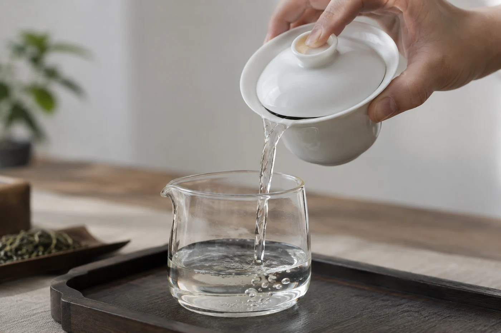
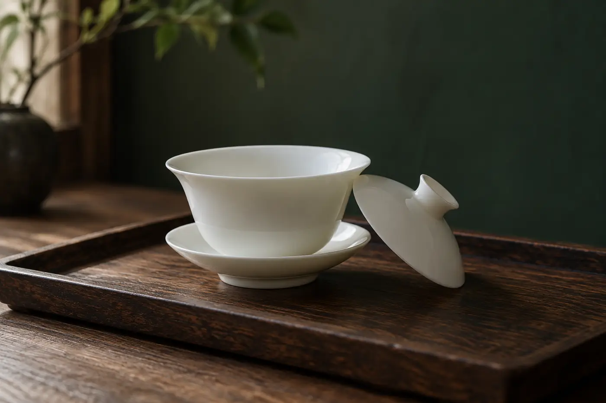

客人坐下來，雙手放在膝上，眼睛看着桌上排好的一列杯，不敢伸手。

入座前，他多半已經問過一句：「我不懂茶，會不會失禮？」茶具擺得整齊，主人的手又熟，初來的人反而更怕拿錯杯、說錯話。

這時候我只做幾下小動作。指一指杯子，說這是你的；倒茶之前提一句，湯剛出來很燙；再把清水放到他手邊，說想停就停。講完，就不再講任何茶桌規矩。

一隻杯，茶有多燙，水在哪裏，不想喝可以直說。這幾句，比一口氣講完所有禮儀有用，客人也知道自己的需要被放在心上。

叩手、握杯的姿勢，他問起才教，不問就不提。桌上有公道杯、茶荷、茶濾這些他沒見過的器具，逐件介紹反而累人，看到他好奇了，才說一句名稱和用途。

座位要安排在看得到主人雙手的地方，又不會被熱水和壺擋住。初學的人最想知道下一步會發生甚麼，看得見出湯、分杯，心裏就踏實。茶杯放在他慣用手那邊，旁邊留一小塊空位放手機或眼鏡。桌上的器具一兩款能完成一席茶就夠，多了反而礙手。

我會先問味道和濃淡舒不舒服，再看他有沒有興趣知道更多。

要求初學者猜品種、說香型，只會令他緊張。「像不像蜜？有沒有一點木頭味？」這樣問已經足夠，答不出也無妨。有人只說得出「好喝」或「有點苦」，這已經是有用的資料。我會換個問法：「比剛才那杯淡還是濃？」「要不要加點水？」讓他用比較代替形容，比較容易得多。

最要不得的，是對他的疑問回一句「你多喝幾年就懂」。這句話等於把門關上。

第一泡，我通常會揀清淡一點的茶。紅茶、熟普洱這類湯色深、口感平和的，初學者一般較易接受；一開始就碰上濃烈的生普洱或高火焙茶，有人會覺得太苦太澀，沒心情再喝下去。不過這要看人，並沒有一定。

## 讓他用清水試一次

客人若想動手，我先示範一次，再倒清水讓他練，看蓋碗拿着順不順手。蓋碗的杯沿容易燙手，熟手會用拇指與中指捏住碗沿，食指按着蓋，初學者未必一時掌握，用清水練就沒有壓力。

真正注入熱水的那一步，由熟手來做，沒把握的動作慢慢來。親手做過一次，比旁觀一整套漂亮流程更記得住。

客人怕燙，就改用小壺，或者直接用玻璃杯、有把手的杯來泡，這些都是正當的選擇。蓋碗方便，卻不是唯一的器具。我會說：「這個我來泡，你喝就好。」下次他想試，才讓他學。

## 有些客人，先問一句

孩子、長者、孕婦，或者因身體狀況要少喝茶和咖啡因的人，我會先問：「想喝淡一點，還是換成清水？」讓他自己決定。不替他判斷，也不講健康道理，茶不能當藥，更沒有理由勸人多喝。

手不方便、拿杯要小心的客人，替他換一隻有把手的杯，也能避免燙傷。這種事說出來反而尷尬，順手換了就好。

一席入門的茶，客人離開時還想再喝一杯，我就滿意了。規矩若令初來的人退縮，先放一邊。

客人記得的，通常不是你用了哪一款茶，而是那一句問話。問過，他就知道自己可以再來。
