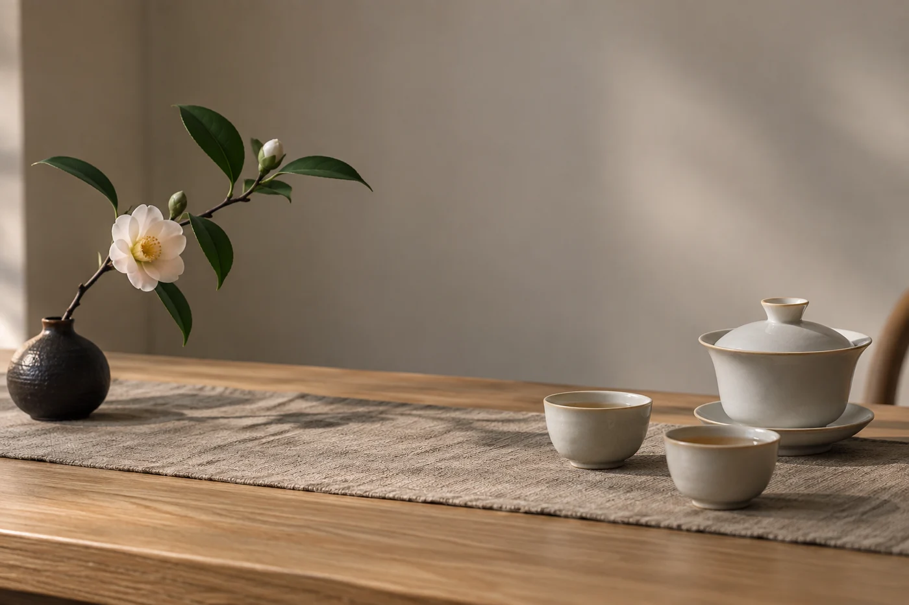

朋友替你斟滿一杯，自己先喝了一口，眉開眼笑。你也端起來，嚐了，覺得平平無奇。

杯還在手裏，對方已經看着你。

這種時候，我覺得最舒服的說法，是先交代自己的偏好，不去評斷茶的好壞。例如：「我平日喜歡香氣鮮明一點的，這杯對我來說比較內斂。」

這句話說明了你用的是哪一把尺，也給別人的感受留了位置。你沒有否定那款茶，也沒有把朋友推到對面去。

喜歡，是你和這杯茶之間的事：合不合口味，令不令你放鬆，想不想再喝一杯。品質，是一些可以拿出來討論的觀察：氣味正不正常，滋味是否協調，各部分有沒有突兀，茶葉的狀態和存放是否妥當。

兩本賬可以重疊，也可以各走各路。你可能欣賞一款製作很用心的茶，它卻不是你愛喝的類型；也可能偏愛一款很樸素的日常茶，覺得比貴價的更親切。不需要替任何一邊辯護。

朋友直接問你好不好喝，坦白又不傷人的答法有幾個方向。可以說你注意到的特點，「這杯的甜感很明顯」；可以說你平常的口味，「我較習慣香氣再清一點的」；也可以反過來問對方當初為甚麼喜歡，讓對方多講兩句。

我不太建議說「一般啦」「沒甚麼特別」。這類評語沒有資訊，聽的人只會覺得被否定。

要談品質，才回到比較具體的事情：氣味正不正常，滋味是否協調，沖泡條件是甚麼，產品資料是否清楚。這些可以拿出來比較，不靠個人口味。即使兩個人對這些觀察相近，各自買哪一款，仍然可以不同。

不過，朋友分享的茶，或者主人親手沖的茶，這個場合通常不需要論品質。專心喝，說一句謝謝。

有些人一直說不清自己喜歡甚麼，被問起只能答「好喝的就可以」。我會請他們拿幾組對照問自己：偏愛清淡還是濃郁？偏愛香氣還是滋味？喜歡乾淨直接，還是一層一層地變？喜歡柔和，還是帶一點收斂感？

答完這幾題，手上已經有一份簡單的口味輪廓。之後跟朋友分享，或者向茶店諮詢，可以直接說「我偏愛清淡、香氣明顯的」，對方也更容易推薦合適的茶。

也有倒過來的場面。你說自己愛喝某一款普通茶，旁邊有人說「那個不算好茶」。平靜說明自己喜歡的理由就好，不用辯論，也無須覺得矮了一截。口味是自己的，價錢和名氣不能替你決定喜歡甚麼。

輪到我們在別人面前評論一款茶，也要記得對方可能很珍惜它。用字稍為留情，是茶席上的基本禮貌。

口味也會變。從前覺得太濃的茶，日後可能學會換一種方式沖泡；昔日着迷的香氣，如今也許只想偶爾喝一次。飲茶的經驗，不是一張填好就不能修改的表格。

「這杯很適合我」，已經是很完整的讚美，用不着把它推成人人都應該喜歡的標準。
