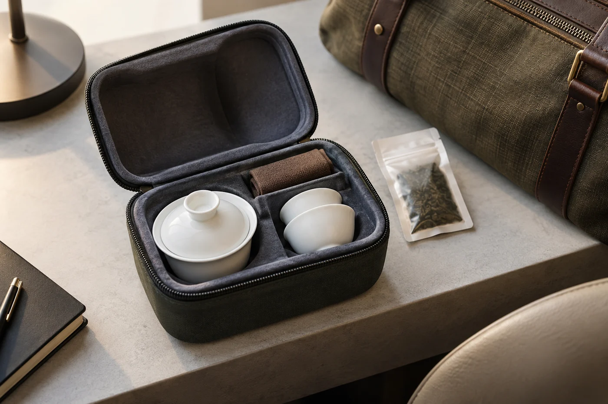
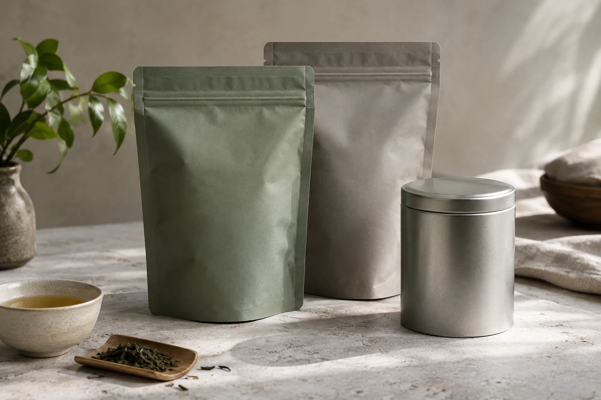

茶刀從茶餅邊緣斜斜插進去，輕輕一撬，總有幾片碎葉先落在桌上。拆茶的人要把它們撥回茶荷，再找回剛才那道縫，慢慢撬下一塊。

散茶就沒有這一段。袋口一撕，倒出一撮，便可以泡。

這點差別看似很小，可是在趕着出門的早上，它可能決定一款茶有沒有機會被喝到。所以有人問我普洱散茶好還是茶餅好，我總是先問回對方：你平日在哪裏喝，多久喝一次。

普洱成茶大致有兩類形式。散茶沒有經過壓製，一條一條、一撮一撮，直接取用。緊壓茶則是把茶葉蒸軟後壓成餅、磚、沱等形狀，方便運輸與存放，其中餅形最常見。

壓製只改變茶的形態，不是品質的保證。一餅壓得鬆緊合宜的茶，拆得完整，沖起來勻淨；壓得太緊的，拆起來費力，碎末也多。散茶的好處是看得清楚，茶葉的老嫩、條索、碎末比例都攤在眼前；短處是較容易受潮、染味，也較容易被壓碎。

## 我會怎樣替人選

常在辦公室或外出時喝茶，選分裝好的散茶最省事。拿了就走，不需要工具，也不怕拆得一桌碎葉。一個人沖泡、一次只想泡一小撮的，用散茶同樣方便，投茶量容易調，今天想淡一點，少放一撮就是。熟茶散裝的選擇也不少，日常喝起來沒有負擔。

喜歡在家裏慢慢整理茶的人，茶餅就很合適。拆茶本身是一段安靜的時間，有人頗享受。茶餅原本的包裝完整，存放時有整體保護；若打算放一段日子，一餅一餅獨立包好，也比一大袋散茶容易管理。

只是拆餅要工具，也要一點耐性。茶針或茶刀的尖端要遠離手和身體，扶茶的那隻手要避開下針的位置。平日沒有時間，家裏也沒有一張穩固的桌面，勉強買茶餅回家，未必划算。

拆開後剩下的部分，要重新包好放回，別讓切口長時間露在空氣裏。散茶也一樣，袋口盡量少敞開，用完即封，濕手和濕勺都不要伸進去。

有一點常被忽略。外形不同的兩款茶，原料和批次未必相同，名字相近，也不一定只差在壓與不壓。把包裝上的原料、類型、製造日期和批次看清楚，才不會把所有風味上的差異都推到形狀頭上。

沖泡也有分別。緊壓茶在水中是一層層舒展開的，出湯要多一點耐性；散茶一入水就散開，出味較快。同樣的水溫與時間，兩種形式可以喝出不同的濃淡，茶本身並沒有問題。

## 兩種都怕的東西

潮氣、陽光和異味，是散茶和茶餅共同的敵人。散茶表面積大，吸味也快，最好用不透光、能密封的容器分成小份，開了一份才動下一份。茶餅可以保留原有的外包裝，再放進透氣而乾淨的紙袋或布袋，不要貼近地面和牆角。

回南天或者連日下雨，兩種都要多檢查。取出一點聞一聞，有悶味的話，先放到通風處，不要急着封回去。

拿不定主意，就先買小樣，兩種形式各取一份，用同樣的器具、同樣的茶量，沖幾次比較。確定自己願意常喝，再考慮整餅或較大的包裝。

我看重的，是你知道它甚麼時候會被打開。每天要上班，櫃裏放一袋散茶；週末有空，再拆一角茶餅。兩樣各有各的用處。
