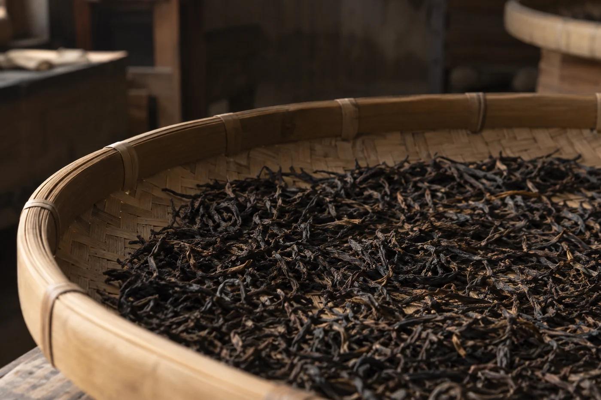
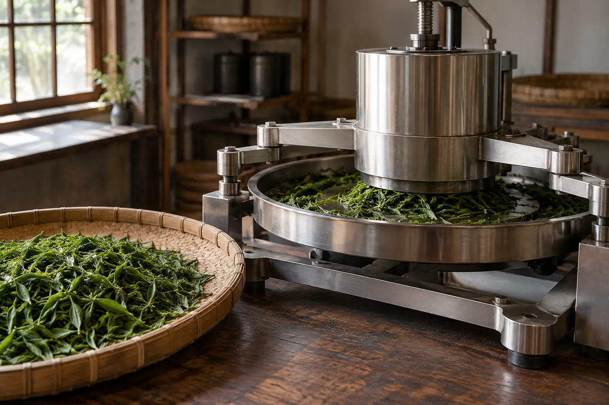

製茶現場的照片，鏡頭總是偏愛那雙熟練的手。

我以前看這類照片，也很容易被打動。手的動作好看，畫面也好看，好像單憑這雙手，杯裏的茶就差不到哪裏去。喝得多了，才慢慢明白，一款茶好不好喝，不能由畫面動不動人來決定。

手工製的茶，不一定比機械製的好；機械製的，也不等於低檔。實際生產裏，兩者多數是配合使用。機械處理分量、維持穩定的條件，人手負責需要細緻判斷的環節。我判斷一款茶，看的是原料、製作控制、清潔，還有杯中的表現。

手工的好處，是能按每批葉的狀態即時調整。鮮葉今天偏濕、明天偏乾，有經驗的人可以馬上改力度、改時間。

可是量一大，人力就難保每一鍋、每一批都一致，做久了也會因為疲勞出現差異，衛生管理更要多花心思。

機械的好處在穩定和效率。溫度、轉速、時間可以設定，每一批的條件接近，用得好，同樣做得出出色的茶。反過來，參數一設錯，錯的就是一整批，沒有人手那種邊做邊改的彈性。

兩邊各有風險。我較看重的，是做茶的人清不清楚自己在做甚麼。每一步為甚麼這樣安排，哪裏由人決定，哪裏由設備協助，答得出來，通常比一句「純手工」可靠。

哪幾步離不開人，要按茶類看。需要即時判斷的步驟，現場經驗的分量很重，例如烏龍茶搖青時看葉緣的變化，決定甚麼時候停；又或者殺青時憑手感和香氣判斷火候。

另一些步驟剛好相反。大批量的揉捻、乾燥，機器能令條件更均勻。有些茶區甚至把機械當作提升衛生和穩定度的工具，並不覺得是品質上的退讓。至於哪些環節非人手不可，各茶類、各產區的看法不完全一致，這一點我不想說得太絕對。

一個茶園只做少量，由人手逐批照顧，是合理的選擇，還可以多試不同做法。產量大了，讓機械負責重複性高的步驟，人把精神留給最需要判斷的地方，同樣合理。方式本身沒有高低，要看做茶的人有沒有把自己的選擇交代清楚。

## 在工場看過的兩件事

有一次在雲南一間初製所，殺青機旁邊貼着一張手寫的紙，寫着每批鮮葉的公斤數和滾筒溫度，字跡被蒸氣熏得發皺。師傅說，機器只是替他省力，聞到那股青氣走了沒有，還是要靠他站在出料口。他一天站八個鐘。

另一次在福建，一間小廠全靠人手搖青，做的量很少。廠主說得坦白：手工不是為了故事，是因為他只有這麼多茶青，買機器划不來。

兩間廠，一個用機器，一個用手，說起自己的茶都講得清楚。反而有些包裝寫滿「古法」的，問到殺青用甚麼、看甚麼狀態才起鍋，答不上來。

標明「機械採摘」的茶，也有人一聽便皺眉。採摘方式要和茶園的地形、品種、目標茶類一起看。平坦的大面積茶園用機械採，葉的大小會較不整齊，適合做某些用途；高山或梯田多靠人手採，揀得較細。很難一句說誰好誰壞。

手工需要更多人力和時間，成本通常較高，這是事實。但價錢高，並不證明做得好。「手工」兩個字也沒有統一標準，有的只是部分步驟用手，有的才是全程。

手工和衛生，又是兩回事。人手接觸茶葉愈多，工作環境、手部清潔、器具管理就愈要講究。一家工場肯把這些細節講清楚，比包裝上印「手工」更令我安心。

所以買茶的時候，我會問兩個實在的問題：哪些工序由人手完成，哪些由機器協助？為甚麼這樣安排？然後再看原料資料、工作環境和成品表現。這樣得到的，比單問「是不是全手工」全面得多。

「全手工」三個字，說的是一雙手做過哪些事，不是一句保證。聽人介紹茶，我通常只問一句：整個過程最難掌握的是哪一步。他怎樣答，比任何形容詞都清楚。
