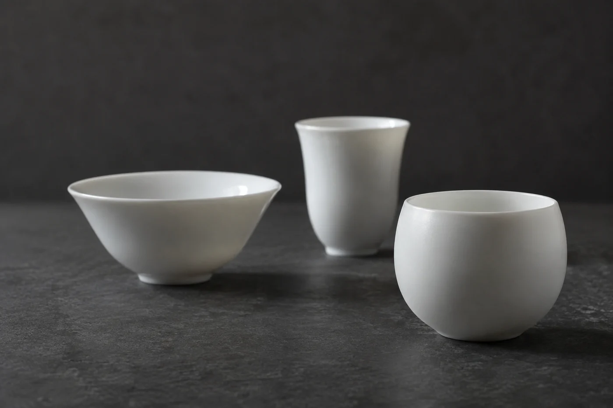
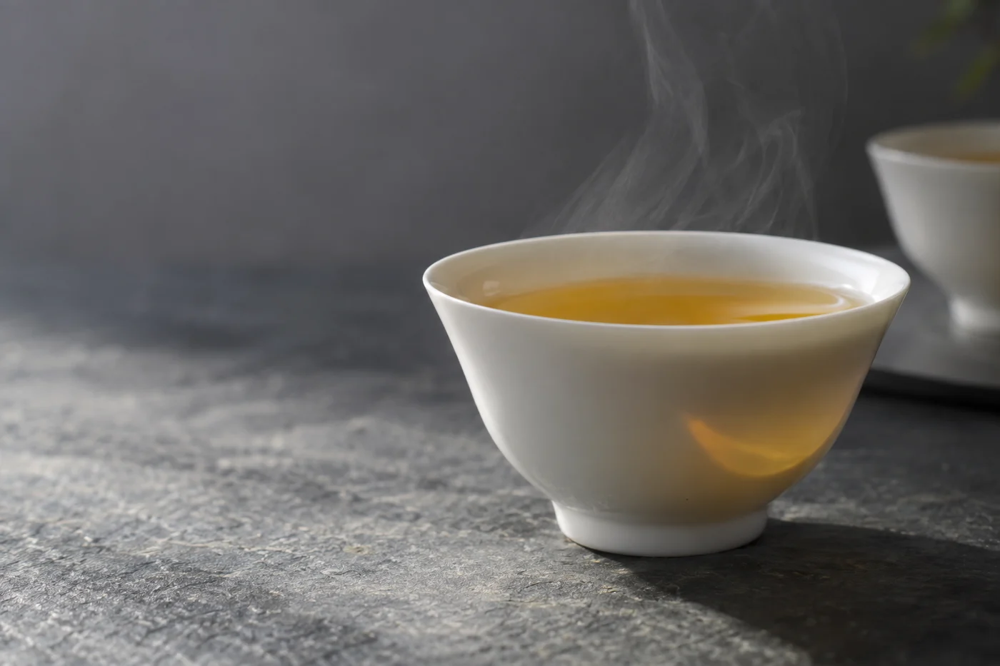

早上的聲音很多。水壺在響，手機在震，門外的升降機一層一層停。

吃完早餐，碟子還在桌上。我不急着收，先把杯子挪到面前，多坐幾分鐘。這杯茶若只是拿着出門，就少了一份從容。

早上用不着儀式。選一款熟悉的茶，杯子前一晚已經洗好，能坐下來就夠了。

早上先別泡濃。按自己的口味，也按當天身體的狀況調整，空腹或者胃不舒服時，就泡淡一些，喝不完就放着。我比較建議吃過早餐才喝，而不是一起床就空着肚子灌一杯濃茶。

分量上，二百五十毫升的杯放三克茶葉就夠。水溫看茶，紅茶、烏龍用剛滾的水，綠茶要放涼一會再沖。早上時間緊，我索性選耐泡、不怕水燙的茶，省掉等待。

早餐配甚麼茶，各家習慣不同。有人喜歡清淡，有人喜歡濃一點、帶焙火香的。吃得油膩，例如煎炸的東西，喝杯烏龍或熟普會覺得清爽；吃得清淡，粥或麵包，配一杯淡些的綠茶或白茶，也不會搶味。這些都是個人感受，不是規則，喝了舒服，不覺胃空、不心悸，就是合適的。

有一件事我起初不明白。同一款茶，早上泡總覺得香氣薄，要湊近才聞得到。後來一位做護理的朋友說，人剛睡醒，嗅覺要一段時間才回復，鼻腔也還沒適應室溫。難怪早上的第一杯，喝下去先覺得燙，過一會才覺得香。所以我不在早上試新茶，那些留給下午。

杯洗好，倒扣風乾，茶葉放在杯旁，電水壺注好水。這幾下加起來不到兩分鐘，早上起床，伸手就能開始。茶具若還要找、要洗，多半就放棄了。

家人拿起水壺，揭開壺蓋看了看。

「昨晚剩的。」

「倒掉。重新燒。」

只是隔夜留在壺裏的水，早上最好倒掉，重新注入新水再燒。這是煮食的衛生常識，馬虎不得。

忙的日子，我用三分鐘的做法。電水壺開着，杯裏放三克茶葉，水滾了先放涼一兩分鐘才注入，蓋上杯蓋。穿衣服、找鑰匙的工夫，茶就泡好了。回來把茶葉取出，或者倒到另一隻杯，喝兩口再出門。不夠精緻，但很穩。

第一口不要急，等茶湯不燙口才喝。太燙的東西入口，對口腔和食道都不好，這是一般常識。放在桌上涼一會，香氣反而更清楚。

等的時候，桌上只剩兩樣東西：吃過的碟子，和還有溫度的杯。我會看一看窗外的天光，其他的事，留待一天正式開始再說。

喝咖啡的朋友，偶爾換成茶試試，留意自己的感覺。茶同樣含咖啡因，只是一般泡出來的份量較少，提神也來得較緩，但各人反應不同。這只是試試，不是要取代甚麼。

再趕的早上，坐三分鐘也算數。連三分鐘都沒有，喝一口清水也可以。習慣能長久，靠的是肯變通。

出門前，我把杯子沖淨放好。晚上回來看見它乾乾淨淨擺在桌上，就記得早上曾經好好坐過一會。
