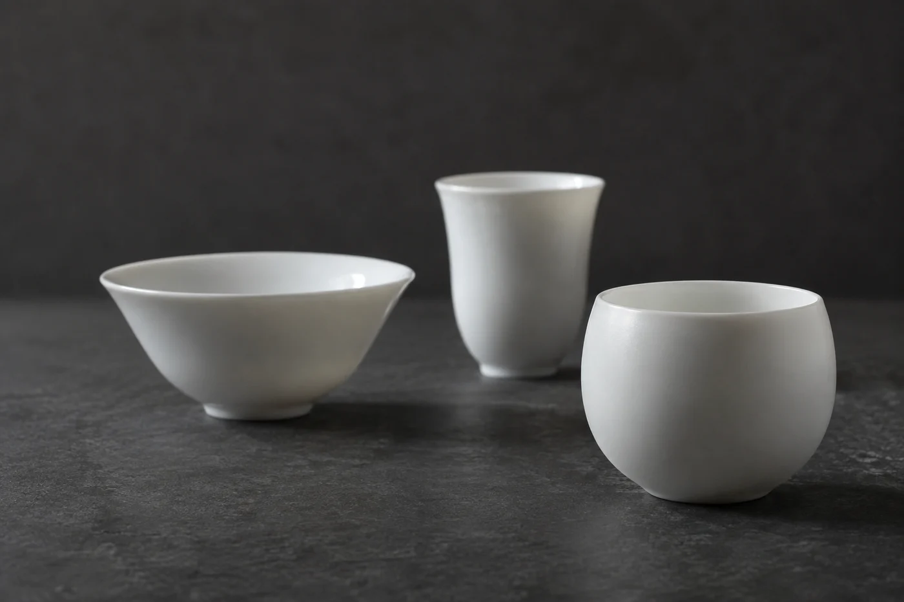
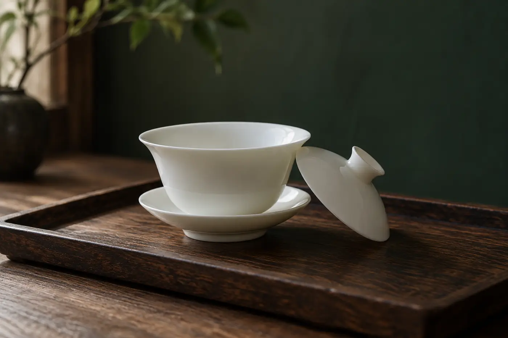

玻璃櫃裏的杯子很安靜，燈打在杯沿上，一圈細細的亮。它看起來像從來沒有裝過水。

可它曾經被人握過，喝過。我在博物館看茶杯，總先想想那隻手。

所以我不急着看標籤。我先看它怎樣被拿起，再看它盛的是甚麼，旁邊又放着甚麼器物。杯沿的薄厚、足底的高低、容量的大小，都和使用的方式有關。由這幾處入手，一隻杯會比單看釉色和年代有趣得多。

我的次序是先看杯沿，再看杯身的弧度，最後看足底。

杯沿關係到入口的感覺。一般來說，沿薄的杯入口輕盈；沿厚的較穩重，也比較不容易燙嘴。不過各器有各器的取捨，不能一概而論。杯身是直的、斂的還是敞的，會影響香氣怎樣聚散，也影響茶涼得快慢。

足底最常被略過。足圈高，拿起時指頭有地方夾住；足圈矮而寬，放在桌上很穩，卻不易抓。有些杯底有款識或記號，展板若有說明，可以留意一下，但款識怎樣解讀是專家的功夫，我們看個大概就好。

## 大杯小杯，別急着下定論

容量大的，可能是一口氣喝完的用法，也可能是共用，或者盛別的飲品。容量小的，多半是細品，一次倒一點，喝完再續。

古器的用途卻不是每次都一目了然。同一種形制，在不同年代、不同地區，用法可能不一樣。展板上寫「推測」「或作」，就是在提醒我們，這是專家的判斷，並非定論。

我很少一見小杯就說是喝茶的，一見大杯就說是喝酒的。器物的名稱與用途，要有出土環境或文獻佐證，單憑今天的印象，很容易看走眼。

我自己的習慣是先猜，再讀展板，再回頭看一次。看看自己的想法和資料差在哪裏。猜錯不要緊，差的那一點，往往就是學到東西的地方。一件小物件，也因此在眼前多停留一陣。

香港有專門收藏茶具的博物館，展示中國茶器與飲茶文化的發展，是認識這方面的好地方。出發前先查館方最新的展覽和開放安排；到了現場，以展覽資料為準。古人怎樣用這件器物，未必和我們現在一樣，別把今天的用法直接套上去。

看完杯，也看看它旁邊同時展出的東西，壺、托、蓋，想想它們怎樣配合着用。茶器是一套東西，只看一件，等於只看了一半。

蓋碗就是好例子。蓋可以撥茶、聚香，碗盛茶，托承熱，也方便端起。三件各有任務，少了一件，用法就變了。

拍照和記筆記，要守館內規定。有些展廳不准拍照，有些不准用閃光燈，看現場的標示。我不會把展板全拍下來，只在本子上畫一條杯口的輪廓，記一個新學的詞，或者寫一個回家想查的問題。帶回去的少，記得反而牢。

帶小朋友去，可以給他一個簡單的任務：找出最薄的杯、最小的杯、杯底最特別的那一隻，每隻說一個理由。比起要他背年代，這樣他會看得久一點。

回到家，拿起自己常用的茶杯多看一眼。杯沿厚不厚，握起來穩不穩，足底高不高。倒一口水試試，感覺杯口怎樣影響入口。看過宋人的杯，再回來看自己那隻，很多細節才浮出來。器物隔着玻璃，手感卻是可以帶回家的。
