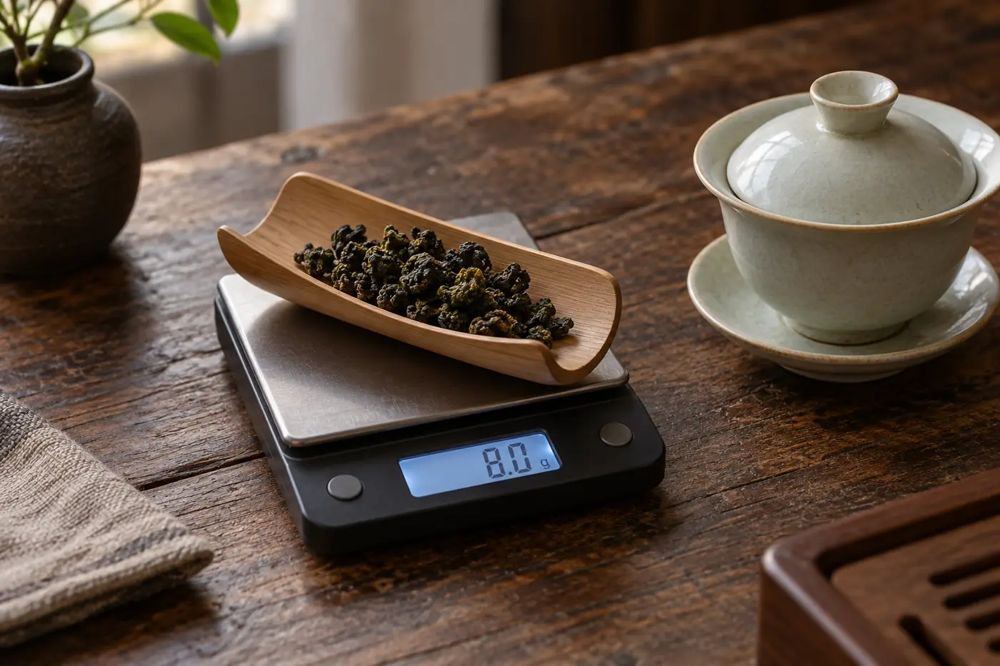
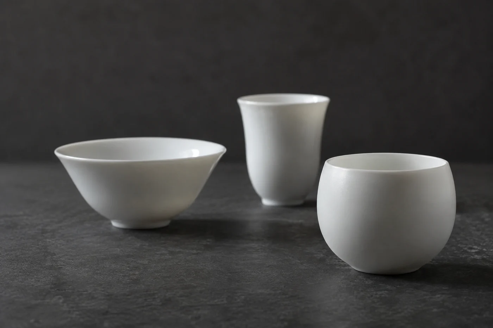

「樣樣都改了，怎麼還是不好喝？」

這句話在課堂上很常聽到。茶湯入口，舌面一緊，很多人的反應是把所有條件一起換掉：水放涼，茶減半，時間縮短，連杯子也換一隻。第二泡果然淡了，卻未必好喝。剛才到底哪一步出了錯，依然是個謎。

我的做法是，下一泡只改一個條件，通常先從縮短浸泡時間或減少茶量開始。一次動三四樣，就算變好了，也不知道是哪一樣起作用；變差了，更不知道該從哪裏退回去。

## 先弄清楚是澀還是苦

兩者常被說成一件事，分開來看，調整會順手得多。澀是收斂，像吃了未熟的柿子，舌面和口腔內側發緊、發乾。苦是一種味道，停在舌根，有時回甘得很快。茶裏兩樣常常一起出現，但成因和處理未必一樣。

一般來說，浸泡過久、茶量過多、水溫太高，三項都可能令澀感和苦味一併加重。茶本身也有分別。較新的生普洱、部分綠茶，本來就帶一點收斂；也有些澀與茶青老嫩、製作方式有關，不一定是你泡壞了。

要改，先得知道從哪裏改起。我會請人把上一泡的條件寫下：大約用了多少茶、多少水、泡了多久。記不清也沒關係，下一次定一個容易重複的做法，由那裏開始就好。

「太澀」兩個字也要說得具體一點。是一入口就緊，還是喝下去之後喉嚨才覺得乾？前者多半與浸泡過久或茶量過多有關；後者就要多觀察幾次，才好判斷。

## 我先動時間

最容易着手的是浸泡時間。香氣還好，只是難入口，就先縮短時間，看滋味能不能保留。茶湯本來就濃得厲害，才考慮少放一點茶。水溫和器具，這時暫且不碰。

縮短多少，我習慣一次減三四成。原本泡四十秒的，改成二十五到三十秒。改得太少，看不出差別；改得太多，又淡得無從比較。

我的次序一向是：先看浸泡時間，再看茶量，水溫放到最後才動。時間最容易控制，也最容易重複。水溫牽涉器具和環境，變數多，一動就連帶別的東西也跟着變。

同一款茶連續兩三次都偏澀，就要回頭想想，會不會是茶本身的特性。有些茶天生帶收斂感，這時用較短的時間、分次出湯，往往比減少茶量更見效。

## 比較的時候要公平

改完一泡，總想跟上一泡比一比。兩杯要在相近的溫度下喝。一杯熱、一杯涼直接對照，很容易把溫度的差別當成茶的差別。

有條件的話，用同樣的杯子裝，兩杯茶量也一樣，這樣才比得出味道。連續喝幾杯之後口腔會累，中間喝一口清水，停一停再嚐。同一款茶也別在一個下午泡三四次來比，澀感會累積，嚐到後面已經不可靠，隔天再試更準。

每次的記錄寫成一行就夠，例如「五克、九十度、三十秒，偏澀」。四五次下來，哪一項的變化最明顯，紙上看得一清二楚，比腦裏的印象可靠得多。

有些茶，怎麼調都不是自己喜歡的味道。這很平常，記下來就好，不必當成自己學藝不精。沖泡能做的，是替一款茶找到合適的表現，沒辦法叫每一款茶都變成同一種滋味。

若澀得特別異常，喝完胃部不舒服，或者茶葉本身有發霉、異味，就不要勉強，換一份茶再試。
