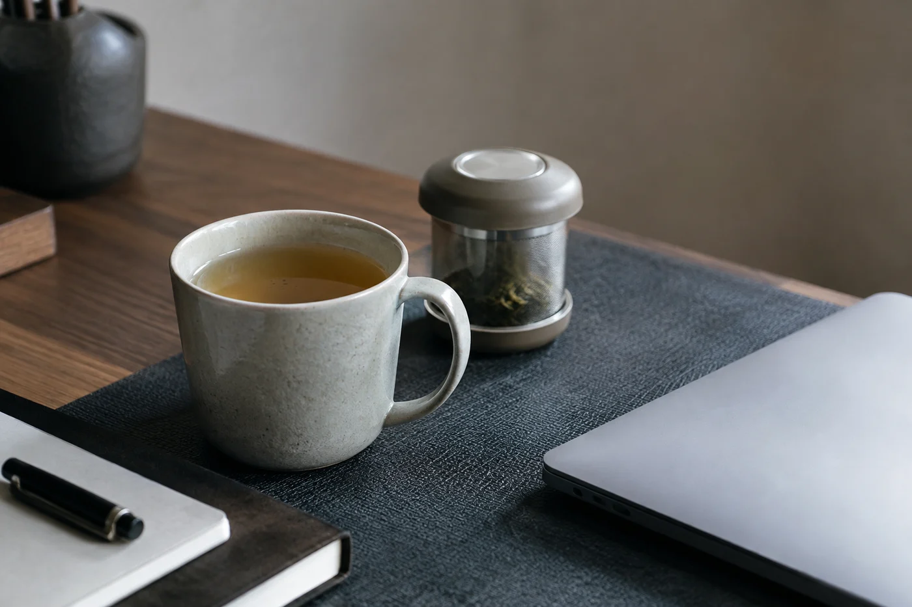
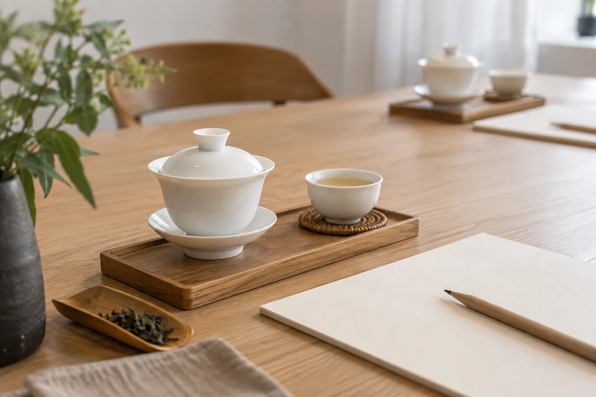

我以前也是這樣。新茶一到，每一包都想剪開聞一聞，試一泡。

幾星期後拉開櫃門，裏面躺着一排半開的袋子，夾鏈有的扣了，有的沒扣。選擇多了，真正喝進口的卻沒有多。

後來我改了做法：新茶一次只開一兩包，喝完再開下一包。

每開一包，就多一包要照顧。袋口要封好，要記得喝，要趕在它走味前喝完。同時開五六包，每包每天只輪到一點點，結果是五六包都放得很久。

開封的那一刻，倒數就開始了。茶的香氣是揮發性的東西，袋一開就走；每開一次袋，整包茶就跟外面的空氣換一次，氧氣把香氣和鮮爽一點一點帶走。清香的茶變得快，個把月就見分別；焙火足、緊壓的茶慢一些，可是沒有哪一種開了可以不理。

茶行裏看得最清楚。舖面那幾罐茶天天開合，賣得慢的那款，兩個月後老闆自己也不賣了，拿去退或留着自己喝。他們的茶不是放壞的，是開壞的。

## 兩處地方

我把茶分在兩處：「正在喝」和「未開封」。

正在喝的，只放少量常用的款式，擺在順手的地方。未開封的，按包裝要求好好保存，不要隨手拆。正在喝那一格放兩三款，已經很多，要看你一星期泡幾次。

想比較幾款新茶，取一點茶樣就夠，不必把大包逐一拆開。每款三五克，夠泡一兩次。放在白瓷碟上並排看乾茶，也聞得出分別。

常和朋友分享的，可以預先分裝，但要用乾淨乾燥的容器，寫上茶名等資料。分得愈來愈細，到最後連自己也認不出哪包是哪包。

## 一款茶要連續喝

要慢慢品的茶，我喜歡集中在幾天內連續泡同一款。每次只稍稍改一點水溫或茶量，看它怎樣反應。茶多放兩克，水溫降幾度，酸、澀、甜的比例都會移動，這種移動要連續喝才感覺得到。

一包茶喝到這個程度，才算認識了它。同時開着五六款，很難有這份專注。像買書，一次買十本，每本讀幾頁，最後一本也讀不完。

也有例外。要比較同一類茶，例如同是烏龍、產區不同，一次開兩三包是合理的。前提是預先分好分量，當天或一星期內喝完，各自封好。容易出問題的，是沒有目的、沒有計劃地一次開很多款。

## 已經開了一堆

先停手，別再開新的。

把半開的茶按新舊排個次序，開封最久、最容易變的先喝。喝不完的分給朋友，附上開封日期。其餘袋口重新封好，集中放在同一處，不要東一包西一包。

隔一段時間，看看各款還剩多少。哪些是真心喜歡，哪些只是當時好奇，餘量會告訴你。

有時我們並不是真想喝很多款，只是想知道「還有甚麼」。這份好奇，用茶樣滿足就夠了。樣品量少，一兩次喝完，不會留下負擔。

喝完一包熟悉的茶，櫃裏空出一個位置，再迎下一款。今晚，就先把桌上半開那包泡完。
