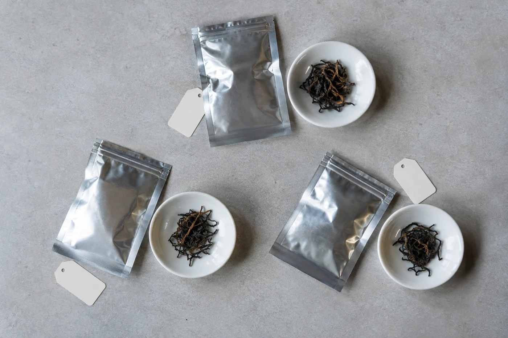
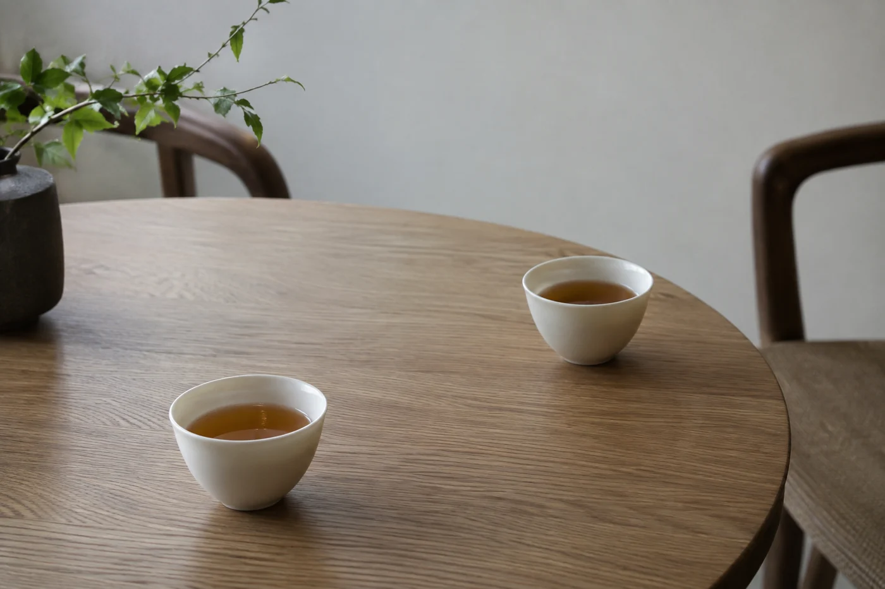

我以前也有這個習慣。一包喜歡的茶，捨不得開，心想留給客人，或者等一個像樣的日子。每次打開櫃門看見它，都說一聲改天再喝。

改天一直沒有來。終於拆開的時候，香氣已經不如記憶中那麼清楚。

從那以後，我對學生說的話就簡單了：好茶不必留到客人來或節日才開。一款茶最好的去處，是被人高高興興地泡來喝，普通的一天也值得。

不用每次都開最貴的。從家裏挑一款你一直想再喝的，留一段可以專心的時間，器具洗好，水備妥，然後泡開。珍惜一款茶，不一定是繼續收着，讓它進杯裏也是。

如果每次看見它，心裏都想着「改天再喝」，那改天往往就是今天。尤其是開了封的茶，每多放一個月，香氣就散一點。

茶葉放太久，保存得再好，香氣也會慢慢散。變化最明顯的是綠茶、清香型的烏龍和輕發酵的白茶：新鮮的清香淡了，味道變平，甚至帶出一股陳舊的氣味。紅茶、熟普、焙火較重的烏龍相對耐放，但開封之後，吸味、受潮的風險同樣存在。

茶放得越久越好，是一個迷思。只有部分茶類，例如普洱，在合適的條件下會隨年份轉化，風味因此改變，這是另一回事，也不代表開了封的綠茶可以放兩年。每種茶的保存期，看包裝上的說明；不確定，就向賣家問清楚。

## 分量大的，分小包收

我也不是說所有茶都要馬上喝完。分量大的，可以分成小包，每次取一份，其餘密封收好。這樣常常喝得到，也不會因為開封太久而走味。

存放的原則是密封、避光、避潮、避味。茶罐不要放在廚房爐邊，也不要和香料、肥皂放在一起。取茶用乾燥的茶匙，手有濕氣，先抹乾。這幾點做好，開封後的茶才撐得過幾個月。

泡的時候，按包裝或賣家建議的茶量與水溫起步，不要憑感覺亂放。稱一稱茶葉，水燒開後視茶類降溫，第一泡的時間寧短勿長。喝完再按口味微調：覺得苦澀，下次少放茶或縮短時間；覺得太淡，就多放一點茶，或多等十來秒。

好茶泡壞，多半壞在太急。普通日子沒有客人在旁邊等，反而最適合慢慢練。

杯端起來，只留意今天的香氣和濃淡，哪裏舒服，哪裏想調整。就算沒有想像中驚艷，也不用替當初的購買辯護，下次改喝別款便是。一款茶合不合口味，和價錢高低並不直接掛鈎。買茶最實在的標準，是自己喝得開心、喝得下去。

客人來了，當然可以泡好茶。只是不必特意等客人，才捨得拿出來。常喝的茶，慢慢會和生活連在一起，某個午後，一次朋友來訪，一段安靜的閱讀。

今晚有空的話，把櫃裏那包放了很久的茶找出來，先看看日期，再燒水。
