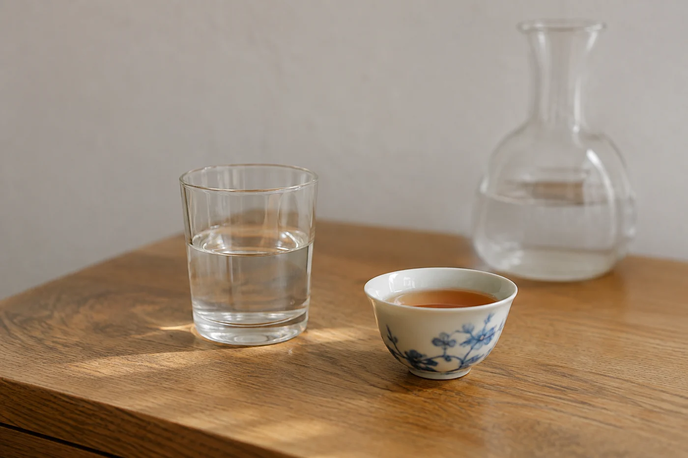

茶湯剛倒進杯，窗光斜斜落在杯沿，湯面還浮着一圈細泡。這時候，手很自然會伸去拿手機。

我也會拍，只是動手之前，有幾件小事我習慣先做。原則不多：用自然而穩定的光，少用改變顏色的濾鏡，先顧安全和客人，再按自己的喜好構圖。照片好看固然好，若能如實顯示器物與茶湯的樣子，日後翻看才有用。

先把桌上的水抹乾，器具放穩，揀一個不妨礙客人的角度。別為了拍一道水線，把熱水壺舉得老高；也不要讓客人拿着燙手的杯子，等你慢慢構圖。大家是來相聚的，照片排在後面。

想拍倒茶的一瞬，可以先倒一次，記住水柱的位置與角度，再請助手幫忙，或者自己騰出另一隻手按快門。一手拿壺、一手拿手機最危險，壺嘴滴水或者手一滑，都容易出事。真的想自己一個人拍，就把手機靠着一個杯或一本書立好，用倒數計時，比單手硬撐穩得多。

## 窗邊的光最好用

光從窗邊來，最合用。讓它從側面或斜側面照進來，不要讓太陽直射在杯上。直射的光會令湯面反光、茶色發白，影子也太硬。陰天，或者隔着一層薄窗簾的柔光，最容易拍出真實的茶色。

晚上就不同了。室內的暖黃燈會令湯色偏黃偏橙，白瓷也變成米色。這不是照片出錯，是光源本身的顏色。想比較湯色，盡量在同一種光下拍，拍到一半別開關燈，也別移位置。天花燈直射下來，杯裏會多一圈光斑；把手機稍微偏一個角度，光斑就走了。

修圖要有分寸。調一點亮度和對比，讓照片接近眼睛所見，沒有問題；用濾鏡把紅茶拍成橙色、把綠茶拍成黃色，照片就失去記錄的作用。手機的美食模式或美顏功能，常常自動把顏色加強，記錄用的照片最好關掉。要比較湯色深淺，杯後放一張白紙當背景，比什麼濾鏡都準。

若想用照片比較不同的茶，背景、杯子和光線要盡量接近。杯子最好用同款白瓷，背景用素色，拍攝的距離與角度也一樣。不然畫面裏的深淺，可能只是光線造成，未必真是茶湯的差別。手機靠近杯身，鏡頭會把近處放大，湯色看起來濃；退後兩步再放大畫面，比例就正常得多。

我會順手在筆記寫下茶名、水溫、茶量和浸泡時間。照片配上筆記，日後對照，比單看照片可靠得多。

茶席的好看，常常在留白。器物不用擺滿，幾件主要的東西之間留一點空位，畫面就鬆動。俯拍看整體佈局，平拍看杯子與湯色，兩種各拍一張就夠，用不着拍幾十張再挑。桌上若有花或小擺設，宜矮宜淡，別搶了茶的位置。雜物在拍之前移開，比拍完再修容易得多。

杯沿的茶漬、杯底的水珠、桌面的一點茶渣，肉眼不覺得，相片一放大就很顯眼。拍之前用乾淨的茶巾輕輕抹一下。熱茶有蒸氣，鏡頭靠得太近，水氣會令畫面發霧，退後一點，或等蒸氣散一散。

開頭說的那圈細泡，急不來。靜待幾秒，泡沫自己聚到杯邊，湯面就乾淨得多。這幾秒，剛好讓客人先聞一聞香。
客人見我舉起手機，問：「要不要等一等？」

「等。泡沫散了才拍。」

照片裏有人的話，公開分享前先問對方願不願意。寫活動的日期與地點，就據實寫，不要為了畫面動人，替一張普通的茶席加上並不存在的故事。用的是插畫，也應該說明那是插畫。

拍好了，我就把手機放下，回到杯子前。照片隨時可以再拍，茶要趁熱喝。
