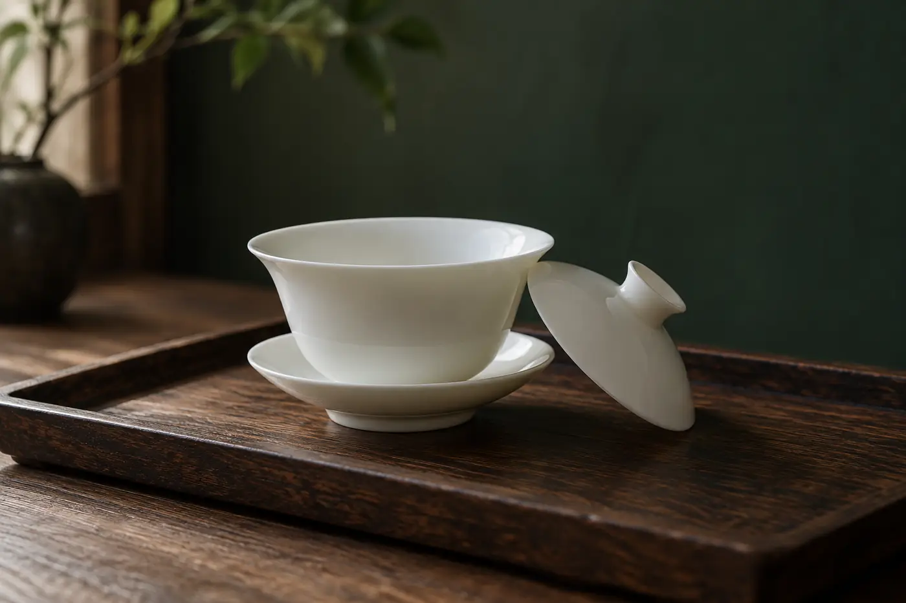

蓋子一斜，水從縫邊淌出來，沿着手指流到茶盤上。

課堂上第一次拿蓋碗的人，很多都會這樣。手指忙着記位置，眼睛盯着出水，心裏又怕燙，幾件事一齊來，動作自然僵硬。這不是笨，是同時要顧的東西太多。

所以我讓初學的人先用清水練出湯。沒有燙手的擔心，也不用理會茶湯濃淡，手勢的毛病才看得清楚。練穩了，再換熱水。

桌上放幾樣東西就夠：一隻蓋碗，一個公道杯，沒有的話用其他容器代替，一壺清水，一條茶巾。桌面放個茶盤或托盤接水。

水注到約七分滿就夠。注得太滿，反而更容易灑。

坐的位置也要試一試。椅子的高度，要讓手肘自然放在桌面上，肩膀是鬆的。桌面太高，就得提着肩膀倒水，很快會累，動作也跟着變形。

我會請人把整個動作拆開練：拿起，移動，倒出，放回原位。

拿法是拇指和中指捏住碗沿兩側，食指輕按蓋鈕，蓋子留一道小縫，讓水流出，同時擋住茶葉。這是蓋碗最常見的拿法。若總覺得不穩，可以請老師看看你的手指位置。

倒的時候，看看手腕有沒有扭到不舒服的角度，公道杯是不是放得太遠，蓋子的縫夠不夠出水。每次倒完，低頭看桌面。水跡落在哪個位置，就知道問題出在哪一步。

## 水跡會告訴你哪裏錯

最常見是滴水。多半是倒完之後收得太慢，或者碗沿離公道杯太遠。把兩者拉近，在最後一刻把碗稍為往上一提再收，滴水會少很多。

手指發燙，清水階段不會出現，換成熱水才發現。通常是捏的位置太低，貼近了碗身。所以在清水階段就要養成捏碗沿的習慣，到了熱水才不會慌。

蓋子掉下來，是食指沒有壓住蓋鈕，或者倒得太斜。傾斜的角度，夠出水就好，不要超過需要。

改的時候，一次只改一處。總是滴水，就先看角度和收水那一刻；握得很緊，可能是碗太大，或者指頭放的位置不合適。光叫自己「放鬆」沒有用，要找出令手真正放得鬆的條件。一次改一樣，才知道是哪一改見效。

清水還有一個好處：可以放心重來。倒灑了，抹乾再練，茶葉的損失微不足道。初學的人很需要這份可以失敗的餘地。

## 換熱水，要一步一步來

清水練熟，不等於已經過關。清水幫你熟悉器具，卻代替不了熱水，溫度帶來的感覺要認真面對。轉用溫水、熱水的時候，最好有老師在旁，或者自己確實有把握。

我會先用不燙手的熱水，確定手勢沒有走樣，再逐步加熱。蓋碗受熱之後，碗沿和蓋子都會變燙，要先養成習慣，捏最不燙的位置。用熱水的時候，旁邊不要有小孩或寵物走過。

同一個簡單動作，重複幾遍，手會慢慢認得路。到真正泡茶那天，你便有餘力看葉片、聽水聲，不必把全副心思用來守住一隻碗。
