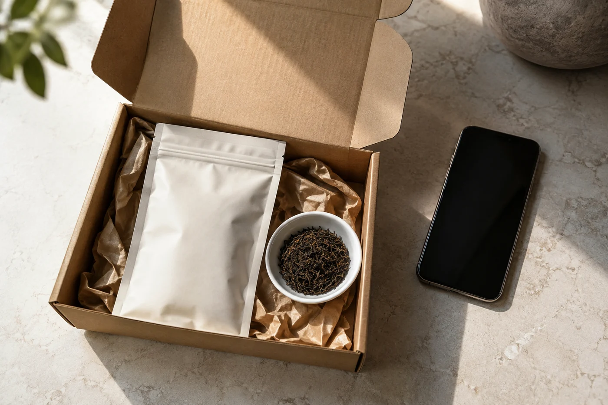
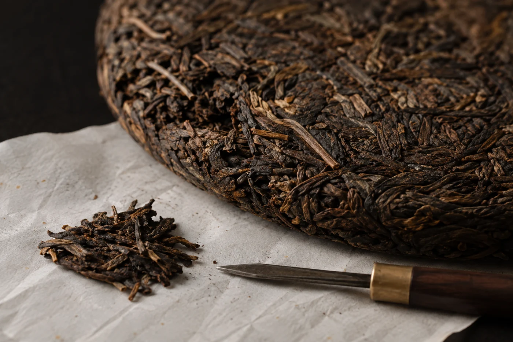

「人家送的，一直不敢拆。」

課堂上常有人這樣說，語氣有點不好意思，好像辜負了誰。我聽了，多半會問一句：你家裏有沒有拆茶的工具？答案通常是沒有。

這就是問題所在。對方家裏只有一隻大杯，收到的卻是一餅壓得很緊的茶，又沒有工具可拆，心意再好，也多半先被放回櫃裏。所以送普洱，我會先想收禮的人平日怎樣喝茶，再決定送甚麼。價錢和包裝，放在後面。

我只想他喝不喝普洱、平日用甚麼器具、喜歡濃還是淡。

不熟悉普洱的人，口味接受度不一。生茶較有收斂感，熟茶較圓潤。平日愛喝奶茶或較濃飲品的朋友，熟茶多半容易入口；喜歡清淡綠茶的，可以試試年輕的生茶，或者乾脆換一類茶。送不喝普洱的人一餅普洱，再附一句「你慢慢學」，通常也不會拆。

還要想想對方有沒有地方放。住所小、沒有茶櫃的人，收到一整餅，甚至一提七餅，其實是負擔。

拿不準對方喜歡甚麼，我會用幾款小份茶樣代替一整餅，讓他慢慢找自己喜歡的。每款十數克，夠沖兩三次就好，附上標籤，不必用盒子裝得很隆重。

日常容易取用的包裝，打開就能泡，對方才會真的喝。要送整餅的話，記得附上拆茶的工具和簡單用法，並告訴對方一次只拆一點。

包裝簡單乾淨就好。紙盒或布袋，加一個密封小袋。茶本身要乾爽，沒有異味。

緊壓茶存放時，不要用塑膠袋緊緊封死，也別留在悶熱的車廂或陽光下。送出之前，先確定茶沒有受潮，包裝完整。開過一半的茶餅不要送，除非你清楚說明，並且已經重新妥善包好。

## 卡片上寫怎樣開始

隨茶附一張簡單的卡片：茶名，類型是生茶還是熟茶，製造或購買的大概時間，在哪裏買，再加沖泡建議。茶量、水溫、泡多久，各寫一個範圍就夠。產品原有的標示也要保留。

字不用寫得誇張。清楚交代怎樣開始，比「極品珍藏」四個字有用得多。

## 有幾件事我會特別小心

送的是自己拆分出來的茶，先做好清潔和分裝，用乾淨乾燥的容器，並如實說明來源。不要把散裝的茶塞進來歷不明的舊盒子，也不要替它添上一個無法核實的年份。

送給長輩或有健康考慮的人，卡片上不寫「養生」「降脂」這類字眼。茶是飲品，不是藥，每個人的反應也不同。對方若在懷孕、服藥，或對咖啡因敏感，送茶時順帶提醒他按自己的情況調整分量。

商務場合送禮，留意對方公司有沒有收禮的規定。這種時候，小份而包裝得體的茶樣，反而比貴重的禮盒妥當。

過些日子，我會問一句：「那款茶喝得習慣嗎？」聽到真實的回答，再約一次坐下來泡。他口味偏濃還是偏淡，有沒有開始喝，下次送茶時都用得上。

茶給人喝過了，才算送到。
