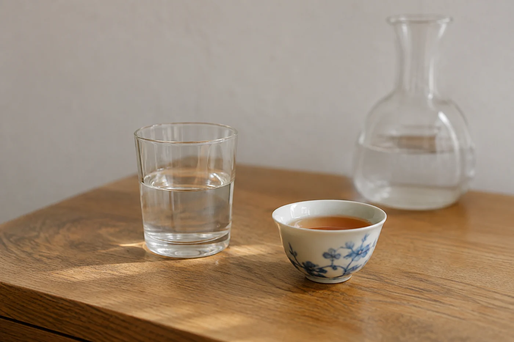

杯子在他手裏轉了半圈，又轉回來，茶已經喝了一半。旁邊的人正說着香氣和回甘，他只是微笑。

茶席上常有這樣的客人。話少，不代表沒有感受，可能正在想怎樣說出口。如果每一輪都點他評一句，這杯茶他很難喝得安心。

我不催。真要問，就問容易答的，例如「濃度舒服嗎」。他說喜歡，或者說不喜歡，都是完整的答案，我不再追問下去。

「這杯濃度舒服嗎」比「你喝出哪個山頭」容易回應得多。前一條人人答得到，後一條像在考試。而茶席上最掃興的，是有人發現自己正在被考。

## 一句評語的重量

我自己也做過那種客人。二十年前第一次去別人的茶席，主人家每斟一杯就望着我，等我說出點甚麼。我記得那晚喝了六款茶，回家只記得自己很緊張，一款都想不起來。

所以現在我不點名。二選一的問法最好用：「比上一杯濃還是淡？」「熱的好，還是放涼一點？」對方點個頭、指一指，就算參與了。也可以問和生活有關的：「有沒有像你以前喝過的甚麼？」答案準不準確不重要，要不要說下去，由他自己選。

大家談起各自的感受，我會先聽完才接話。有人說這杯像木頭，我不急着把它糾正成某個專業香名，反問一句「是哪一種木頭」，讓他從生活記憶裏自己去找。字眼慢慢長出來，比馬上套上漂亮術語踏實。

分茶和座位也要留心，別讓最活躍的幾位自然把注意力全佔了。清水、茶杯、茶的資料，我放在每個人都拿得到的位置，參與的方式就不只剩開口一種。

桌上放一本小筆記和一支筆，想記下茶名或感受的，隨手就能寫。願意寫的人，往往比願意說的人記得更仔細，那幾行字也是他的參與。

話題告一段落，我可以轉向另一邊，問一句「剛才你有沒有同樣感覺」，把機會遞過去，等他自己開口。對方仍然不想說，就順着換話題，不要堅持。

## 看得出來，也看不出來

客人自不自在，有些跡象。肩膀放鬆，杯子在手裏轉來轉去，會主動添水，多半是自在的。若他一直看手機，把杯子放得遠遠的，或者頻頻看時間，可能是想早點結束。這時追問沒有用，換一個節奏就好：縮短每輪的講解，或者提議一起喝一泡淡茶，談談別的。

有些人需要一點時間熱身。第一泡沉默，到第三泡才開口，是常見的事。茶喝到後面，話題自然多起來，前面急着開口，反而打斷。

也有看錯的時候。我以為悶坐了一晚的那位先生，散席時在門口叫住我。

「剛才第三款，是甚麼茶？」他問，「我想買一餅。」

原來他整晚在心裏比較。那杯茶他喝得很投入，只是沒有說出來。

有時話少的是主人自己。這也沒問題，茶席本來就容許安靜，泡茶的動作、水聲和茶香，已經把空檔填滿。主人若緊張，就把注意力放在手上的步驟，客人看見從容的動作，也跟着放鬆。

安靜的客人，很多時只是在享受當下，並不代表不開心。茶聚散了，他也許只說一句「下次再來」。有些愉快不會變成評語，會變成願意再來。
