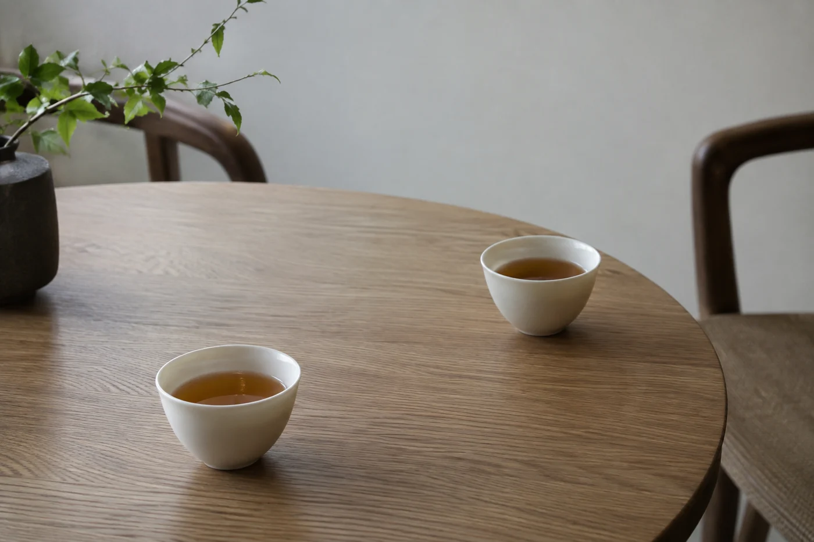

回南天一來，牆身冒汗，玻璃起霧，連茶巾都乾不透。這種日子最想泡一杯熱茶，也最要替茶葉多想一步。

我會先做兩件很實際的事。濕傘放遠，不讓它靠近茶葉；窗關好，桌面擦乾。茶葉怕潮，雨天正是它最容易出事的時候。

至於窗外的雨，不必急着替它找一句漂亮的話。坐下來就好。

乾茶的水分很低，空氣一潮，茶葉就容易吸濕，香氣轉悶，嚴重的會發霉。香港的回南天、梅雨季，相對濕度長期在八九十徘徊，牆、地板、木櫃都出水，這段日子開罐取茶，次數要比平常更節制。

有一件事反直覺：回南天開窗通風，多數時候於事無補，外面的濕氣比屋裏更重，一開窗牆身出汗更快。我寧願關窗，開抽濕機，把櫃門關好，等濕度回落再開窗透氣。家中沒有抽濕機，就用密封箱加食品用的乾燥劑，效果也不錯。

茶罐放在離窗、離門、離濕傘最遠的位置，用完立刻蓋好，不要讓它在潮濕的空氣裏敞着。取茶用乾燥的茶匙，手上的水氣別沾到茶葉。
家人拎着濕傘進門。

「放哪裏？」

「玄關。別帶進房間。」

濕傘放在玄關或門邊，傘架下面墊一塊吸水墊，不要帶進茶桌所在的房間。濕衣服也不要掛在存茶的櫃附近。這些水氣慢慢散開，對茶不友善，對書和木器也一樣。

水燒好，我會取平日熟悉的那款，手上不追新方法。天氣濕冷，我喜歡熟普、紅茶或焙火較重的烏龍，湯色暖，喝下去舒服。這只是我的偏好，換成自己喜歡的綠茶也完全可以。

今天可以不比較，也不記錄。茶合口就喝，想淡一點就調，喝夠了就停。學過的東西都還在，放着就好。

天冷，杯也涼得快。我習慣先用熱水燙一下杯再倒茶，湯就沒那麼易涼。茶盤積水、茶巾濕透，要及時處理；木茶盤和竹製茶具長期潮濕，容易發霉變形，用完擦乾，放在通風的地方。茶巾最好兩三條輪替，濕了就換，不然抹完桌子又抹杯，等於把水抹回去。

## 茶受潮了，手和鼻子知道

茶葉變軟，不再脆，捏一下聽不到清脆的聲音；氣味變悶，有霉味或陳舊的酸氣；肉眼看到白色或綠色的霉點。這些都是受潮的信號。

遇到了就不要硬喝。受潮到甚麼程度，肉眼很難判斷，有懷疑寧可小心。只是輕微回潮、沒有異味的，可以泡一小杯試試，有任何異樣就倒掉，猶豫只會讓自己多喝一口。

防潮最簡單的辦法是分裝。小包分好，每包放一次或幾次的量，其餘密封收好，用時才拆，包上寫日期，就能及時喝完。也可以把茶罐放進較大的密封盒，盒內放食品用的乾燥劑，但乾燥劑不要直接碰到茶葉，吸飽了要換，別以為放進去就一勞永逸。

有人同坐，話題離茶遠一點也無妨，窗外的雨，最近看的書，一件還沒想通的小事。茶有時只是讓人肯多坐一會的理由。

雨停的時候，杯多半已經空了。記得把茶罐蓋好，放回原位。
