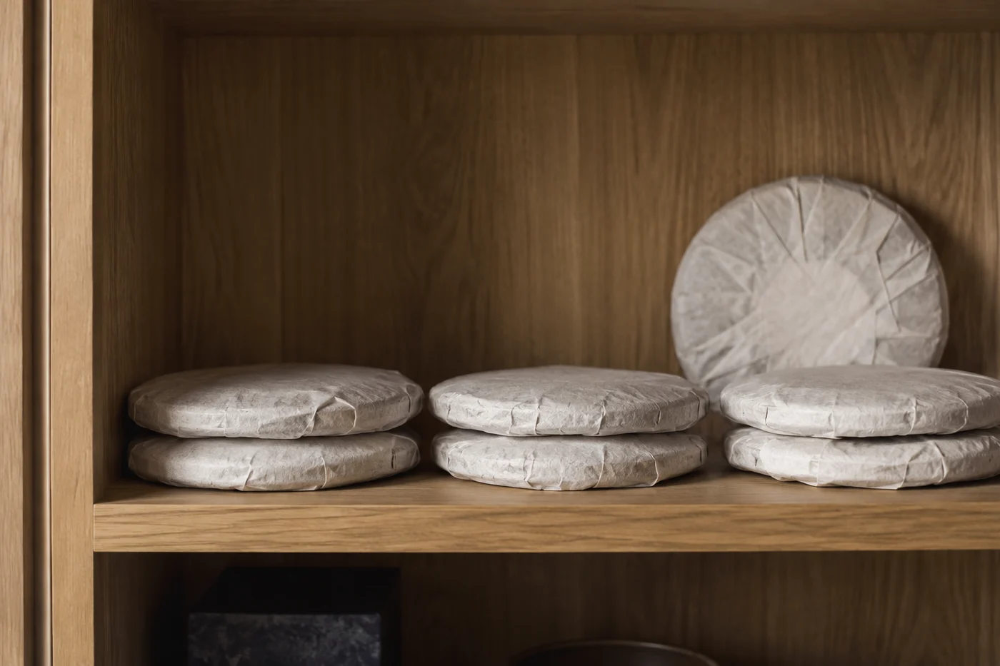

回南天一來，窗玻璃起霧，地磚摸上去濕濕的，像蒙着一層水光。走廊的牆也是，手一按，留下一片印。

這幾天常有人問我，要不要把茶全部搬出來「透氣」。我通常勸他先別動。每打開一次袋，就多放進一點濕氣，搬來搬去，未必有益。

「拿出來吹一吹會不會好一點？」

「外面比櫃裏更濕，別開袋。」

牆之所以出水，是因為牆身溫度比空氣低。又暖又濕的空氣碰到冷牆，水就凝在表面。茶袋貼着牆放，等於貼着一塊不斷滲水的板。靠外牆的櫃子要特別小心，櫃背和牆之間留一點空隙，會好得多。

茶也不宜貼近地面、窗邊，廚房的蒸氣和油煙更要避開。一個乾爽、清潔、沒有強烈氣味的櫃，離地有點高度，不被陽光直射，已經足夠。

## 先看包裝

袋口封妥沒有，包裝有沒有破，都要看。夾鏈要扣實，茶碎不要卡在袋口。鋁箔袋和厚身密封袋，擋濕氣一般比紙袋好。紙袋和竹殼透氣，潮濕天就要靠環境幫忙。

外面可以再加一層。把原袋放進有蓋的金屬罐或硬身盒子，等於多一道屏障，潮濕天效果明顯。罐蓋要緊，罐子本身要乾爽、沒有異味。放乾燥劑的話，必須是食品級，不能和茶直接接觸，也要定期更換，不然它自己反成了濕氣的來源。

家裏有溫濕度計，可以記下環境變化，了解自己屋子哪個季節最潮。但不必追着網上流傳的某個數字，把所有茶都塞進同一種極端環境。

## 餅茶與散茶

餅茶、磚茶、沱茶外面通常有包紙，結構緊，吸濕比散茶慢；可是一旦受潮，裏面也不容易乾。散茶接觸空氣的面積大，更要把袋口封好。

普洱一類本來就容許一定通風。這件事香港人並不陌生：舊日的茶倉，靠的就是高濕和高溫讓茶轉化，轉出來的茶厚、滑、帶陳味，也帶一點倉氣。今天的人多數偏好乾倉，寧願轉得慢，也不要那股味。

所以我不主張全部抽真空，更不主張加濕。中間那條路最難走，也最實在：環境乾淨、穩定、濕度不要長期偏高。綠茶、清香烏龍要保鮮，潮濕季節最好密封，盡快喝完。

## 抽濕抽的是房間

除濕處理的是整個空間，不是茶本身。開抽濕機時，別讓茶被熱風或冷風直接吹到，也不要放在出風口附近。

向茶葉噴水，或者怕太乾而在茶櫃裏放一盆水，這兩樣一定不要做。茶受了潮，往往回不了頭。

也不建議自己在家處理受潮的茶。拿去曬太陽，香氣會散，還可能沾上塵味。用焙籠、烤箱、微波爐去烘，溫度難控制，很容易把茶搞壞。

輕微受潮，例如只是袋口幾粒茶碎發軟，可以先移到乾爽位置，換新包裝封好，再留意氣味有沒有變。若已經發黏、結塊、有霉點或異味，就不要再喝。多沖幾次水、多洗幾次茶，都補救不了。

香港春夏之交，濕度常常很高，這種天氣連續幾天，對存茶的影響未必即時看得出，卻會慢慢積下來。屋裏較潮的，把茶放在離地較高、通風較好的房間，不要放儲物室或近窗角落。高層低層、向北向南，情況差很遠，要按自己屋子的實況判斷。

雨停了，天氣轉好，再逐包看看包裝，聞聞氣味。我都會在標籤上記一筆：某月檢查，無異樣。下一個回南天再翻開，心裏就有個底。
