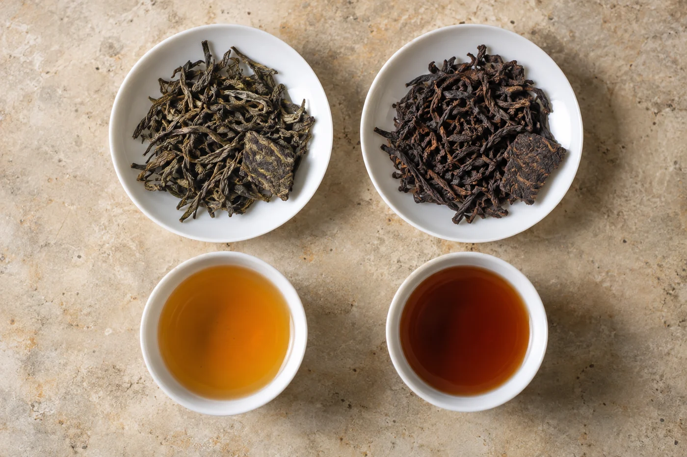

「放了二十年，怎麼還是生茶？」

第一次接觸普洱的人，常這樣問我。語氣有點疑惑，好像那餅茶欠了誰一個交代：放了這麼久，總該「熟」了吧。

這個疑問很普遍，因為「生」字容易令人想到年輕，「熟」字容易想到年老。可是普洱的生與熟，說的是加工方式，跟年紀無關。這裏其實有兩套說法：一套講工藝，一套講時間。混在一起，就會出現一餅「老了卻還沒熟」的茶。

老的生茶，仍然是生茶。熟茶也有剛製成的，和存放多年的。

兩者的原料，都是雲南大葉種茶樹的鮮葉，經殺青、揉捻、曬乾，做成曬青毛茶。到這一步為止，生熟還是同一件東西。

生茶是把毛茶直接壓成餅，或者保持散茶，之後靠存放慢慢轉化。

熟茶在毛茶之後多走一道工序，叫渥堆發酵：把茶葉堆起來，控制水分和溫度，讓它在短時間內轉成較深的色澤、較圓潤的口感，再乾燥、整理。傳統做法堆到幾十厘米高，上面蓋布保濕，中間要翻堆，讓溫度均勻；堆子的溫度和濕度靠人手摸、靠經驗調，太乾發不起來，太濕會壞。行業裏一般認為，這一堆至少要一個多月才成。

所以熟茶並不是放熟了的生茶。它由另一套工藝做出來，分岔的地方在製作，不在歲月。

## 喝起來大概的分別

新製的生茶，香氣較高揚，入口帶收斂感，有些偏苦澀。熟茶湯色紅濃，口感偏圓厚，帶一種陳舊感的氣味，初次接觸的人多半會留意到。那股氣味有人叫棗香、有人叫木香，也有人覺得像舊地窖，第一口不習慣很平常，第二三泡往往順得多。

這只是大概，不是規則。同是生茶，原料和工藝不同，表現可以差很遠；熟茶也有渥堆較輕、較重之分。生茶放了多年，湯色與滋味會往深、往柔和走，但仍然是生茶，和熟茶不是一個路數。

想入門，先向可靠的商家取兩份資料清楚的茶樣，一生一熟，用你平日熟悉的方法沖。先看乾茶和湯色，再聞香，再喝，把兩者的差別記下來。

湯色可以當作線索，但單看一杯茶的深淺，斷定不了它的製法和年份。陳年生茶的湯色，也可以很深。真正可靠的，是包裝與資料上寫的茶類。正規標示會註明生茶或熟茶，有疑問，直接問商家。

先喝哪一種，沒有標準答案。平日愛喝濃一點、暖胃一點的飲品，或者想晚上喝一杯，熟茶比較容易入口。喜歡香氣、不介意稍有收斂感的，可以先試年輕一點的生茶。

不論哪種，第一次都不宜泡得太濃，也不要空腹喝。普洱的刺激性因人而異，喝得不舒服就停下來，不必硬撐。

## 泡法先同一套，再分開調

器具和水溫可以先用同一套，再按茶調整。熟茶一般耐沖，可以用沸水，第一泡多數人會快速沖洗一遍。生茶若覺得苦澀偏重，就略降水溫、縮短出湯時間，茶量也減一點。

同一個蓋碗泡完生茶再泡熟茶，中間要洗。生茶氣味較清，熟茶較重，殘留會互相影響。換茶時用熱水沖淨器具，一個很簡單的習慣。

## 買的時候，先讀懂包裝

山頭不必急着記。先看懂包裝上寫的原料、類型、製造日期和存放資料，不明白的就問。

聽到「生茶放久會變熟茶」，要小心。生茶隨存放會慢慢轉化，但不會變成熟茶的樣子。拿這句話當賣點的商家，說明對兩者並不重視區分。

分清生熟，像在地圖上先認出兩條大路，往後走哪一條，看自己的口味，比別人替你安排的喜好有用。我自己的做法，是兩款茶樣各取一份，週末用同一個蓋碗，分兩天喝完，再決定買哪一種。
