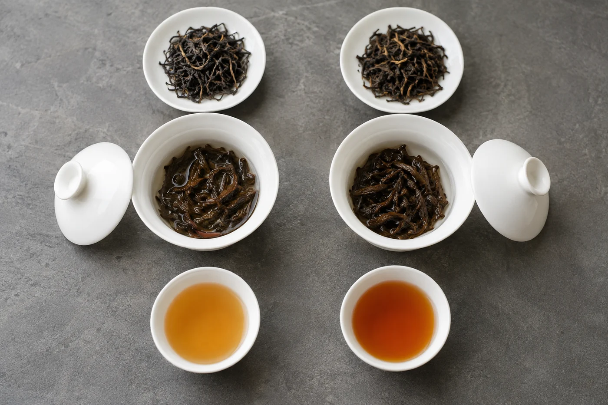
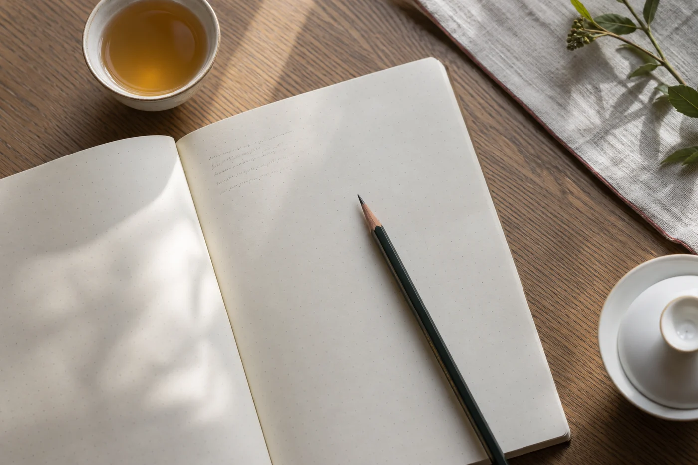

我讀茶書，書邊常有鉛筆畫的小問號。

畫得最多的地方，不是看不懂的段落，反而是最動人的句子旁邊。句子漂亮，說法未必準確。讀到特別打動我的一段，我會停一停，問自己：這是感受，還是事實？

有學生拿着一本書來問，為甚麼書上說的和課堂上不一樣。翻開一看，那是一本散文。很多誤會由此而起：拿散文的句子，當研究的結論。

所以讀茶書，我最先做的是分清它是哪一類。散文借茶談感受，教材教你辨認和操作，研究在限定的條件下查證。三種都有用處，只是各自回答的問題不同。

寫得好的茶散文，會讓人想起故鄉，想起某個下午，它的力量在感受。這是長處。遇到具體的說法，例如茶葉含甚麼成分、某個歷史事件在哪一年、喝茶對身體有甚麼好處，句子再動聽，也要另找可靠的資料核實。

教材的優點是有系統，把製法、分類和沖泡方法整理成可以學的次序，適合入門。但教材為了清晰，常常要簡化，例外和爭議往往被略去。讀完覺得一切分明，碰到現實裏的茶卻對不上，這很正常。

研究文章剛好相反，說得窄而準，往往只談某一種茶、某一個條件下的結果。讀的時候，別把一份研究的結論套到所有茶上，也別因為研究提到某種成分，就推論喝茶有甚麼確定的功效。茶與健康的關係因人而異，不能當藥。

網上文章最難分辨，作者、年份、依據，常常一樣都找不到。我讀網文先看作者是誰，有沒有交代說法的出處，有沒有寫日期。一樣都沒有，只當作參考，不當作根據。

同一個說法被許多網站重複，也不代表它是真的，很可能只是互相抄寫。要查證，就找兩份彼此獨立的資料，例如一本正式出版的教材，加一份研究文章，兩邊都支持，才算穩當。

## 古書和名詞，都要回到原處

「古書上有寫」，也不一定就可以相信。古籍是珍貴的材料，但古人也會抄錯、聽錯，或記下當時的傳說；後人引用時，又常常只取一句，離開了上下文。看到「某書記載」，我會先找原文看前後的意思，再看有沒有學者的整理或解釋，不直接信轉述。

專業名詞也一樣。不同年代和地區，用語可能不同，同一個詞，作者也可能另有所指。先看他怎樣界定，再拿其他資料比較。斷章取一句，常常代表不了整篇的意思。頁碼和出處隨手記下，日後回查方便很多。

兩份資料說法打架，很常見，不必慌。先看兩份談的是不是同一件事，同一個「發酵」，在製茶與在微生物的意思就不同。再看它們各自的條件與年代。若確實衝突，我會把兩種說法都記下，註明來源，暫時不下結論，等有第三份可靠的資料再判斷。

這和品茶很像。兩款並排喝，差別才浮出來；只喝一款，很難說得出它的特點。資料放在一起讀，哪一份站得穩，也就看得出。

## 抄一點，再用自己的話寫一遍

喜歡的句子可以摘錄少量，旁邊寫下自己為甚麼被打動。要公開分享，就保留作者與來源，也注意引用的分量。

另外，我會試着用自己的話把讀到的東西再寫一遍。寫不順的地方，往往就是還沒完全搞清楚的地方。補回去，理解會牢固得多。

那些小問號，查過之後，有些我擦掉了，有些一直留着。留着的那幾個，提醒我那一頁還要再讀。
