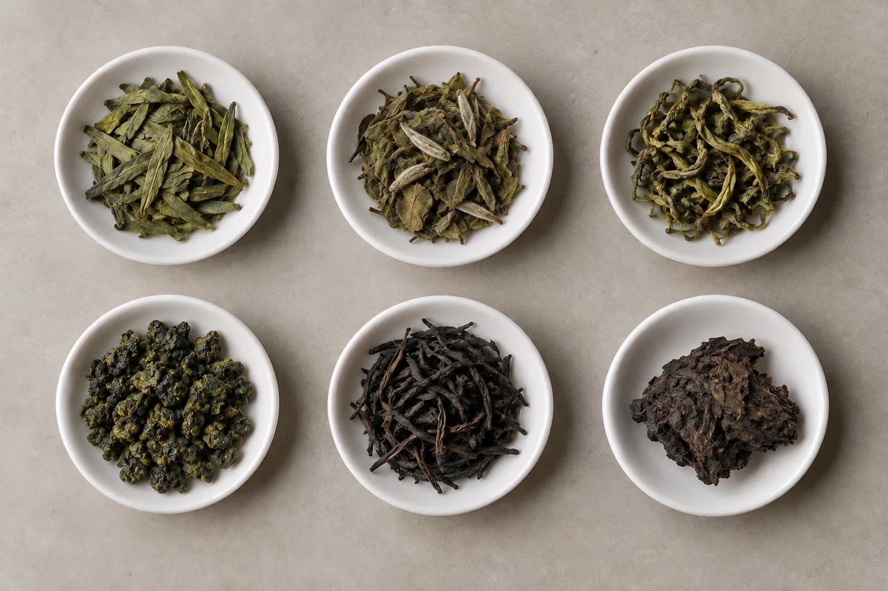

碟上那片葉的邊緣泛着一圈紅，葉心卻還是綠的。剛才捲成一粒的烏龍，泡過幾回，現在整片攤開，連葉脈都看得見。

這就是葉底，沖泡後舒展開的茶葉。很多人喝完便倒掉，我會先把它倒在白碟上，輕輕撥開看一看。捲着時藏起來的邊緣、葉脈和梗，熱水一泡，全露了出來。

「這片邊緣紅了，是不是壞了？」

「是搖青留下的。烏龍本來這樣。」

我習慣在茶味轉淡、準備收茶的時候看。這時葉片已經完全舒展，也不會太燙。墊底用白碟、白瓷茶盤或者一張白紙，顏色最易看清。光線最好是自然光。黃色的燈光會令葉色偏暖，綠與黃就分不太出來。

## 那圈紅是怎樣來的

烏龍的葉底常見葉緣帶紅、葉心偏綠。這是做青時搖青、靜置交替，葉片邊緣受損氧化，中間還保着綠。紅邊佔多少，大約就看出這批茶發酵到哪一步：紅邊少，偏清香；紅邊多而連片，走向熟香、焙火的路。

所以葉底不是好看不好看，是工藝留下的帳。看懂了，同一款茶下次再喝，你會知道自己在喝哪一種取向。

其他茶類也有大致的傾向：綠茶葉底多是綠色或黃綠，比較鮮明；紅茶偏紅褐；熟普洱和陳年茶顏色較深，質地也較軟。這些只是概括，原料和工藝不同，差異可以很大，只當作入門的對照。

## 先看一盤，再挑一片

攤開以後，先整體看，顏色是否均勻，葉片是否完整；再挑一兩片，細看葉脈、邊緣，有沒有梗。

還可以用手指輕輕按一按。柔軟而有彈性的，通常是嫩採；硬、脆、一按就裂的，可能偏老，也可能焙得足。這個手感，照片拍不出來，要多摸幾次才分得清。

把這些和乾茶的樣子、香氣、茶湯放在一起記，會比筆記上只寫一個「靚」字有內容得多。葉片吸足了水，輕放便好，不必反覆拉扯。

## 和乾茶放在一起

泡茶前，我常先留下幾片乾茶，喝完把葉底放到同一張白紙上，看看遇水之後脹大了多少，形狀變了沒有。條索緊結的茶，遇水後會明顯舒展；本來已是散葉的茶，變化相對小。

這個對照也能幫你回頭讀懂乾茶。乾茶大小一致的，葉底通常也較整齊；乾茶混雜了不同老嫩，葉底也會看得出來。但它始終是輔助的觀察，仍要配合滋味一起判斷。

葉底碎了，不一定是壞茶。有些茶本來就以碎茶或細條為形態，也有些因為運輸、壓製或存放而破碎。要看是否符合這類茶的常態，碎到甚麼程度。同一款茶裏大小差距很大，混了很多粗老的梗與葉，可以記下來作為觀察，最後仍要由整體滋味來定。

## 一片大葉說明不了身世

葉底柔軟、完整，不代表樹齡、產地或價格就合理。看見一片大葉，也不必馬上替它安上一棵古樹的身世。這些判斷，要靠可靠的產品資料和更全面的品飲。

我見過有人拿着一片肥大的葉底，當場替這款茶定價。茶農一年的工夫，被一片葉決定了，說起來有點荒謬。

看完就收拾。葉底可以倒進廚餘，也可以鋪在盆栽的土面上當覆蓋，前提是確定茶裏沒有加香料。不要直接倒進洗手盆，茶渣日積月累，容易堵塞。茶具用完就洗，濕葉放久了會發霉，也會生異味。

杯裏的味道淡了，葉片還留着製作與沖泡的痕跡。我看過、記過，才把碟子拿去洗。
