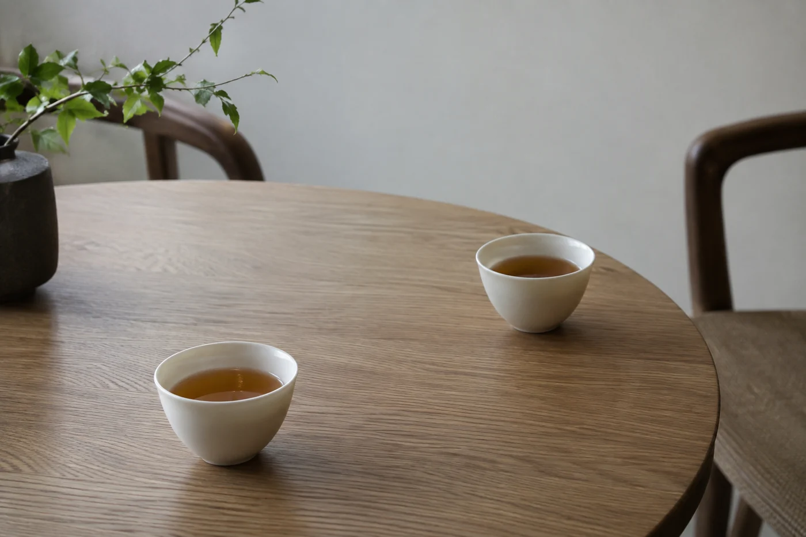

「同一壺茶，點解呢隻杯好飲啲？」

茶桌邊有人這樣問，我不會笑他多心。同一泡茶換一隻杯，入口的感覺的確可能不同。杯沿的厚薄、杯口向外張開還是微微收起、杯身的深淺，都會改變茶湯流進嘴裏的速度和位置，也改變散熱。

買杯的時候，手指摸釉面，眼睛看顏色。可是每天真正和你相遇的，是嘴唇碰上的那一圈杯沿。厚一點好還是薄一點好，只有自己的嘴唇說得準。

薄沿的杯，嘴唇碰上去幾乎沒有阻隔，茶湯流入口中比較輕、比較順，感覺細緻。厚沿的杯，嘴唇有明確的接觸感，茶湯入口稍為集中一些，杯也比較耐碰，不容易崩口。

這兩種沒有高低之分，看個人偏好。只有一點要記住：薄壁的杯散熱快，也容易燙手，倒了滾水之後，拿的位置要小心。

杯口的形狀也有分別。外張的杯，茶湯入口時散得開，舌面接觸的範圍較大，也涼得較快。口沿微微內收的杯，香氣容易聚在杯口，低頭一聞比較明顯。所以聞香的時候，不少人偏愛口沿內收的小杯；大口喝的日常茶，則愛用外張的。

這些是一般的感覺，未必人人相同。我自己的經驗是，換杯之後，香氣上的差別往往比味道明顯。

## 要比，就比得公平

家裏若有幾隻不同的杯，可以把同一泡茶分進去，等溫度差不多了，再小口比較。拿起來舒不舒服，茶湯入口是快是慢，杯沿碰上嘴唇是穩是輕，一樣一樣感受。某一種杯形，不代表比較高級。

茶量要相近。否則一杯已經涼了，一杯還燙着，你分不清是杯形的影響，還是溫度的影響。最好由同一個公道杯分茶，斟到同樣的高度，在差不多的時間內喝。

像圖中這兩隻杯，口徑大小不同，同一款茶斟進去，茶面的面積和散熱的速度已經不一樣。比較的時候，這些也要一併算進去。

深淺也是一樣。小而深的杯，熱氣留得久，香氣集中在杯口；寬而淺的杯，散熱快，湯色一目了然，入口也比較開闊。評茶要看湯色，較宜用淺而寬的白色杯，深淺透亮看得清楚。日常慢慢喝的話，深一點的杯可以讓茶保溫久一點。

釉面光滑細密的杯，不吸味，也不易掛茶漬，入口只有茶本身的味道。表面粗糙或有裂紋的杯，容易積茶垢，用久了偶爾會有隱約的氣味。

內壁的顏色，主要影響你看到的湯色。白色或淺色的內壁，湯色看得準；深色或有花紋的，湯色會被襯得偏暗。想把湯色看清楚，內壁素淨的杯最穩妥。

## 天天拿得起的那一隻

日常用的杯，還要看清潔和收納。杯底太窄，會不會一碰就翻？手指伸不伸得進去洗？櫃子放不放得下？這幾樣小事，決定了它是每天用的杯，還是只在照片裏出現的收藏。

大小也要配茶。品茗杯一般只盛二三十毫升，一口到兩口喝完，適合多泡幾次、每次少量的喝法。大杯適合一次沖一杯的日常茶。拿小杯去喝大杯的量，就要反覆斟，茶湯涼得快。

適合自己的杯，通常不用太多解釋。每次伸手，自然先拿它；喝完了，也樂意仔細把它洗好。
