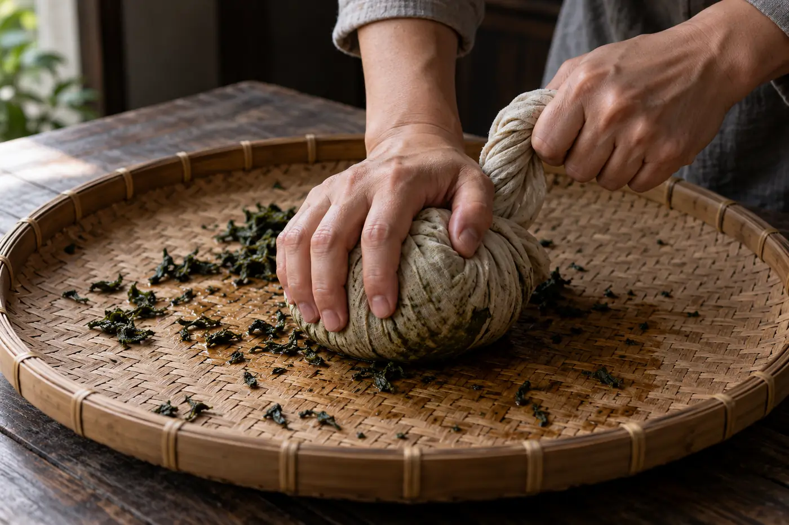

泡完的葉底，我習慣用茶夾挾到白碟上攤開。

捲得緊緊的條索，在碟上一片片鬆開，葉面上卻還留着一道道摺痕，有些邊緣微微破了。學生問我，這些痕是怎樣來的。答案是兩個字：揉捻。

「揉一次就夠嗎？」

「分幾次揉，中間還要解塊。」

揉捻，是用力道把萎軟或殺青後的茶葉捲緊、壓揉。它既令葉片成形，變成條索或球狀，也讓葉細胞受到擠壓，沖泡時茶汁較易釋出。不過並非每種茶都要揉，白茶就是很典型的例子。

形狀最容易看見。揉過的茶體積縮小，條索緊結，方便貯存和運送。更要緊的是，細胞組織受了力，葉內的成分更容易溶出，沖泡時滋味比較濃，也比較耐泡。

同一個動作，在不同茶類裏的任務並不相同。紅茶的揉捻還會促進氧化，因為細胞受損，酵素與底物充分接觸。綠茶在殺青之後才揉，那時酵素已停止作用，揉捻的重點是塑形，以及讓味道容易釋出。

## 力度是手上的功夫

揉得輕，葉形鬆散，滋味出得慢；揉得重，細胞破損多，茶湯容易濃而苦澀，葉片也可能碎。嫩芽尤其不能重手，芽尖一斷，外形和賣相都受影響。粗老一點的葉，反而要多些力道才捲得起來。

所以常見的做法是輕重交替，中途還要解塊，把揉成一團的葉抖散，讓受力均勻，也散走一部分熱量。熱積在葉堆裏，茶容易悶出不好的氣味。這些細節，用機器也好，用人手也好，都要照顧到。

手揉時，師傅會把一小團葉捧在掌心，向前推、再收回，力度由肩膊帶下來，不是單靠手腕。做久了，手掌起了厚繭，摸一摸就知道這一團還差幾下。我在雲南看過一次，老師傅中途停手，把葉湊近鼻尖聞一聞，說夠了。我聞不出分別，他聞得出。

## 每種茶的揉法不一樣

烏龍茶的揉法最多變。球形烏龍要把葉包在布裏反覆揉緊、團成球，再慢慢乾燥定型，這個過程要重複多次，所以成品緊結，沖泡時要等葉球慢慢鬆開。條形烏龍的揉捻則輕一些。力度和次數不同，成品的形態和滋味也跟着不同。

紅茶揉得較充分，要令葉細胞破損得夠，氧化才推得動。工夫紅茶多為條形；碎茶類則把葉切碎，好讓它快速出味，這是另一個製作取向。

也有些茶的外形，並不是揉出來的。龍井一類扁平綠茶，主要靠在鍋中炒壓成形，不能說成典型的揉捻。碧螺春一類螺形茶有搓團的動作，手法也跟一般揉捻不同。白茶保持自然舒展，不經揉捻，外形最接近原葉。

動作看來相似，做的未必是同一件事。

揉捻只是中間的一步。綠茶揉完要及時乾燥，揉出來的茶汁不能留在葉面久放，否則色澤與香氣都會變差。紅茶揉完要攤開氧化，溫度和濕度都要控制。球形烏龍包揉之後還要烘焙定型，成品才一粒粒結實不散。

看一款茶的外形，看到的是它走過的整條路。

## 不揉的茶，會不會淡

有人以為白茶沒揉，味道就薄。不一定。白茶的味道釋出較慢，所以常見的建議是投茶量足一點，或者讓前幾泡多悶一會。這是外形和葉組織造成的差別，並不代表茶不好。耐不耐泡，還要看原料、萎凋和乾燥的功夫。

反過來，揉得緊結的茶也未必更出色，只是沖法要配合。球形烏龍可以用較小的容器、較熱的水，讓葉球舒展開來。

若有機會看師傅揉茶，問題可以問得具體些：葉子進入揉捻前是甚麼狀態，為何要分幾次揉，怎樣判斷已經夠了。這樣問，才能把「很熟練」的印象，換成對工序的理解。

現在的製作，手工和機械常常並用，有些環節由機器揉，有些造型仍靠人手。看見一雙手，不代表一定更高級；看見機器，也不能說茶不好。品質要連同原料、控制和衛生一起判斷。

葉底不會騙人。揉得緊的，沖開要慢一點；揉得鬆的，葉片散得快，味道也退得快。這些都寫在一片葉上，只是要攤開才看得見。
