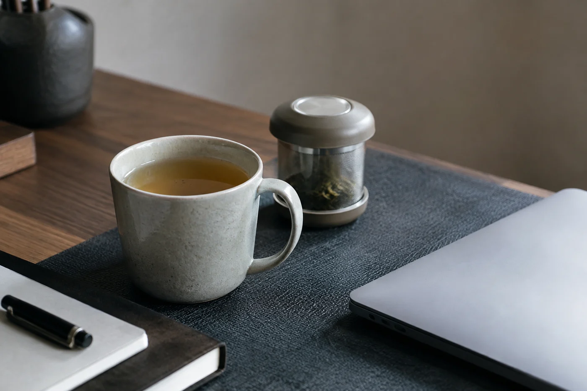
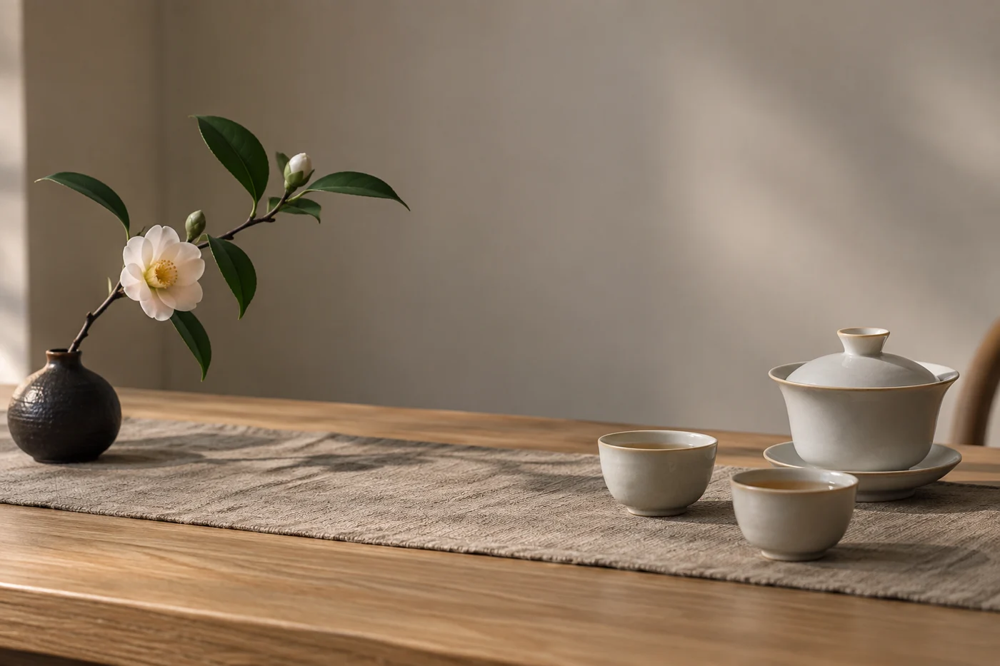

客人坐下，脫下眼鏡，手在桌面上停了一停。

壺、杯、花和兩三件小擺件，各有各的位置，看上去很完整。他左右看了一圈，最後把眼鏡放回口袋。照片裏好看的桌面，坐下來相處，未必舒服。

茶桌要留一片空，就是為了這一刻。客人有地方放杯子、手機和眼鏡，主人倒水、遞茶的路也順。

佈置茶席，我先做減法。當天不泡的茶罐、多餘的杯、純裝飾的小物，收到別處，只留沖泡和飲用必需的。

水壺放在穩妥、順手的位置，電線不橫過走道。從出湯到分杯，那條路要清楚，伸手時不會跨過花枝，倒水也不會從客人面前過。

熱水是桌上最需要照顧的東西。煮水壺和廢水盂放在主人慣用手那一側，離客人遠一些。有兒童或行動較慢的客人，他們的座位不要正對熱水。茶巾放在手邊，隨時擦乾水跡。

每個座位留一小塊乾爽的地方，放得下一個杯、一部手機或一本筆記就夠。桌子不大，花器可以退到旁邊，茶點也晚一點才上，把所有心意一開始就擠在同一個平面，桌面反而亂。

桌子實在太小，與其硬塞，我會分層。茶具留在桌上，茶點放在旁邊的小几或托盤，需要時再遞過去；茶葉罐、備用杯放回櫃裏，用到才拿。桌邊有地方的話，放一張小凳子或矮櫃當第二桌面，擺水壺和雜物。

也別為了留空，把桌子清得像展示間。留空是為了用得順手，用得着的東西照樣放在手邊。

站着看不準。我擺好茶席，一定坐到客人的位置試一次：拿一次杯，放一次杯。視線有沒有被裝飾擋住，膝蓋有沒有空間，慣用左手的人拿杯方不方便，坐下的一刻就知道。再回到主人位，看看倒水時手肘會不會碰到別人。

茶盤、桌布和杯墊，一兩件就夠。茶盤可以接水，讓桌面保持乾爽，木桌尤其怕水跡。桌布和杯墊能減低器物碰撞的聲音，也讓杯子不易滑，只是顏色宜素，不要有太濃的圖案。加得多了桌面就擠，挑最需要的就好。

沒有茶盤，在桌上鋪一塊防水的墊布，再放壺和杯，效果相近。木桌和布面最易留下水漬，散席後記得擦乾。

坐了一陣，杯子移了位，筆記攤開，花枝旁多了一副眼鏡。這些都是相聚中自然發生的。我添茶時順手理一理，不必每次把桌面還原。有人坐過的茶桌，總會亂一點。
