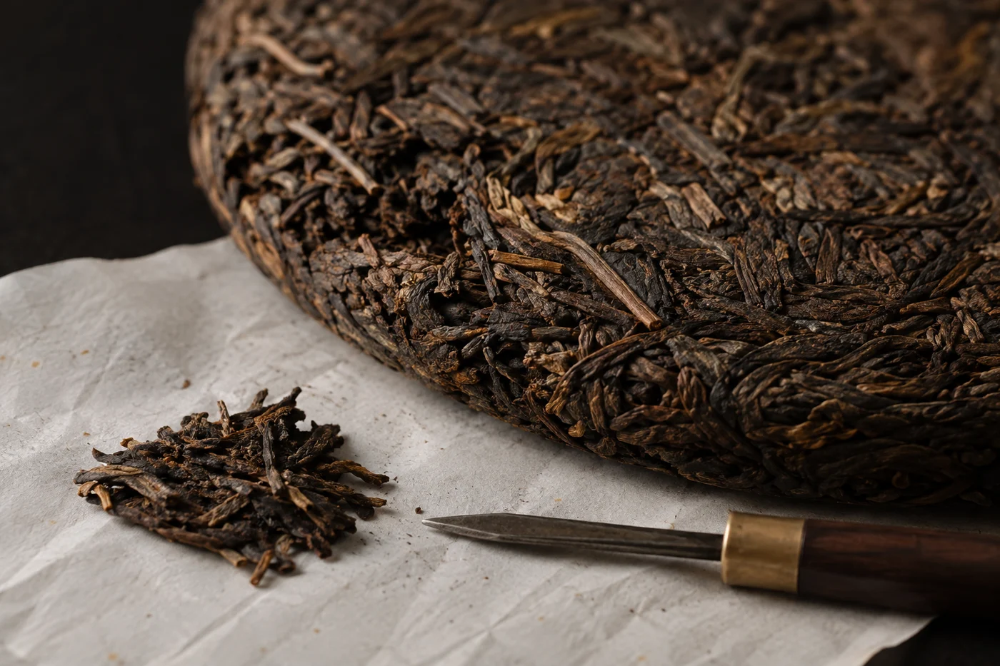

夾鏈袋一拉開，先聞到的不是茶，是一陣潤手霜的香。

分茶的人多半沒留意。塗了潤手霜，順手就去捏茶葉，茶葉吸味很快，手上的味道就跟着進了袋。朋友打開時聞到的，未必是你想讓他認識的那陣茶香。

喝到喜歡的茶，總想分一點給朋友，這份心意很好。只是分的時候，我在意器具乾淨、資料寫清楚、分量別太多。

開始之前，先把桌面清乾淨，雙手洗淨抹乾，不塗潤手霜，不噴香水。用的容器和工具要乾燥，適合接觸食品。茶匙別與沾過水的茶具混用，也不要在煮食的蒸氣或濃烈的氣味旁邊分裝。

一款分完，收好，才處理下一款。幾款茶同時攤在桌上，很容易混淆。

容器方面，小型的密封夾鏈袋、鋁箔袋，或者清潔乾燥、沒有氣味的小罐都可以，確認適合接觸食品就行。舊藥瓶、香水樣品瓶這類，再方便也不要拿來裝茶。

## 每一包都寫上幾行字

每包寫上茶名、來源、分裝日期，再加一句基本的保存方式。原包裝上若有年份或批次，也抄上，並註明「按原包裝抄錄」。自己不確定的資料，空着就好，不要替它補。

## 撬緊壓茶，手要慢

從餅茶、磚茶撬茶樣，要盡量讓整葉和碎片分佈得均勻一點。也跟朋友說一聲，茶樣的形態可能和整餅不同，沖泡時按實際情況調整。

撬的時候用茶針或茶刀，從茶餅邊緣順着葉子的紋理慢慢撬，不要硬掰。茶樣越碎，泡出來越容易偏苦澀，朋友可能因此誤會了這款茶。撬茶的工具，用前用後都洗淨抹乾。

送之前，我會先問對方想不想試。不要因為自己喜歡，就寄一大堆過去。分量夠喝幾次，能在近期喝完，又方便存放，比塞滿一盒貼心。

有人喜歡分得很精細，每包只有三五克。這個分量要看對方怎樣泡：習慣用小蓋碗的，三五克剛好試一次；習慣用較大的壺，就未必夠泡一次。所以分之前，我會先問清楚對方平時用甚麼器具，再決定每包放多少。

我會給每位朋友備足兩次的分量。第一次泡，多半還在摸索水溫和茶量；到第二次，才比較看得出茶本身。

## 交到朋友手上的時候

提醒對方盡快喝，開封後把袋口封好，不要放在廚房或潮濕的地方。若是郵寄，用硬身的盒子護住，免得茶葉壓碎，也別和有氣味的東西一起寄。

綠茶這類容易受影響的，在袋上寫一句「請放陰涼處，盡早喝完」，比附一大段說明有用。

老茶、陳放過的茶又不同。它們的味道和狀態與新茶不一樣，分裝之前，我會先自己泡一次，確定狀態正常才送。若茶帶明顯的陳味，要告訴對方這是預期中的特性，並建議出湯快一點，先洗一遍。送出去的茶，自己心裏要有底。

想再細心一點，可以附一張空白小卡，請朋友寫下自己的感受，不必給他標準答案。隔一陣子再聊起這款茶，兩地的水不同，杯子不同，同一片葉泡出來的味道也許都不一樣。分茶有趣的地方，多半在這裏。

分茶樣花的時間不多，卻決定了朋友下次還願不願意跟你換茶。
