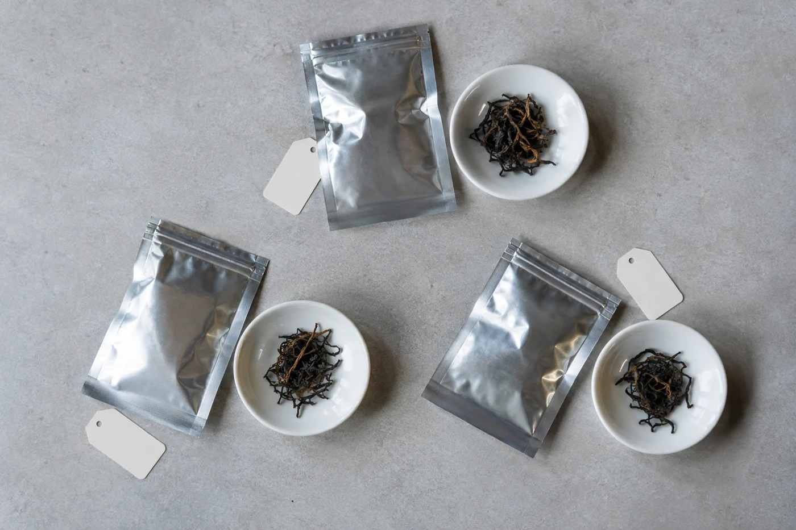

每年一到清明前後，就有人問我：今年的新茶到了沒有？

我明白那份期待。包裝上「春茶」兩個字，讓人想到新芽、山風、一年的開始。印象很好，只是單憑這兩個字下判斷，茶樹與製作背後許多事情就被省略了。

春茶不一定最好。春天的新芽一般內含物豐富、滋味鮮爽，所以很多茶類都看重春茶；可是茶好不好，還要看產地氣候、品種、採摘標準和製作工藝。季節是重要的線索，不是唯一的答案。

茶樹經過一個冬天休養，春天發芽整齊，芽葉肥嫩，這是春茶受推崇的主要原因。一般的說法是，春茶的氨基酸等成分相對較多，滋味偏鮮甜，苦澀較輕。

綠茶尤其講究早春。清明前後採製的茶，常被視為上品，名稱上也常分「明前」「雨前」。

這套說法放在綠茶這類嫩芽茶上最合用，換了烏龍就不一樣。有些產區的秋茶，香氣反而特別突出；夏天日照強，葉子味道偏濃重，更適合做某些風格。紅茶、黑茶也各有採製的重點。把「春天最好」當成所有茶的通則，並不準確。

## 夏天和秋天的葉子

夏茶長得快，葉片舒展得快，多酚類偏高，所以苦澀感較強，香氣也較直。這是夏茶常被看輕的原因。可是有些紅茶、拼配用的茶，正需要這種濃度，用得其所，一樣好喝。

秋天氣候較乾爽，溫差有時較大，部分烏龍茶的秋茶以香氣高揚見稱。至於冬天，溫暖的產區仍可能有一輪採摘，滋味與香氣各有特點，只是各地情況不同，不宜一概而論。

溫帶茶區的茶樹，冬天休眠，春天發芽，夏天長得最旺，秋天再有一輪生長。溫暖的產區生長期更長，一年可以採好幾次。每個階段的芽葉厚度、含水量和內含物質比例都不同，製茶人按這些特點安排工藝。

所以春、夏、秋茶的分別，根本上來自茶樹所處的氣候和葉片的成長狀態。我會問的，是這批葉子適不適合做成這類茶。季節的名字，只是一個標籤。

## 包裝上那個日期

看包裝上的日期，我會多想一層：這是採摘日期，還是加工、壓製或包裝的日期？幾個日期未必相同。有些茶採下來要存放較長時間才加工，有些在包裝前已放了一段日子。看不明白就直接問，不要把其中一個日期當成茶葉全部的經歷。

「新茶」和「好茶」也要分開。新茶指當季剛做好。有的茶新鮮喝最好，有的茶，例如焙火烏龍、陳放的白茶和普洱，要放一陣才更好喝。「越新越好」只適用於部分茶類。

想知道季節對味道的影響，就要把其他條件拉平。盡量找來源、品種與製法都相近的茶樣，用同一套沖泡條件喝，茶量、水溫、時間和器具一致，比較才算數。兩款茶甚麼都不同，卻把差別全歸給季節，結論多半站不住腳。

比的時候寫幾個字：乾茶香、湯色、第一口的鮮甜或苦澀、回甘、耐泡程度。同一產地不同季節的茶各喝一泡，感覺比聽任何說法都清楚。

揀哪一季，順着自己的口味就好。某一季的茶特別合心意，就把它的季節和產地記下，下一年再找。其他時節的茶，也留一點好奇給它們。
