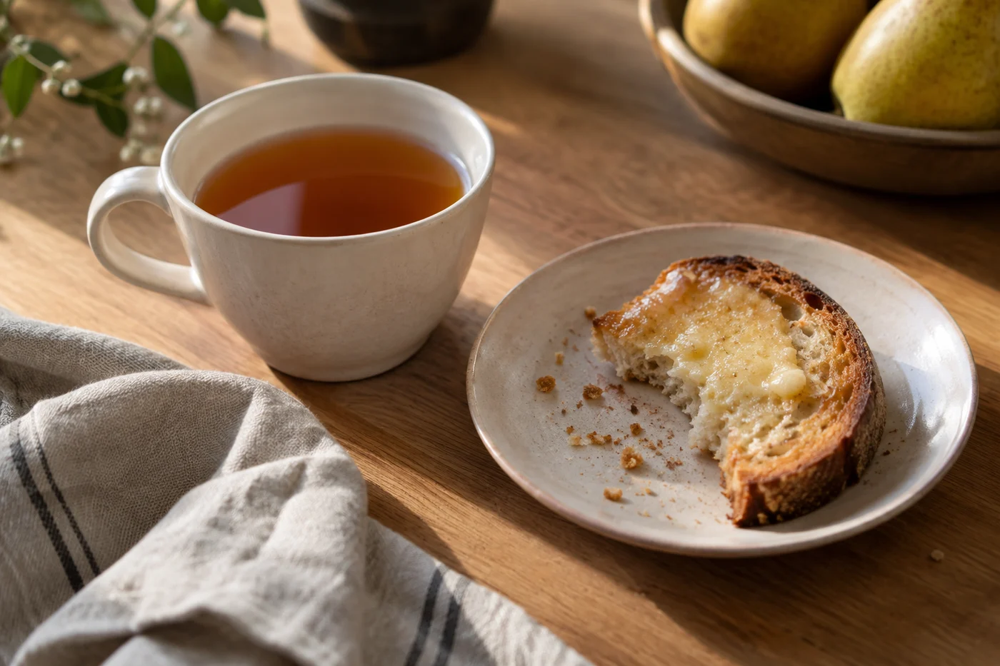

有一天下午泡茶，一道陽光斜斜落在茶罐上。前幾個星期，那裏還是陰的。

季節來的時候，未必先從氣溫開始。可能是午後的光移到另一邊，窗開得少了，或者椅背上多掛了一件外套。茶桌不用為此添置新茶具，跟着這些細節慢慢挪一挪就好。

換季時我會先看三件事：陽光會不會直射茶葉，坐的位置有沒有風，水壺和電線是否安全。這三樣妥當了，才談佈置。

陽光直射，茶葉會褪色、走味，茶罐要移到陰涼處。冷氣或風扇直吹，茶湯涼得快，人也坐不定。冬天開暖爐、夏天開風扇，電水壺的線就要留意，別和其他電線纏在一起，插座也不要一個接一個地串下去。

由需要出發去佈置，桌面才不會只剩下照片裏的色調。

換一塊乾淨的茶巾，挪開太高的花器，或者把常用的杯放近一點，整張桌的感覺已經不同。葉片、果實這類裝飾，若容易掉屑或氣味強，就放遠一些，不要靠近茶具和茶葉。

留白也算佈置。低矮的花器和茶具之間留一點空，坐下來才不覺得擠。花器不要擋住視線，更不要擺在倒水的路線上。

器物本身不必換。耐用的白瓷杯、玻璃壺，一年四季都用得上。真想換點甚麼，換一件小東西就好，例如一隻杯墊、一塊茶巾。茶具每多一件，要洗要收的就多一份，先把手上的用順了，再談添置。

夏天濕熱，茶罐要封得更嚴，開罐的次數愈少愈好。冬天室內有暖氣，就避開暖爐和出風口。

換季前，我會把櫃裏的茶翻一遍，快喝完的放到前面，開封很久的先喝。這比添置新茶實際得多。茶罐、茶袋寫上開封日期，一眼看得出誰該先動。這件事不花錢，卻最有用。

要不要跟着季節換茶，隨喜好就可以，我不想把四季寫成人人照做的規則。今天想喝清爽一點，明天想喝焙香重一點，自己感受，自己決定。茶與身體的關係因人而異，不必套別人的處方。

真要一個起點，我的習慣是：天熱時泡淡一點，用小杯，多泡幾次；天冷時水溫保持高一點，杯子先燙熱。只是習慣，各人可以不同。

夏天也有人喜歡冷泡。把茶葉放進乾淨的容器，注入冷開水，放進雪櫃浸幾個小時，味道一般比較柔和，苦澀感也低些。綠茶、白茶、輕發酵烏龍都合適。

衛生上要守住幾點：容器洗乾淨，全程冷藏，當天喝完，不要留到第二天。這是食物安全的基本做法，不要省。

器物還是那些，光卻不同了。換季那天，我會抹一抹桌子，把茶罐轉個方向，避開那道陽光，再泡今天的茶。
