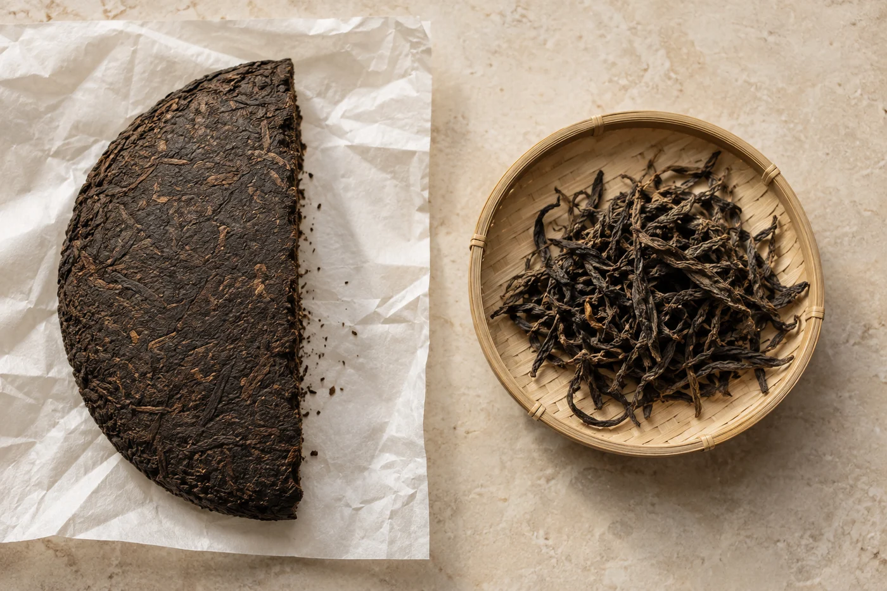

一匙蓬鬆的葉，一匙緊實的茶粒，各自倒上電子磅，數字差得不少。

看起來一樣是「一匙」，放進壺裏的茶量卻不同。我常在課堂上做這個小動作，然後才開始講乾茶的形狀。形狀最先影響的，是你下茶的分量，之後才輪到其他事。

乾茶的外形，多與製作方式有關。看形狀，大概猜得到它經過哪些工序。可是單憑外形，判斷不了這杯茶好不好喝。

細長的條索最常見，葉片經揉捻捲緊成條，紅茶、不少綠茶和部分烏龍都是這樣。針形多用芽頭製成，挺直纖細，嫩度高，成茶看起來整齊。

扁形要在鍋中邊炒邊壓，龍井是代表。螺形是搓捲成小螺，多見於嫩芽茶。

捲成小球或顆粒的，是烏龍茶經過包揉、一次又一次揉緊的成品。緊壓茶包括餅、磚、沱，是把毛茶蒸軟後放進模具壓緊，方便運送和存放。白茶多保持自然舒展，外形最像原來的葉，也有一部分壓成餅。

外形記下的是製法。至於好不好喝，它說不出來。

看乾茶，我會請人先用自己的話描述：扁、長、捲、碎、鬆、緊。專業術語慢慢學也不遲。

把乾茶拍一張，泡開後再拍一張葉底，兩張並排，變化一目了然。這比背茶名有意思得多。

專業審評看乾茶，常看形狀、整碎、色澤和有沒有雜質。日常看茶，挑其中幾項就夠：條索粗細是否一致，色澤是否乾淨自然，有沒有大量茶梗或碎末，聞起來有沒有霉味、雜味。色澤要對照該類茶本來的樣子，綠茶不一定翠綠，烏龍也可以偏黑褐。

回到開頭那一匙。蓬鬆的葉和緊實的茶粒重量相差，緊壓茶和散茶舒展的速度也不同。初次試泡一款茶，我會用小秤量一量，少一樣要靠猜的東西。

外形整齊，有時反映挑揀和加工做得仔細，但滋味是另一回事。有些茶為了賣相，特別揀出好看的葉，味道未必更好；也有外形樸素的，喝起來一泡泡都有變化。

反過來，葉片有點破碎，也不能一口咬定是劣質。有些茶本身就是碎形，用途不同，例如方便快速出味的茶包用茶。緊壓茶在運送、撬茶時難免有碎末，這是正常的，不代表品質差。

要判斷，還是得完整地喝一遍，對照茶品本來的風格與資料。外形是入門的線索，最後由杯裏的香氣和滋味決定。

碎末不多的話，沖泡時用濾網處理，或者先輕輕搖掉。袋底那一撮碎末，我會留在茶荷，不倒進壺裏，免得茶湯渾濁、苦澀。若整包都是粉末，又摻了大量梗，就要想一想這款茶的定位，價錢是否相稱。

## 形狀不同，泡法跟着變

緊結的球形茶，葉要慢慢鬆開，前幾泡可以用較熱的水、稍長的時間。蓬鬆的大葉，換大一點的容器，讓它有地方舒展。細嫩的針形茶，水溫偏高就容易悶熟。緊壓茶多先撬下適量，有需要就洗茶，讓茶塊稍為鬆開再沖。

所以拿到一款新茶，我不急着燒水。先用手掂一掂，看一看形狀，再決定放多少茶，用哪一把壺。
