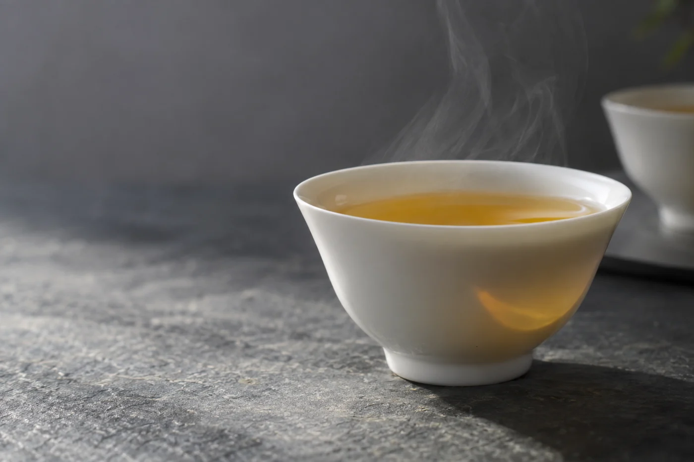
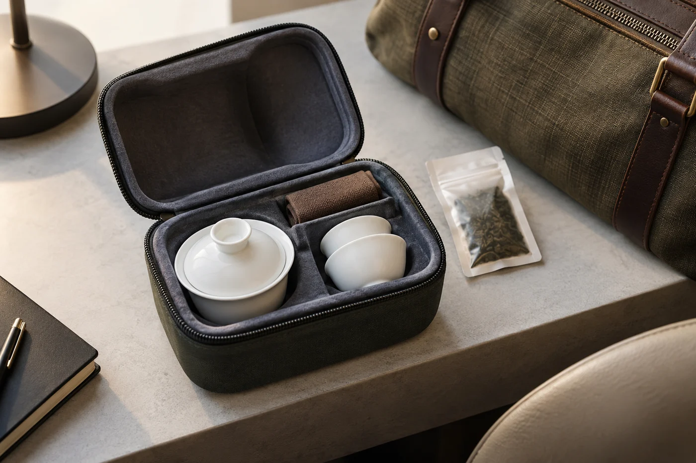

濾網從杯裏提起來，一滴茶湯順着網底落在鍵盤邊。拿着濾網的人一手找紙巾，一手不知道該把它放在哪裏。

辦公桌上泡茶，難處多半就在這一提一放。桌面只有一個角落放杯子，也可以好好泡茶：用一隻帶濾網的杯，茶湯夠濃就把濾網提起，放在小碟上，續水時再放回去。我只守一件事：茶葉不要一直泡着。

所以那隻小碟不是多餘的。很多人買了濾網杯，最後還是讓葉子浸一整天，就是因為提起來沒有地方放。

「放哪裏？」同事提着濾網站在桌邊。

「小碟。沒有小碟，放杯蓋上。」

## 選杯，看四樣

杯口要夠大，濾網放進去、取出來都順手；單手拿起要穩；杯身不能燙手；杯底要平，放在桌邊不易翻。

看起來輕巧的杯不一定好用。常常被電話打斷的人，單手能穩穩拿起，比好看要緊。

材質各有脾氣。雙層玻璃杯不燙手，又看得見湯色；陶瓷保溫較好。金屬濾網要細密、容易洗，可是網眼太細，茶渣會卡住，洗起來花時間。濾網最好有蓋，或者配一隻小碟承着，開頭那一滴就不會落到鍵盤上。

## 茶從少放起

容量三百多毫升的杯，先放兩三克，大約一小撮，喝完看濃淡再調。喜歡的濃度到了，濾網就提出來。整個下午讓葉子泡在水裏，到最後只會喝到一杯愈來愈濃的茶，也沒有調整的餘地。

水溫要看茶。綠茶、黃茶這些嫩茶，倒了沸水，稍等一會再放茶；烏龍、紅茶、普洱，辦公室熱水機的水一般夠用。放茶前先用熱水暖一暖杯，香氣會好一點。

續水時把濾網放回去，留意這一次泡多久。已經淡了就換一份新茶，不必為了湊泡數，喝下沒味道的水。袋泡茶、碎茶容易出味，一兩次便收；整片葉的烏龍、普洱，可以續四五次。

## 被打斷的時候

辦公室泡茶最大的敵人不是水溫，是打斷。

會議突然召開，同事站在你桌邊等答覆，那杯茶就懸在那裏。我的做法是先處理茶：濾網提出來放在小碟，杯蓋蓋上。茶湯與葉子分開了，你走開十分鐘回來，還是一杯可以喝的茶。回來之後再續水，第二泡照樣。

反過來說，如果濾網一直浸着，你走開那十分鐘，茶就濃得發苦。回來喝一口，以為自己泡壞了，其實是時間在替你泡。

## 茶葉怎樣帶上班

當天要用的量，先分裝成小袋或小罐，不要把整罐放在桌上。辦公室有冷氣、人多，又有咖啡和食物的氣味，茶很容易吸味。小罐要蓋緊，收在抽屜，不要放近窗邊。

桌上若有空間放一套小蓋碗，用起來比濾網杯更接近正式泡茶，只是收拾多一步。要看你每天有多少時間。

保溫杯可以用，但要知道它的特性。保溫杯令葉子長時間浸在熱水裏，茶容易苦澀，味道也悶。真的只能用保溫杯，就放少一點茶，選不太細碎的葉，早上泡好，中午前喝完。不要放隔夜。

## 沒有熱水機的話

可以在桌邊放一個電熱水壺。電線不要拉過走道，插座不要與其他電器一起過載。水壺放在平穩的位置，旁邊別堆紙張。公司若有規定，先問清楚才用。外面買了熱水回來，先倒進杯裏等一兩分鐘，再放茶葉。

用過的杯和濾網，下班前洗淨，不要把濕茶葉留在杯裏過夜。網眼用小刷子清，杯內壁用軟布擦，別用鋼絲球刮花。

茶含咖啡因，對睡眠敏感的人，下午稍後可以泡淡一點。每個人反應不同，按自己的情況調。
