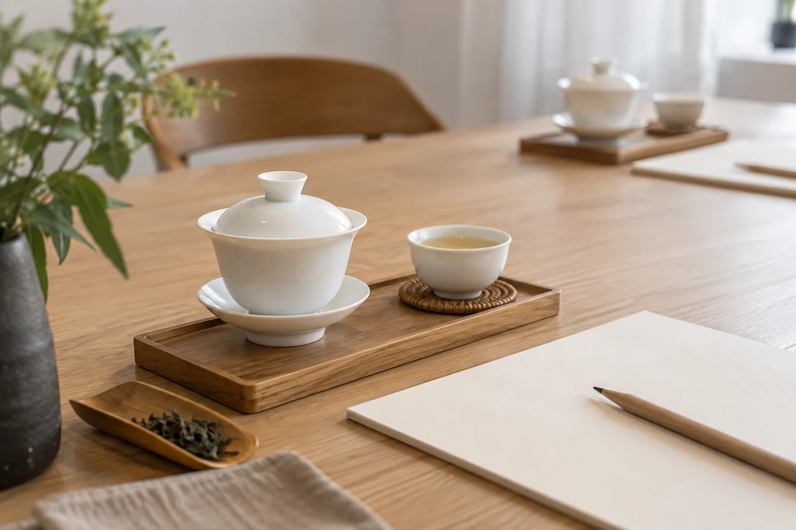

「紅茶，就是紅色的茶吧？」

課堂上常有人這樣問。答對了一半。紅茶得名，是因為茶湯和葉底偏紅，可是紅與綠，不是分類的憑據。

六大茶類是按製作方法分的。看鮮葉經過哪些工序，尤其是葉內成分氧化到甚麼程度，以及有沒有殺青、悶黃、渥堆這些關鍵步驟。湯色只是結果之一，不能反過來當作根據。名字叫綠茶，湯也不一定很綠。這一點清楚了，後面就好懂得多。

同一類茶，顏色可以差得很遠。老白茶的湯色近琥珀，新做的白茶卻是淺黃清淡。烏龍茶有的輕發酵，湯色黃綠；有的焙火較重，湯色橙紅。反過來，不同茶類的湯色也可能相近。單看杯中深淺去猜茶類，十次總有幾次猜錯。

名字也會誤導人。西方習慣把我們說的紅茶叫做 black tea，意思是乾茶偏黑；我們說的黑茶，卻是另一類發酵後的茶。討論之前不先對好名字，很容易各說各話。

## 真正分開它們的，是工序

簡單講，綠茶重在殺青，用高溫讓酵素停止作用，保住鮮葉的青綠。白茶主要靠萎凋與乾燥，工序最少。黃茶在綠茶的基礎上，多了悶黃一步。

青茶就是烏龍，要經過搖青，讓葉緣受力、部分氧化，再殺青和揉捻。紅茶則讓氧化走得很足。黑茶的特色在後發酵，普洱熟茶的渥堆就屬這一類。

風味大概也跟着工序走。綠茶清新，多帶豆香、栗香或鮮爽的青草氣，一般宜用較低的水溫，太燙容易苦澀。白茶淡雅，新茶偏清甜，陳放後轉為棗香、藥香一類，變化較明顯。黃茶產量少，風格柔和，不及綠茶那樣鮮銳，也沒有綠茶的青澀感。

青茶的範圍最闊，由清香的輕發酵，到焙火濃郁的類型都有，同一類可以像幾種不同的茶。紅茶滋味醇厚，帶蜜糖、麥芽或果香，容易被人接受，也適合加奶。黑茶多屬陳年耐存放的類型，普洱、六堡、安化黑茶都在其中，湯感厚滑，很多人愛它的陳香。

這些都只是大概。同一類之下，品種、山頭、年份、焙火都會令風味拉開距離。所以聽到「某類茶一定怎樣」，我通常聽聽就算。

## 當成一張地圖

六大茶類，我會當成一張地圖。先知道有哪幾個大區，不必急着記住每一個地名。每一類之下還有不同產地、品種和工藝風格，一次認齊是不可能的事。

每一類先找一款資料清楚的茶，用接近的方式沖泡，慢慢喝。喝的時候，把乾茶的外形、香氣、茶湯，和泡過的葉底放在一起看。同是綠茶，炒青和蒸青已經不一樣；同是烏龍，清香型和焙火型也像兩種性格。我頭幾年學茶，把炒青和蒸青混為一談，喝了一年才發覺，一款有炒鍋的香，一款是蒸氣蒸出來的青。

想比較，一次不要超過兩三款，茶量和水量保持一致。喝多了人會疲勞，味覺也會變鈍。最能喝出差別的時候，其實是上午，肚子不太空，也不太飽。

泡法同樣跟着茶類走，六類不宜用同一套。嫩芽型的綠茶、黃茶和部分白茶，水溫宜低一些，否則容易燙熟，變得苦澀。烏龍、紅茶和黑茶，一般要較高的水溫，才能把香氣和厚度帶出來。陳年或緊壓的茶，有時還要先洗茶，讓茶塊鬆開。

這只是起點。可以先看賣家或製作者的建議，再按自己口味微調，記下茶量、水溫和時間，下次才有得比較。

## 「我喜歡紅茶」之後

常聽到有人說自己喜歡紅茶，或者不喜歡綠茶。這種說法能讓人知道大概的口味方向，只是一個茶類裏面包含的風格太多，喜歡其中一款，不代表懂得整個類別，也不代表同類其他茶都會合口味。

所以我習慣把問題問細一點：這款茶經過哪些工序？哪一步決定了它現在的香氣？氧化程度大概如何？有了這幾個問題，分類就不再是一張要背的表，變成幫你看懂一款茶的線索。

也有些茶不容易歸類，或者名稱和習慣說法對不上。例如有些白茶經過壓餅，有些加工時用了花或其他材料，有些新創的做法並不完全依照傳統。遇到時不必緊張，回到製法，再回到杯子，兩邊對照，通常找得到位置。

家裏如果只有一兩款茶，就從那兩款開始。把它們的工序查清楚，在紙上畫一條簡單的流程，哪一步有，哪一步沒有。這樣做，比一口氣背六類實在。六類的次序，喝到第六款的時候，自然會記得。
