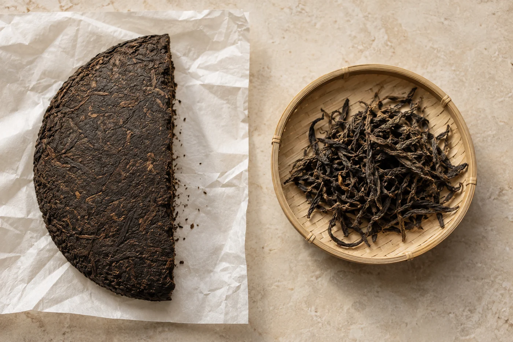

一餅茶拆開，就沒有回頭路。

在店裏試到一餅好茶，人很容易想把整餅抱回家。壺是別人的，水是別人的，連坐下來的心情也是別人的，這些在心裏都知道，只是當下顧不上。

我的建議是把衝動推遲幾個星期：先要一份茶樣，帶回家慢慢試。將來這餅茶多半在你自己的環境裏泡，讓它先走進日常，才決定。這份喜歡很可貴，只是不必急着付鈔。

## 一小袋要多少

夠沖三到四次就好，大約十數克到三四十克，按自己平日的茶量來算。太少，只能試一次，判斷不了；太多，又失去了先試的意思。

打算買的若是緊壓茶餅，最好請商家從同一餅取樣，並標明取自哪一部分。表面和內裏的茶，鬆緊與碎末比例未必一樣。撬得深一點的那一塊，往往比面上那一層更有代表性。

還有一件事一定要問：茶樣和要賣的那餅，是不是同一款、同一批次。包裝上的名稱、製造日期、批次，拍照或抄下來，標示也保留好，日後整餅送到，可以逐項對一對。商家若說茶樣是「類似的」或「同一系列的」，那就不是同一款，試出來只能作參考。網上買茶，這一點尤其要問清楚，照片裏的茶餅，和寄來的那一餅，中間隔着一次快遞和一個賣家。

## 回家分三次喝

茶樣不要一次用完。隔幾天再喝，新鮮感退了，才看得出自己是否仍然願意揀它。

第一次，用自己熟悉的方法泡。第二次，按商家的建議試。有時你喜歡的，其實是店裏泡得特別濃或特別淡的那個版本，先弄清楚，免得整餅買回來，才發覺平日根本不想這樣喝。第三次換個時段，早上和晚上各喝一回，看看身體在不同狀態下怎樣感受它。每次記下日期、茶量、水溫和三兩句感受，寫得短就好。

茶樣放在密封小袋或小罐，寫上茶名和日期。試到第三泡時，留意葉底是否完整、有沒有雜味、喉嚨有沒有乾。這幾樣比香氣更難臨時作假。

試的時候，也想想將來怎樣喝。平日用蓋碗還是小壺，天天泡還是週末才泡？茶耐不耐泡，要怎樣存放，都跟生活方式連在一起。一餅三百多克的茶，天天五克，兩個月左右見底，這條數我每次都替人算一遍。

拿到茶樣，擠走袋裏多餘的空氣，放在乾爽陰涼的地方，別跟有氣味的東西放一起。也不要把茶樣帶在身上，或者留在車廂裏幾天。高溫和濕氣會令它變化，試出來的味道就不準了。夏天車廂裏的溫度，可以高得把一小袋茶悶壞。

三次喝完仍然想再喝，價錢又在可接受的範圍，就可以考慮買。若有點猶豫，先問自己是不是在怕「錯過就沒有」，好茶不會只來一次，香港的茶店、網上的賣家，總會遇上下一款。

買多少也要想一想。有人一買就是整提，幾年後還有大半留在櫃裏。家裏本來已經存了不少茶的，我會先數一數手邊的分量，對照自己喝的速度。我不想每一包都等「總有一天」才打開。先把手上喜歡的喝完，下一次要買甚麼，通常會更清楚。

茶樣喝剩的那一點，我會留在小袋裏。等整餅送到，再拿出來一起泡一次，對照一下。同一餅茶，兩次相隔一個月的味道，有時真會不一樣，那時候就知道，它值不值得再買一餅。
